# ADR-0004: M1 Host Command, Status and Stream Protocol for NoctiNIRS 2

| Field | Value |
|---|---|
| ID | ADR-0004 |
| Title | M1 host command, status and stream protocol (Wi-Fi UDP host link, USB diagnostic console, system state machine, boot and SafeOff contract) |
| Status | **Proposed**. Not Accepted. This file is a design record only. It does not authorize implementation, merge, flash, Class H, release or tag. |
| Date | 2026-10-22 (rev 3.1 file draft) |
| Issue | [#33](https://github.com/YerriSuyudHasim/noctinirs-2/issues/33) |
| Author role | Architect (Agent 02). Folds Agent 03 (Firmware), Agent 04 (Hardware), Agent 05 (RTOS), Agent 06 (Verification) and Agent 07 (Independent Reviewer) inputs recorded on #33. |
| Independent reviewer | Agent 07, on the exact head SHA of the pull request that adds this file. The reviewer must not be an author of this ADR. Prior Agent 07 verdict on the comment drafts: **CHANGES REQUESTED** ([6227160691](https://github.com/YerriSuyudHasim/noctinirs-2/issues/33#issuecomment-6227160691)); §11 maps each blocking item to its resolution. |
| Approver / merge | Merge per the recorded rule ([6227114578](https://github.com/YerriSuyudHasim/noctinirs-2/issues/33#issuecomment-6227114578)): joint explicit approval by Agent 01 and Nori, otherwise the Owner `YerriSuyudHasim`. Since 2026-10-22 the Owner delegates approvals to Nori ([6333953903](https://github.com/YerriSuyudHasim/noctinirs-2/issues/33#issuecomment-6333953903)); flash, Class H, release/tag still need Nori to confirm with the Owner. Status → Accepted is a separate decision under that delegation. |
| Input commit | `noctinirs-2` `main` @ `f2d7c8cfecdc6570df155fac4d90625c16a7bf4b` (squash of PR #36). Design comments on #33 were written against `main` @ `4a21171353b72ceff62774ba114705e0c8be2c31`. |
| Toolchain basis | ESP-IDF v6.1 `fff9895c82d744c7237be8847347bdd1b07c6643` (pinned build), C11, target `esp32s3` |
| Evidence class of this document | Static (Class S design review only). Class B/U for this protocol: **NOT RUN** (no implementation exists). Class H / flash: **NOT RUN**. |

> This ADR defines a *target* contract. Nothing in it is implemented. Every numeric value that is not cited to a source on #33, an Accepted ADR, or a file on `main` is marked **TBD** with the role that owns it, or **Proposed allocation** when it is an Architect identifier choice (opcodes, enum values) that freezes only at Accept. No timing, latency, heap, stack or electrical claim is made. A green build is Class B only.

## 1. Context

### 1.1 Problem

M1 needs one durable contract between the NoctiNIRS 2 device and the LAN host: how commands arrive, how replies and frames leave, which commands are legal in which state, how the device boots into a known emitter-off state, how it reaches and leaves SafeOff, and what happens on Wi-Fi loss. Without it, the Wi-Fi adapter (#30 / PR #34), the ADS131 path (#35, merged diagnostic slice in PR #36) and the later emitter/scheduler work would each invent their own command handling, state, and fault semantics.

The design was negotiated as comments on #33 (rev 1 → rev 2 → boot draft → heartbeat addendum → boot/state rev 3) and an unposted Architect rev 3.1 amendment. This file consolidates that record, applies three rev 3.1 corrections (§3.15), and closes Agent 07 blocking items B1–B3 (§11).

### 1.2 Current product state (verified at `f2d7c8c`)

- `components/` contains only `nn2_core`, `nn2_ports`, `nn2_app` (canonical layers, [`tools/layers.json`](../../tools/layers.json) schema v2; header prefixes `nn2_core_`, `nn2_port_`/`nn2_ports_`, `nn2_app_`).
- `nn2_core_types.h` defines `nn2_status_t` {`NN2_OK`, `NN2_ERR_INVALID_ARG`, `NN2_ERR_INVALID_STATE`, `NN2_ERR_FULL`, `NN2_ERR_EMPTY`, `NN2_ERR_IO`, `NN2_ERR_NOT_SUPPORTED`, `NN2_ERR_TIMEOUT`} and `nn2_sample_src_t` {`UNKNOWN`, `FAKE`, `ADC`}.
- Ports on main: `nn2_port_adc.h`, `nn2_port_adc_stream.h` (temporary compatibility port, #36), `nn2_port_clock.h`, `nn2_port_led.h` (on/off only), `nn2_port_log.h`. No command, stream, SafeOff, Wi-Fi or board-identity port exists on main.
- Adapters live under `main/adapters/` (ADS131 diagnostic: `nn2_ads131_esp.c`, `nn2_ads131_logic.*`, `nn2_ads131_build_guard.h`, `nn2_rtos_config.h`). Board table `main/nn2_board_v1.c`.
- Build profiles: `NN2_PROFILE_FAKE` (default; fake ADC, disabled emitter) and `NN2_PROFILE_ADS131_DIAGNOSTIC` (overlay `sdkconfig.ads131-diagnostic`).
- No Wi-Fi, host protocol, PCA9956B/IO18, SlotPlan runtime, ADS1299 or bootloader hook code is on main. PR #34 (Wi-Fi provisioning) is open at head `8a9c33aeeee43b5538dff2fa20154f2f656d029a` against base `4a21171`; it is not on main.

### 1.3 Historical references (evidence only)

The draft began from a Class S survey of `reference/v4` console/STATUS code (#33 body). V4 is evidence only. V4 wire compatibility is **not** required (C-b). Nothing under `reference/**` is a requirement or a build input.

## 2. Requirements and constraints

### 2.1 Owner locks (issue body, 2026-10-17, via Nori)

| ID | Lock (quoted from #33 body) |
|---|---|
| L1 | "Host commands over Wi-Fi only; USB is for provisioning (#30) and diagnostics only." |
| L2 | "Separate USB diagnostic console for bring-up; V4 debug/dump commands move there, not into host API." |
| L3 | "`board_id` derived from MAC/eFuse." |
| L4 | "New stream format reusing V4 envelope ideas (magic, version, CRC) plus `protocol_version`, `session_id`, `frame_sequence`, `timestamp_us`, ADC source tag." |
| L5 | "After `safe_off`, device stays locked until `clear_fault`." |
| L6 | "Session report sent automatically on `stop_stream`." |
| L7 | "PARTIAL frames are still sent, with quality/reason flags; host decides." |
| L8 | "`safe_off` goes to strongest evidence level (PCA reset asserted); reply states evidence level reached (and physical state remains unverified, OE# tied to GND)." |
| L9 | "After FAULTED, no auto-recovery; wait for host command." |
| L10 | "`get_status` reports first fault, last fault, and fault count." |

### 2.2 Owner and Owner-delegated decisions recorded on #33

| ID | Decision | Source |
|---|---|---|
| O1 | "`get_info` / `get_config` **allowed** while streaming (read-only). Commands that change settings remain **rejected** during stream." | [6226931941](https://github.com/YerriSuyudHasim/noctinirs-2/issues/33#issuecomment-6226931941) |
| O6 | "Prolonged Wi-Fi loss: short grace period while frame drops are counted; if still not reconnected → **auto `stop_stream` + LED off**." | 6226931941 |
| O7 | "After `clear_fault`: settings are **preserved**; device state is **STOPPED**. Host must deliberately send `start_stream` again." | 6226931941 |
| O8 | "USB diagnostic console **may** trigger `safe_off`. USB **must not** turn LEDs on." | 6226931941 |
| RECOVERING | "While in `RECOVERING`, LED **must** be off first … `FAULTED` still has **no auto-recover** (needs host command). `RECOVERING` is only for small non-fault disturbances." | 6226931941 |
| Delegation | Owner confirmed Nori may make firmware technical decisions; merge, flash, Class H (A3), release/tag still need the Owner. | [6227100743](https://github.com/YerriSuyudHasim/noctinirs-2/issues/33#issuecomment-6227100743) |
| D1 | Wi-Fi loss: **3 s grace**, then auto `stop_stream` + LED off; state STOPPED, not FAULTED. | [6227092516](https://github.com/YerriSuyudHasim/noctinirs-2/issues/33#issuecomment-6227092516) |
| D2 + C-c | Raw I_ON and I_OFF per slot; host computes net; M1 aggregate = **mean + sample count**; median deferred. | 6227092516, [6227106079](https://github.com/YerriSuyudHasim/noctinirs-2/issues/33#issuecomment-6227106079) |
| D3 | One packet per frame (20 slots); PARTIAL flagged; queue full → drop + counter; Core 1 never blocks on network. | 6227092516 |
| C-a | Envelope keeps **CRC-32** (CRC-32/ISO-HDLC). | 6227106079 |
| C-b | New envelope in the V4 layout style; V4 wire compatibility not required. | 6227106079 |
| Merge rule | Merge only when Agent 01 **and** Nori both approve; otherwise the Owner decides. Green CI, Agent 07 IR APPROVE on exact head SHA, branch protection still apply. | [6227114578](https://github.com/YerriSuyudHasim/noctinirs-2/issues/33#issuecomment-6227114578) |
| P1 (D1 anchor) | Option (b): grace starts at the earlier of `WIFI_EVENT_STA_DISCONNECTED` or no valid host command/heartbeat for N ms; mandatory host heartbeat; N > 2 × heartbeat period; both OPEN until Class H; timer in `nn2_net` Core 0 posts only `stop_stream`. | [6227124055](https://github.com/YerriSuyudHasim/noctinirs-2/issues/33#issuecomment-6227124055) |
| P2 | Peer lock while streaming = YES. Other hosts get read-only `get_info`/`get_config`. `safe_off` accepted any time from any host and USB. Lock released on `stop_stream`, grace auto-stop, entry to FAULTED or SAFE_OFF. | [6227158169](https://github.com/YerriSuyudHasim/noctinirs-2/issues/33#issuecomment-6227158169) |
| Q-B1 | RECOVERING: whole SlotPlan idles, all LEDs off, no frames (anything emitted flagged); exit to STOPPED, never auto-resume. | 6227158169 |
| R2 | `clear_fault` from boot-time FAULTED → controlled reboot through the full boot path; runtime FAULTED unchanged (O7). | [6227272016](https://github.com/YerriSuyudHasim/noctinirs-2/issues/33#issuecomment-6227272016) |
| RECOVERED_STOP | `end_reason RECOVERED_STOP` = YES. | 6227272016 |
| P7 | Risk NOT accepted. Bootloader hook drives IO18 LOW; B1 in `app_main` also asserts; HW pull-down for next PCB rev escalated to Owner. | 6227272016 |
| F1 | Board v1 = N16R8; `CONFIG_SPIRAM=n` + CI/build check; IO35–IO37 used for ADS131 as wired; no v1 respin; Class H item for SI/data validity; next PCB → N16 module. | [6227307332](https://github.com/YerriSuyudHasim/noctinirs-2/issues/33#issuecomment-6227307332) |
| F1 plan | Boot-time SPIRAM fail; pin directions; never drive SPICS1; ADS131 SPI ≤ 8 MHz until Class H; H-ADS-PSRAM; internal-DRAM-only consequence. | [6227327287](https://github.com/YerriSuyudHasim/noctinirs-2/issues/33#issuecomment-6227327287) |
| Process | Stacked draft PRs; #33 rev 3.1 review (02 fold, 05 delta, 07 re-review) stays as is. Flash/A3, Class H, release/tag Owner-only. | [6227975679](https://github.com/YerriSuyudHasim/noctinirs-2/issues/33#issuecomment-6227975679) |
| Delegation (2026-10-22) | Owner delegates approvals to Nori ("Any recommendation or approval from Nori counts as my approval"), incl. technical decisions and joint merge approval with Agent 01 (green CI, Agent 07 IR on exact head SHA, squash). Flashing, Class H, releases/tags still need Nori to confirm with the Owner directly. Basis for the `flags`/SIMULATED wire addition and the scope statement (§2.4, §3.3) relayed by the Orchestrator. | [6333953903](https://github.com/YerriSuyudHasim/noctinirs-2/issues/33#issuecomment-6333953903) |

### 2.3 Architecture and platform constraints

| ID | Constraint | Source |
|---|---|---|
| K1 | `nn2_core`, `nn2_ports`, `nn2_app` include no ESP-IDF, FreeRTOS, lwIP, `sdkconfig.h`, NVS or adapter headers (forbidden-include regex). | ADR-0001 §3.3, `tools/layers.json` |
| K2 | Wire schema encode/decode is pure Core; mode state machine and command dispatch are Application. | ADR-0001 §3.1 |
| K3 | Tasks, ISRs, queues, timers, sockets and `esp_restart` exist only in adapters and `app_main`. Core-1 order `nn2_led` > `nn2_sched` > {`nn2_ads131`, `nn2_ads1299`}; `nn2_net` Core 0 candidate; numbers OPEN. | ADR-0003 §3.4–§3.5 |
| K4 | No `portMAX_DELAY` on run/fault/recovery waits; every blocking port documents context, timeout (ms) and errors. | ADR-0003 §3.9 |
| K5 | f_s ∈ {1, 2, 4, 5, 8, 10} Hz; configuration only while STOPPED; snapshot at START. | ADR-0002 §3.1, §3.10 |
| K6 | LED hard software cap 50 mA; first energisation band 15–30 mA (Owner-locked). | ADR-0002 §3.9 |
| K7 | M1 transport Wi-Fi STA to a LAN host; no BLE; no tunnel. | ADR-0003 §3.7, §3.12 |
| K8 | Any new `components/nn2_*` entry needs a reviewed `tools/layers.json` schema/map extension first. | ADR-0001 §3.5 |


### 2.4 Scope and non-goals

**In scope:** device firmware behaviour, the wire protocol, and board-to-PC data exchange (UDP host link and USB diagnostic console) as specified here.

**Consumers (out of this ADR's decision scope, named for traceability):** host tooling lives under `tools/host/` — `nn2proto` (host protocol library: envelope codec, CRC, registry mirror, reserved-flag rejection, `"simulated"` JSON field) and `nn2ctl` (command-line client built on `nn2proto`). They implement this contract; they do not extend it. Changes to the wire contract happen only through this ADR.

**Non-goals:**

- Host UI, Figma or other UI design, and any full-stack / web / backend application are **explicitly out of scope**.
- Cloud or tunnel front ends (ADR-0003 §3.7 deferral), BLE, storage (M2), power / fuel-gauge.
- Firmware implementation, CMake or `sdkconfig` edits, `reference/**` edits in the PR that adds this file.
- Flashing, Class H, energized optical work, eFuse operations, release or tag.
- Clinical, diagnostic or patient-safety claims.
- Restating ADR-0002 timing or ADR-0003 topology.

## 3. Decision

### 3.1 Layering and placement

```text
            Adapters + app_main (ESP-IDF / FreeRTOS / lwIP)
   nn2_net UDP host-link | USB diag console | PCA9956B + IO18 | ADS131 | ADS1299 | esp_timer | MAC | restart
                                 │ (ports only)
                           nn2_ports (contracts)
                                 │
     nn2_app: system state owner, command dispatch, peer lock, reply cache, grace/heartbeat policy
                                 │
     nn2_core: envelope codec, CRC-32, command registry table, transition table + guards,
               error/fault/end_reason/quality enums, counters struct (C11 atomics only)
```

| Element | Layer | Notes |
|---|---|---|
| Envelope encode/decode, LE helpers, CRC-32/ISO-HDLC table, length/magic/version checks | `nn2_core` (`nn2_core_wire_*`, `nn2_core_crc32_*`) | Byte-serialized, no packed structs, no struct overlay. Pure, host-testable. |
| Command registry (const table, §3.5), state × command allowed matrix, transition table, guard predicates, enums | `nn2_core` (`nn2_core_proto_*`) | Pure data + pure functions `next = f(state, event, guards)`. No time source, no I/O. |
| System state owner, dispatch, peer lock, reply cache, heartbeat/silence bookkeeping, grace decision, session lifecycle | `nn2_app` (`nn2_app_host_*`) | Executes in exactly one task context (`nn2_net`, Core 0; C1). No FreeRTOS types; time via `nn2_port_clock`. |
| UDP socket, Wi-Fi events, timers, USB console I/O, IO18 GPIO, I2C, SPI, `esp_random`, MAC read, `esp_restart` | Adapters | Under `main/adapters/` (current main convention) or as new components only after a `tools/layers.json` extension (K8). Placement decided in the implementation issue. |
| Boot order B0–B9, budget constants, task creation, SPIRAM runtime check | `app_main` composition root | Only place that knows concrete adapters. |

Ports required (names **Proposed**, header prefix per `tools/layers.json`):

| Port | Purpose | Context / blocking |
|---|---|---|
| `nn2_port_host_link_t` (CommandSource + FrameSink) | Deliver decoded datagrams with peer identity; send control and frame envelopes on two TX classes. | Task only; send nonblocking (drop + count); receive bounded by timeout_ms. |
| `nn2_port_diag_console_t` | USB diagnostic intake (read-only queries and `safe_off` only) and diagnostic output. | Task only; bounded line wait. Distinct from #34 `nn2_port_prov_console_t`. |
| `nn2_port_led_t` extension (#48) | Existing on/off port extended with `safe_off()` → evidence level (§3.9 enum), `assert_reset()` (IO18 LOW, plain GPIO, callable from Core 0 or Core 1, no lock), `request_reinit(timeout_ms)` (RI, §3.10, executed in `nn2_led`). The disabled adapter returns evidence `NONE` and is SIMULATED. #48 chose to extend `nn2_port_led` rather than add a separate emitter-safety port; this ADR adopts that. | `assert_reset` non-blocking, no lock; `request_reinit` bounded completion wait. |
| `nn2_port_board_id_t` | Read 6 B factory MAC → `board_id[8]`. Read-only; no eFuse writes. | Boot only. |
| `nn2_port_random_t` | Non-zero random `session_id` (`esp_random` in the adapter). | Task. |
| `nn2_port_sys_t` | `restart()` for the R2 reboot path. Core and App never call `esp_restart`. | Task; never from ISR or `sys_evt`. |
| `nn2_port_clock_t` (exists) | Monotonic µs for `timestamp_us`, silence and grace bookkeeping. | Existing contract. |
| `nn2_port_wifi_station_t` (PR #34, not on main) | Link UP/DOWN events consumed by `nn2_app_host_*` for the grace anchor. | Per PR #34 contract. |

### 3.2 Transport binding

1. **Host link:** UDP over Wi-Fi STA, **one socket** in `nn2_net` (Core 0), non-blocking or bounded `SO_SNDTIMEO`. TCP is rejected for M1 (F1, rev 2 §A).
2. **Single-socket rule (C5 sub-clause):** RX is polled before every TX batch so a `safe_off` decode never waits behind `sendto`. On `ENOMEM`/`EAGAIN` the frame is dropped and `send_errors`/`frames_dropped` incremented; no spin-retry.
3. **One envelope per datagram.** Encoded size ≤ `NN2_NET_MAX_DGRAM` (default 1472). Never fragment. Payload `length` ≤ `NN2_NET_MAX_DGRAM − 32` (default **1440**, §3.3). Oversize at encode → reject and count; never split (D3).
4. **Host endpoint:** learned from the last valid REQUEST (no discovery in M1). While the peer lock is held, FRAMEs and SESSION_REPORT go to the lock owner only.
5. **USB diagnostic console (L1, L2, O8):** carries #30 provisioning and diagnostics only. It never accepts host-API commands except `safe_off`. It may issue read-only diagnostic queries (status/dump). Any USB command that could energize an LED is **rejected at decode, before enqueue**. USB requests post into the **same** C1 queue / C2 fast path as UDP; there is no second state machine. USB activity does not refresh the host-silence timer. USB wire encoding (text line vs. binary envelope) is adapter-defined but must resolve to a registry entry with `transport = USB` and pass the same registry gate (§3.5); final encoding **TBD (Agent 03)**.
6. **Transport-agnostic rule:** the envelope (§3.3) and registry (§3.5) do not depend on UDP. A later transport adapter (e.g. tunnel, ADR-0003 §3.7) reuses them unchanged.

### 3.3 Envelope (normative header layout)

The rev 2/rev 3 header was the Agent 03 F5 layout ([#33 F5](https://github.com/YerriSuyudHasim/noctinirs-2/issues/33), accepted in rev 2 §A): **26 B**, `_Static_assert(NN2_HDR_SIZE == 26)`, `timestamp_us` at offset 18. This ADR adds a u16 `flags` field (normative addition by the Orchestrator under the Owner delegation recorded in [#33 6333953903](https://github.com/YerriSuyudHasim/noctinirs-2/issues/33#issuecomment-6333953903)) and **fixes the final header at 28 B**.

**Placement of `flags` (Architect decision):** `flags` is inserted at offset 10, directly after `length`, and the remaining fields move up by 2. With that placement every u16 sits on a 2-byte boundary and every u32 on a 4-byte boundary, and the u64 `timestamp_us` moves from offset 18 (2-aligned) to offset 20 (4-aligned). Appending `flags` at offset 26 would have kept F5's offsets but left `timestamp_us` 2-aligned. Full 8-byte alignment of `timestamp_us` would need 4 pad bytes (32 B header) and is rejected as waste. Alignment is a convenience only: the codec is byte-serialized (no packed struct, no struct overlay), so correctness never depends on it.

**Endianness:** every multi-byte field is **little-endian**, written and read with explicit `put_u16le` / `put_u32le` / `put_u64le` / `get_*le` helpers in `nn2_core`.

| Off | Size | Field | Type | Semantics |
|---|---|---|---|---|
| 0 | 4 | `magic` | u32 LE | `0x32534E4E`; on the wire bytes `4E 4E 53 32` ("NNS2"). Differs from V4. Mismatch → drop / `BAD_FRAME`. |
| 4 | 1 | `envelope_version` | u8 | Framing version. **`1`** for this layout. A receiver accepts only versions it implements; any other → `BAD_FRAME`. Changing any offset, size or CRC coverage requires a new `envelope_version`. |
| 5 | 1 | `msg_type` | u8 | REQUEST=0, REPLY=1, FRAME=2, SESSION_REPORT=3, EVENT=4; 5–255 reserved → `BAD_FRAME`. |
| 6 | 2 | `protocol_version` | u16 LE | Version of the command/payload contract (registry, payload heads, codes). Initial value **Proposed allocation `1`**, frozen at Accept. Compatibility policy **TBD (Agent 02 / Agent 03)**. |
| 8 | 2 | `length` | u16 LE | Payload byte count `n` (excludes header and CRC). `n ≤ NN2_NET_MAX_DGRAM − 32` (default **1440**). Must equal datagram size − 32. |
| 10 | 2 | `flags` | u16 LE | Bit 0 = `SIMULATED` (§3.5). Bits 1–15 reserved: **MUST be 0 on transmit**; any set on receipt → reject, not executed (`RESERVED_FLAGS`). |
| 12 | 4 | `session_id` | u32 LE | Device→host: current session, 0 if none. Host→device: §3.4.4. |
| 16 | 4 | `msg_sequence` | u32 LE | Device→host: per session, every message, wraps mod 2³², wrap-safe comparison. Host→device: host counter, informational only. |
| 20 | 8 | `timestamp_us` | u64 LE | Device monotonic µs since boot (`nn2_port_clock`). FRAME: SlotPlan slot reference (ADR-0002). Not wall-clock. Host→device: 0, ignored. |
| 28 | n | payload | — | Per `msg_type`. REQUEST/REPLY heads in §3.4.1 (`req_id` is **u32** and lives in the payload, not the header). |
| 28+n | 4 | `crc32` | u32 LE | CRC-32/ISO-HDLC over bytes **[0, 28+n)**: the whole header including `flags`, plus payload. |

- **Total header size: 28 B** (`_Static_assert(NN2_HDR_SIZE == 28)` plus one `_Static_assert` per offset constant). **Changed from 26 B** in F5/rev 2/rev 3.
- **Per-datagram overhead: 32 B** (28 header + 4 CRC). Max datagram 28 + 1440 + 4 = 1472 = `NN2_NET_MAX_DGRAM` default.
- **Payload cap: 1440 B** (was 1442 B with the 26 B header). Issue [#48](https://github.com/YerriSuyudHasim/noctinirs-2/issues/48) states the formula `NN2_NET_MAX_DGRAM − header` correctly but quotes the old default "1442 B"; with this layout the default is 1440 B (§8, Q-17).
- Minimum valid datagram: 32 B (n = 0).

**`flags` rules (normative):**

1. Every transmitter (device and host tooling) sets bits 1–15 to 0.
2. **Reserved bits are fail-closed (Architect decision).** A received envelope with any reserved bit set is rejected and **not executed**. On the device, a REQUEST with a reserved bit set and a parsable `req_id` gets REPLY status `RESERVED_FLAGS` (0x0008, §3.13.1); otherwise it is dropped; a decode-error counter increments in both cases. This check runs before registry lookup and before the `safe_off` fast path dispatch, so a malformed `safe_off` is also rejected (the host retries with a well-formed request; see Q-16). Host tooling (`nn2proto`) rejects device→host envelopes with reserved bits set the same way. Issue #48 currently says reserved bits are "rejected as INVALID_ARG"; this ADR assigns the dedicated code `RESERVED_FLAGS` (per the Orchestrator instruction) and #48 must follow it (Q-18).
3. **Bit 0 `SIMULATED`, device→host:** set to 1 on every message whose data or effect does not come entirely from real hardware, per the rule in §3.5 (consistent with the registry). Clear (0) only when every hardware-derived datum and effect in the message comes from a real adapter. It is independent of the FRAME `adc_source` value.
4. **Bit 0, host→device:** hosts transmit 0. The device ignores bit 0 on receipt (it is not reserved, so it is not rejected) and never lets it change behaviour.
5. **JSON renderings:** any JSON form of a device message — the USB diagnostic console if it emits JSON, and `nn2proto`/`nn2ctl` output — carries `"simulated": true|false`, equal to bit 0 of the source envelope (or, for USB replies that have no envelope, to the registry SIMULATED flag of the command in this build).

**CRC (C-a, F6):** poly 0x04C11DB7 reflected (0xEDB88320), init 0xFFFFFFFF, refin/refout true, xorout 0xFFFFFFFF, check("123456789") = 0xCBF43926. Pure-C 1 KB const table in `nn2_core`. A ROM CRC (`esp_rom_crc32_le`) may replace it in an adapter only after Class U proves bit-equality on target.

**Decode order:** datagram length ≥ 32 → `magic` → `envelope_version` → `length` == datagram size − 32 → CRC → `flags` reserved bits (→ `RESERVED_FLAGS`) → `msg_type` → `msg_type == REQUEST` → registry lookup. Any other failure before registry lookup → `BAD_FRAME` reply when a `req_id` can be parsed, otherwise silent drop; `crc_bad` (or a decode-error counter) increments in both cases. A `protocol_version` major mismatch → `BAD_FRAME` (**Proposed**; compatibility policy across protocol versions **TBD Agent 02 / Agent 03**).

### 3.4 REQUEST/REPLY payload and transaction IDs

#### 3.4.1 Payload heads

- REQUEST payload: `req_id:u32, opcode:u16, args…`
- REPLY payload: `req_id:u32, opcode:u16, status:u16, body…` (`status` = §3.13.1 code; on error the body carries `reason` and an optional fault record).

#### 3.4.2 `req_id` rules

1. `req_id` is chosen by the requester. The host MUST NOT reuse a `req_id` for a different request toward the same device while an earlier one may still be in the device reply cache (§3.4.3). A per-host monotonic counter satisfies this (**Proposed** guidance).
2. `req_id` wraps mod 2³²; the device performs equality comparison only, never ordering, so wrap is harmless.
3. The REPLY echoes `req_id` **and** `opcode`. The host correlates on `(device, req_id, opcode)`. A REPLY whose `opcode` differs from the pending request is a protocol error on the host side.
4. Host retry policy (Agent 03 suggestion 200 ms × 3) is host-side and **TBD (Agent 03, host owner)**; the device does not depend on it.

#### 3.4.3 Duplicate and replay handling

1. The device keeps a reply cache of the last **4** `(peer, req_id) → reply` entries (F3, rev 2 §A). `peer` = (IPv4 address, UDP source port) for UDP and the fixed identity `USB` for the console.
2. Only state-changing commands are cached: `set_fs`, `set_led_current`, `start_stream`, `stop_stream`, `clear_fault`. A duplicate `(peer, req_id)` with the same opcode is answered from the cache and is **not re-executed**; counter `dup_req` increments (#51 counter name).
3. A cache hit with a **different** opcode → `INVALID_ARG`, not executed, cache entry unchanged (**Proposed**; Agent 03 / Agent 07 to confirm).
4. **Bypass:** `safe_off` (C2 fast path runs before dedup lookup; idempotent by itself), `heartbeat` (idempotent; must not evict command entries, heartbeat addendum), and `get_*` (read-only; same eviction reason; **Proposed** extension of the heartbeat rule).
5. **Replay beyond the cache window** is re-executed. Non-idempotent effects are still state-guarded: `start_stream` in STARTING → `BUSY`, in STREAMING → `INVALID_STATE`; `clear_fault` in STOPPED → `INVALID_STATE`. A stale replay therefore cannot open a second session or clear a fault twice.
6. The cache is volatile; it is empty after every boot.
7. M1 has **no cryptographic authentication** of requests. The peer lock (§3.6) is a coordination rule, not a security control. Authentication scope is **OPEN (Owner)** (ADR-0001 §3.6 `command` port question).

#### 3.4.4 `session_id` and sequences

- `session_id` (u32) is non-zero, random per `start_stream` from `nn2_port_random` (not incrementing), so stale-host datagrams from a previous boot do not match (F4). 0 = no session.
- Host→device `session_id`: 0 is always accepted. A non-zero value that differs from the current session → `INVALID_STATE` for every opcode except `safe_off`, which is always accepted (**Proposed**; Agent 03 to confirm).
- `msg_sequence` (header) counts every device→host message per session; `frame_sequence` (FRAME payload) counts FRAMEs per session and continues across a RECOVERING pause. Both wrap mod 2³²; all comparisons are wrap-safe (serial-number arithmetic).

### 3.5 Command registry

Single const table in `nn2_core`. Every decode resolves to exactly one row or `UNKNOWN_COMMAND`. Opcode ranges are reserved per subsystem, as #48 requires: **system `0x0000–0x00FF`**, **optical (fNIRS) `0x0100–0x01FF`**, **ExG `0x0200–0x02FF`** (no ExG command in M1; reserved), `0x0300–0xFFFF` reserved. `0x0000` is never a valid opcode. Values are **Proposed allocation** (only `HEARTBEAT = 0x0001` was proposed on #33); all freeze at Accept.

| Opcode | Name | Args | RO | LED-capable | Transports | Owner-lock (P2) | Cache | HW dependency (for SIMULATED) |
|---|---|---|---|---|---|---|---|---|
| 0x0001 | `heartbeat` | — | ✓ | ✗ | UDP | owner only while locked | bypass | none (build-level rule) |
| 0x0002 | `get_info` | — | ✓ | ✗ | UDP, USB (diag) | any peer (O1, P2) | bypass | board (MAC), build profile |
| 0x0003 | `get_status` | — | ✓ | ✗ | UDP, USB (diag) | owner only while locked (Q-4) | bypass | emitter, ADC(s) (subsystem state, counters, evidence) |
| 0x0004 | `get_config` | — | ✓ | ✗ | UDP, USB (diag) | any peer (O1, P2) | bypass | none (build-level rule) |
| 0x0010 | `start_stream` | — | ✗ | **✓** | UDP only | acquires lock | cached | emitter, ADC(s) |
| 0x0011 | `stop_stream` | — | ✗ | ✗ | UDP | owner only | cached | emitter, ADC(s) |
| 0x0020 | `safe_off` | — | ✗ | ✗ (safety-reducing) | UDP (any peer), USB | **bypasses lock** | bypass (C2) | emitter |
| 0x0021 | `clear_fault` | — | ✗ | ✗ | UDP; USB only in FAULTED(BOOT)/SAFE_OFF(BOOT) (Q-2) | n/a (lock released) | cached | emitter (RI) / sys (restart) |
| 0x0100 | `set_fs` | `fs:u8` ∈ {1,2,4,5,8,10} | ✗ | ✗ | UDP | n/a (STOPPED only) | cached | none (config store) |
| 0x0101 | `set_led_current` | `channel:u8` 0..19, `mA` 0..50 (encoding **TBD Agent 03**) | ✗ | indirect (config only) | UDP only | n/a (STOPPED only) | cached | none (stores only, #48) |

Column semantics:

- **RO (read-only):** never changes system state, configuration, or emitter; reads the C4 snapshot; never locks Core-1 state (C7).
- **LED-capable:** the command can lead to LED energisation. Such commands are never accepted from USB (O8) and are rejected at decode.
- **Transports:** a host-API request on a transport not listed → `INVALID_STATE` (**Proposed**; `UNKNOWN_COMMAND` acceptable if Agent 03 prefers not to reveal the registry on USB).
- **Allowed states:** §3.7.3 matrix.
- **HW dependency:** the hardware adapters whose data or effect the reply carries. Composition (`app_main`) records for each adapter whether it is real or fake/disabled (`NN2_PROFILE_FAKE`: fake ADC `nn2_sample_src_t = FAKE`, disabled emitter; `NN2_PROFILE_ADS131_DIAGNOSTIC`: real ADS131, disabled emitter).

**SIMULATED rule (one rule for header bit 0, JSON `"simulated"` and the registry):**

1. For a REPLY: `SIMULATED = 1` if any adapter in the row's HW dependency is fake or disabled in this build. Rows with dependency "none" take the **build-level** value: 1 if any hardware adapter in the build is fake or disabled, 0 only when all are real. Error replies follow the same rule.
2. For FRAME: 1 if the frame's source adapter is fake/synthetic **or** the emitter adapter is disabled (an optical frame with a disabled emitter does not measure the commanded light). For SESSION_REPORT: OR over the session's FRAMEs and the emitter. For EVENT: the raising adapter's status.
3. Consequence: in `NN2_PROFILE_FAKE` and in every Class U host test, every reply carries bit 0 = 1 and `"simulated": true`, which is #48 AC6.
4. `get_info` reports `build_profile` and a per-adapter `simulated_mask` (**Proposed**), so the host knows in advance.
5. A SIMULATED `safe_off` reports evidence `NONE` with `physical_state: UNVERIFIED` and never `RESET_ASSERTED` (the disabled adapter cannot assert anything physical).
6. SIMULATED is a provenance label only. It never relaxes a state, peer-lock, transport or safety rule, and SIMULATED data never claims a physical measurement.
7. SIMULATED is not a quality bit and is independent of `adc_source` (#48: "separate from the `adc_source` values").

### 3.6 Peer lock (P2)

- `start_stream` from peer X sets `lock_owner := X` (STOPPED → STARTING).
- While STARTING, STREAMING, STOPPING or RECOVERING, requests from a non-owner UDP peer: `get_info`, `get_config` → reply; `safe_off` → accepted (C2); everything else → `INVALID_STATE`, state unchanged. A non-owner `heartbeat` does **not** refresh the silence timer.
- Release on: STOPPING → STOPPED (normal stop or grace auto-stop), entry to FAULTED, entry to SAFE_OFF.
- USB is never a lock owner; USB `safe_off` is accepted regardless of the lock.

### 3.7 System state machine

#### 3.7.1 States

Numeric values are **Proposed allocation** (used in `heartbeat` reply `state:u8` and `get_status`).

| Value | `sys_state` | Meaning | Emitter (INV-1) |
|---|---|---|---|
| 0 | `BOOT` | B0–B9 in progress (§3.8). | RESET# asserted, except B4–B7 when released with IREF/LDR written 0 and read back |
| 1 | `STOPPED` | Idle; configuration editable. | Off: last exit path ended in RI-5 readback or a normal stop |
| 2 | `STARTING` | Session created, SlotPlan arming. | May energize only via SlotPlan → DeadlineTimer → EmitterControl |
| 3 | `STREAMING` | Session active, FRAMEs emitted. | Same |
| 4 | `STOPPING` | SlotPlan stopped; Core-1 drain; SESSION_REPORT pending. | Off |
| 5 | `RECOVERING` | Transient ADS error; SlotPlan idle; no FRAMEs. | RESET# asserted (Core-1 SafeOff) |
| 6 | `FAULTED` | Sticky fault; tag `RUNTIME` or `BOOT`. | RESET# held |
| 7 | `SAFE_OFF` | Host/USB `safe_off` latch (L5); tag `RUNTIME` or `BOOT`. | RESET# held (P5 acceptable, Agent 04) |

Subsystem states are separate (`led_state`, `ads131_state`, `ads1299_state`, `net_state`) so system `SAFE_OFF` is never confused with `led_state = LED_SAFE_OFF` (Agent 07 S2). `led_state`: `IDLE | ARMED | EMITTING | LED_SAFE_OFF | FAULT`; `ads131_state`/`ads1299_state`: `IDLE | ARMED | RUNNING | FAULT`; `net_state`: `DOWN | UP | DEGRADED`.

#### 3.7.2 Diagram

```mermaid
stateDiagram-v2
    [*] --> BOOT
    BOOT --> STOPPED: B1..B9 pass
    BOOT --> FAULTED: B1s..B7 fail (tag BOOT)
    BOOT --> SAFE_OFF: safe_off (USB) during boot (tag BOOT)
    STOPPED --> STARTING: start_stream (config valid, link UP; lock := sender)
    STARTING --> STREAMING: first slot OK
    STARTING --> STOPPING: stop_stream (cancel alarm) | grace expiry
    STARTING --> FAULTED: non-transient fault
    STREAMING --> STOPPING: stop_stream | grace expiry
    STREAMING --> RECOVERING: transient ADS error (Core-1 SafeOff, SlotPlan idle)
    STREAMING --> FAULTED: non-transient fault
    RECOVERING --> STOPPING: source recovered (RECOVERED_STOP, after RI) | stop_stream | grace expiry
    RECOVERING --> FAULTED: RECOVERY_EXHAUSTED | non-transient
    STOPPING --> STOPPED: drain confirmed, SESSION_REPORT queued, lock released
    STOPPING --> FAULTED: drain timeout (COMPLETION_TIMEOUT)
    FAULTED --> STOPPED: clear_fault, tag RUNTIME, RI pass (O7)
    SAFE_OFF --> STOPPED: clear_fault, tag RUNTIME, RI pass
    FAULTED --> BOOT: clear_fault, tag BOOT (R2 reboot)
    SAFE_OFF --> BOOT: clear_fault, tag BOOT (reboot)
    note right of SAFE_OFF: safe_off from ANY state, any peer or USB
```



#### 3.7.3 State × command matrix (owner peer, or USB where the registry allows)

✓ allowed · ✗ → `INVALID_STATE` · B → `BUSY` · ↺ idempotent. Non-owner rules of §3.6 apply on top.

| Command \ State | BOOT | STOPPED | STARTING | STREAMING | STOPPING | RECOVERING | FAULTED | SAFE_OFF |
|---|---|---|---|---|---|---|---|---|
| `heartbeat` | ✓ | ✓ | ✓ | ✓ | ✓ | ✓ | ✓ | ✓ |
| `get_info` / `get_config` (O1) | ✓ | ✓ | ✓ | ✓ | ✓ | ✓ | ✓ | ✓ |
| `get_status` | ✓ | ✓ | ✓ | ✓ | ✓ | ✓ | ✓ | ✓ |
| `set_fs` / `set_led_current` | B | ✓ | ✗ | ✗ | ✗ | ✗ | ✗ | ✗ |
| `start_stream` | B | ✓ | B | ✗ | B | ✗ | ✗ | ✗ |
| `stop_stream` | B | ✓ (no-op OK, no report) | ✓ | ✓ | B | ✓ | ✗ | ✗ |
| `safe_off` | ✓ | ✓ | ✓ | ✓ | ✓ | ✓ | ✓ | ✓ ↺ |
| `clear_fault` | B | ✗ | ✗ | ✗ | ✗ | ✗ | ✓ | ✓ |

The BOOT column is **Proposed** (BOOT intake exists from B1a over USB only; UDP from B9).

#### 3.7.4 Transition table

| # | From | Event | Guard | Action (in order) | To |
|---|---|---|---|---|---|
| T1 | any (incl. BOOT) | `safe_off` (any UDP peer or USB) | — | §3.9 C2 sequence; release peer lock; if a session existed, SESSION_REPORT `end_reason = SAFE_OFF`; reply with evidence | SAFE_OFF (tag BOOT if from BOOT or FAULTED(BOOT), else RUNTIME) |
| T2 | SAFE_OFF | `safe_off` | — | Idempotent: re-assert RESET#, reply OK with evidence, no new fault (R4) | SAFE_OFF |
| T3 | STOPPED | `set_fs` / `set_led_current` | args valid (fs in set; channel 0..19; mA ≤ 50) | Store in configuration; no PCA write while STOPPED (currents applied at STARTING through the IREF choke point) | STOPPED |
| T4 | STOPPED | `set_led_current` | mA > 50 | `INVALID_ARG`, never clamp | STOPPED |
| T5 | STOPPED | `start_stream` | config valid; link UP; requester is UDP | `lock_owner := sender`; new random `session_id`; snapshot config (ADR-0002 §3.10); arm SlotPlan on Core 1 via bounded notify | STARTING |
| T6 | STARTING | first slot complete | — | EVENT `STREAM_STARTED` | STREAMING |
| T7 | STARTING | `stop_stream` (owner) / grace expiry | — | Cancel armed GPTimer alarm (ADR-0003 §3.8 item 3); LED off via normal path; `end_reason` HOST_STOP / LINK_LOSS | STOPPING |
| T8 | STREAMING | `stop_stream` (owner) / grace expiry | — | Stop SlotPlan; LED off via normal stop path; `end_reason` HOST_STOP / LINK_LOSS | STOPPING |
| T9 | STREAMING | transient ADS error (C3) | budget N/W left | Core-1 SafeOff: RESET# + bus recovery (`nn2_led`); SlotPlan idle; no FRAMEs; in-flight FRAME flagged `ADS_INTEGRITY`/`LED_ON_MISSING` | RECOVERING |
| T10 | RECOVERING | source recovered | within N/W | RI sequence (§3.10); no resume; `end_reason = RECOVERED_STOP` | STOPPING (RI fail → FAULTED) |
| T11 | RECOVERING | `stop_stream` (owner) / grace expiry | — | RI sequence; `end_reason` HOST_STOP / LINK_LOSS | STOPPING (RI fail → FAULTED) |
| T12 | RECOVERING | budget exhausted / non-transient | — | Record `RECOVERY_EXHAUSTED` | FAULTED |
| T13 | STARTING / STREAMING / RECOVERING / STOPPING | non-transient fault (`DEADLINE_MISSED`, `COMPLETION_TIMEOUT`, `PCA_READBACK_MISMATCH`, `SAFE_OFF_FAILED`, …) | — | Core-1 internal SafeOff (RESET# + bus recovery) **before** report; record fault; release lock; SESSION_REPORT `end_reason = FAULT` if a session existed | FAULTED (RUNTIME) |
| T14 | STOPPING | LED-off + drain confirmed by the Core-1 owner (bounded notify, never a poll loop; R-4) | — | Snapshot; SESSION_REPORT via reserved control slot; release lock | STOPPED |
| T15 | STOPPING | confirmation timeout `NN2_STOP_CONFIRM_TIMEOUT_MS` (**TBD Agent 05**) | — | Assert RESET# (Core 0, no lock); `COMPLETION_TIMEOUT` | FAULTED |
| T15b | any non-FAULTED | control-queue post failure (R-5) | — | Assert RESET#; record `INTERNAL` (detail = queue id) | FAULTED |
| T16 | FAULTED (RUNTIME) / SAFE_OFF (RUNTIME) | `clear_fault` | no subsystem reports an active fault (else `PRECONDITION_FAILED`) | RI sequence (§3.10); keep configuration (O7); history kept (L10) | STOPPED; RI fail → FAULTED, `HW_FAULT` + fault record |
| T17 | FAULTED (BOOT) / SAFE_OFF (BOOT) | `clear_fault` | — | Reply OK; after the reply drains (bound **TBD Agent 05**) `nn2_port_sys.restart()` (R2) | BOOT (via reboot) |
| T18 | FAULTED / SAFE_OFF | `start_stream` / `set_*` / `stop_stream` | — | `INVALID_STATE` (L5, L9) | unchanged |
| T19 | any | `heartbeat` (owner while locked) / `get_*` | — | Reply; heartbeat or any valid owner REQUEST refreshes the silence timestamp | unchanged |
| T20 | STARTING / STREAMING / RECOVERING | link down, or host silence > `NN2_HOST_SILENCE_MS` | — | Start 3 s grace timer if not running (§3.11) | unchanged |
| T21 | STARTING / STREAMING / RECOVERING | link up + valid owner datagram during grace | — | Cancel grace timer | unchanged |
| T22 | BOOT | B1s–B7 failure | — | RESET# held; record `first_fault` with tag BOOT; no optical tasks started | FAULTED (BOOT) |
| T23 | any | envelope with reserved `flags` bit set | — | Not executed; `RESERVED_FLAGS` reply if `req_id` parsable; count | unchanged |

Every (state, event) pair not listed → `INVALID_STATE`, state unchanged. The full table is a Class U oracle (§7).

### 3.8 Boot sequence (rev 3.1, replaces rev 3 §2)

**Bootloader hook (P7, Proposed boundary):** `firmware/bootloader_components/nn2_boot_hooks/`, `bootloader_before_init()`. May touch IO18 only: push-pull output, drive LOW via ROM/LL GPIO calls (`esp_rom_gpio_*` / `gpio_ll_*`), ≥ 2.5 µs, then keep LOW through the app hand-off. Must not touch I2C, other GPIOs, NVS/flash data, Wi-Fi, clocks; must not release RESET#; no app logging, no blocking waits, no FreeRTOS API, heap, IDF GPIO driver or log driver. No dependency on any `nn2_*` app/core/adapter component, and nothing in the app depends on it. Residual window ROM boot → hook entry remains (IO18 has the R46 10 kΩ pull-up only, no pull-down, Agent 04 [6227280703](https://github.com/YerriSuyudHasim/noctinirs-2/issues/33#issuecomment-6227280703)); duration **NOT RUN (Class H)**; closure = HW pull-down on next board rev (Owner).

| # | Step | Context | Fail → |
|---|---|---|---|
| B0 | `app_main` entry. First action: write IO18 output level LOW **before** setting direction (or use pad hold), so IO18 never passes through an input/reset state. No `gpio_reset_pin(18)` anywhere. | Core 0, main | — |
| B1 | IO18 LOW held (RESET# asserted ≥ 2.5 µs and kept); `led_state = LED_SAFE_OFF`; evidence `RESET_ASSERTED`. First hardware action. | Core 0 | cannot fail in SW |
| B1s | **SPIRAM / octal check** (F1 plan item 1, corrected by Agent 03/05): compile-time guard (`CONFIG_SPIRAM`, octal symbols, §3.15) plus a runtime heap-region check for any PSRAM region (not `esp_psram_is_initialized()`, which may not link with `CONFIG_SPIRAM=n`). | Core 0, before any task | FAULTED (BOOT), RESET# LOW, no optical tasks, log once, park in a blocking wait. No `abort()`, no `ESP_ERROR_CHECK`, no watchdog reboot loop. |
| B1a | Create the C1 command queue and the state-machine owner context, plus the USB diag console intake. Wi-Fi **not** started. (R2: an owner exists for any FAULTED raised in B2–B7.) | Core 0 | abort → `esp_restart` (no owner possible) |
| B2 | Read factory MAC → `board_id[8]` (6 B MAC + 2 B reserved 0x00). | Core 0 | `SELFTEST_FAIL`/BOARD → FAULTED (BOOT) |
| B3 | I2C init + bus recovery (SCL clocking + STOP). Every mutex take bounded (R5). | Core 0 | `SELFTEST_FAIL`/LED → FAULTED (BOOT) |
| B4 | Release RESET#; wait ≥ 1.5 ms (`vTaskDelay(ceil(1.5 ms / tick) + 1)`, = 3 ticks at 1 kHz, enforced by `_Static_assert`; no `esp_rom_delay_us` busy-wait); read back MODE1/MODE2 reset defaults + error flags (no ID register, F4); write LDR = 00 and IREF = 00 for every output incl. unused 10–13 and read back (LDR POR default is 10b, not 00). | Core 0 | re-assert RESET# → FAULTED (BOOT) |
| B5 | ADS131 self-test: poll DRDY with a bounded timeout; **no ISR installed** (R1). Board v1 pins per §3.15. | Core 0 | `SELFTEST_FAIL`/ADS131 → FAULTED (BOOT) |
| B6 | ADS1299 self-test, device-specific (F5): power-on wait → SDATAC → register readback → START (DRDY observed) → STOP; each step its own bounded timeout. | Core 0 | `SELFTEST_FAIL`/ADS1299 → FAULTED (BOOT) |
| B7 | SAFE_OFF verified (IREF/LEDOUT readback == 0); both ADCs stopped; create ADR-0003 tasks idle, Core-1 pinned, no alarm armed. Each ADS task installs its own DRDY ISR at task start on Core 1. | Core 0 | `SAFE_OFF_FAILED` → RESET# held → FAULTED (BOOT) |
| B8 | Start Wi-Fi/lwIP (pinned to Core 0 via `sdkconfig.defaults` with a build-time check, R3); STA join with #30 backoff; non-blocking. `sys_evt` callbacks only post to `nn2_net`. | Core 0 | **not a fault**: STOPPED with `link = DOWN` |
| B9 | STOPPED; open the UDP socket once IP is up; EVENT `BOOT_COMPLETE` (best-effort). | Core 0 | — |

Per-step boot timeouts: **TBD (Agent 05 / Agent 04, Class H)**. At runtime RESET# is released only inside `nn2_led` holding the bus mutex (RI-1); B4 is the single boot-time exception, executed on the main task before `nn2_led` exists, with the bus uncontended. (The rev 3.1 hook text "Only B1 … releases RESET#" referred to the Agent 07 B1 re-init sequence, renamed RI here to avoid a clash with boot step B1.)

**R2 reboot execution path:** the Core transition yields intent `REBOOT_REQUIRED`; Core never calls `esp_restart()`. `nn2_net` (C1 owner) executes it through `nn2_port_sys.restart()`. Preconditions: RESET# asserted, streaming stopped, all pre-restart waits bounded. Never from an ISR or a `sys_evt` callback.

### 3.9 `safe_off` path and evidence (C2; closes IR-B3)

**Evidence ladder (L8, strictly ordered; reply carries the highest level reached):** 0 `NONE`, 1 `COMMANDED`, 2 `READBACK_OK`, 3 `RESET_ASSERTED`. Every reply also carries `physical_state: UNVERIFIED` and the note `OE#_TIED_GND`. RESET# is the only emitter kill path (OE# = GND; no LED-rail switch, Agent 04 F7).

**Host or USB `safe_off` (C2 fast path), in order:**

1. `nn2_net` decodes `safe_off` **before** dedup and normal dispatch (after envelope integrity checks, §3.3).
2. Assert RESET# (IO18 LOW) as a plain GPIO write — no I2C lock, no wait on Core 1 → evidence `RESET_ASSERTED`.
3. Notify `nn2_led` with the highest-precedence notify bit → SlotPlan stops, `led_state = LED_SAFE_OFF`.
4. Hold RESET# ≥ 2.5 µs and keep it asserted for the whole SAFE_OFF state (P5 acceptable, Agent 04).
5. **Bus recovery is executed by `nn2_led` (Core 1), the I2C bus owner for the emitter.** `nn2_net` never takes the I2C mutex or touches the bus on this path. If `nn2_led` is mid-transaction, the transfer fails or times out within its existing bounded I2C timeout (≤ 1 slot period); with `led_state = LED_SAFE_OFF` that error is expected and is **not** a new fault. `nn2_led` then handles the notify, takes the bus mutex (bounded, R5), runs SCL clocking + STOP, releases the mutex, and reports `BUS_RECOVERED`. If `nn2_led` already holds the mutex, recovery runs without a cross-core handoff.
6. The bus lock is a FreeRTOS **mutex with priority inheritance**, not a binary semaphore. Other bus users (MAX17048 / BQ24295 adapters) use the same mutex with bounded takes; recovery completes before any of them gets the bus.
7. If `BUS_RECOVERED` is not seen within `NN2_SAFEOFF_RECOVERY_MS` (**TBD Agent 05, Class H**) → FAULTED with RESET# held. The `safe_off` reply never waits for recovery; it reports `RESET_ASSERTED` only. Readback after reset is diagnostic only.
8. The `safe_off` reply uses the reserved control TX slot (C5).

Latency bound definition: from device decode of the `safe_off` request to IO18 asserted, excluding Wi-Fi/lwIP RX. Value **TBD (Agent 05, Class H)**.

**Internal SafeOff** (entry to FAULTED or RECOVERING from a Core-1 detection) runs **on Core 1** (`nn2_sched`/`nn2_led`) and is reported afterwards; it never round-trips through Core 0. It asserts RESET# and runs bus recovery like the host path, so the reached level is `RESET_ASSERTED`, which satisfies the C3 requirement "≥ `READBACK_OK`" by ladder order. Its duration counts against recovery window W.

### 3.10 Leaving RESET#-held states: PCA re-init sequence RI (closes IR-B1)

Readback is impossible while RESET# is held, so the rev 2/rev 3 guard "evidence ≥ READBACK_OK" is replaced by an explicit sequence. RI is used for runtime `clear_fault` (FAULTED/SAFE_OFF, tag RUNTIME) and for every RECOVERING exit:

| Step | Action |
|---|---|
| RI-1 | Release RESET# (in `nn2_led`, Core 1, holding the bus mutex). |
| RI-2 | Wait ≥ 1.5 ms (`vTaskDelay`, bounded, same tick arithmetic as B4). |
| RI-3 | I2C bus recovery. |
| RI-4 | PCA re-init: MODE1/MODE2 + error-flag check; all outputs LDR = 00, IREF = 00, outputs 10–13 off; any later IREF write ≤ 222 through the choke point. |
| RI-5 | Readback == expected → success. |

The state owner requests RI through C1 with a bounded completion wait (**TBD Agent 05**). On any failure: re-assert RESET#, stay or go FAULTED (`SAFE_OFF_FAILED` / LED). Boot-tagged FAULTED/SAFE_OFF never use RI; they reboot (T17).

### 3.11 Heartbeat and link-loss grace (closes IR-B2)

- **P1 is LOCKED** (option (b), [6227124055](https://github.com/YerriSuyudHasim/noctinirs-2/issues/33#issuecomment-6227124055)). Fallback (a) is withdrawn.
- **`heartbeat` (opcode 0x0001):** REQUEST payload `req_id:u32, opcode:u16`, no args. Allowed in every state; never changes state. REPLY `status = OK`, body `state:u8, link_rssi:i8, frames_dropped:u32`. Bypasses the reply cache. Refreshes the host-silence timestamp only (any other valid owner REQUEST also refreshes it). Not a liveness grant for LEDs: never starts a stream or energizes an LED. USB has no heartbeat requirement and does not refresh the timer.
- The host **must** send `heartbeat` every `NN2_HOST_HB_PERIOD_MS` while the device is STARTING, STREAMING or RECOVERING.
- `_Static_assert(NN2_HOST_SILENCE_MS > 2 * NN2_HOST_HB_PERIOD_MS)` in the RTOS/net config header. Both values **TBD (Agent 05, Class H)**. A single lost datagram never arms the timer.
- **Grace timer:** `NN2_HOST_GRACE_MS = 3000` (D1). Owned by `nn2_net` (Core 0, R-1). Starts at the **earlier** of a link-down event (`nn2_port_wifi_station` LINK_DOWN; `WIFI_EVENT_STA_DISCONNECTED` in the adapter, §3.14.3) or host silence > `NN2_HOST_SILENCE_MS`, while STARTING (**Proposed**, Agent 07 S1), STREAMING or RECOVERING. Reset on reconnect plus a valid owner datagram. On expiry it **only** triggers the internal `stop_stream` (R-3): STOPPING, stop + LED-off request to the Core-1 owner, **STOPPED only after LED-off is confirmed** (R-4), `end_reason = LINK_LOSS`. Never SafeOff, never FAULTED. Frame drops during grace are counted (`frames_dropped`, `send_errors`).
- Constraint (#30, Agent 05 PASS Class S): first reconnect immediate; first backoff ≤ 1 s (`_Static_assert`; current 500 ms doubling to an 8 s cap), so at least two attempts fit inside 3 s.

### 3.12 RECOVERING (C3, Owner lock, Q-B1)

- "Transient" = only an isolated ADS error: one SPI error, one DRDY overflow, or one integrity failure on one source. `DEADLINE_MISSED`, `COMPLETION_TIMEOUT`, `PCA_READBACK_MISMATCH`, `SAFE_OFF_FAILED` → FAULTED directly; timing and emitter faults never auto-retry.
- Entry: Core-1 SafeOff first (RESET# + bus recovery); whole SlotPlan idles (both sources); all LEDs off; no FRAMEs; a FRAME already in flight is flagged `ADS_INTEGRITY` / `LED_ON_MISSING`; `frame_sequence` continues.
- Recovery work runs inside the affected ADS task with bounded waits ≤ 1 slot period; never in an ISR, scheduler or LED task.
- Budget N attempts per window W: **TBD (Agent 05, Class H)**, in the single RTOS config header (ADR-0003). Exhaustion → `RECOVERY_EXHAUSTED` → FAULTED.
- Exit is always STOPPING → STOPPED (after RI) or FAULTED. **The `RECOVERING → STREAMING` edge does not exist.** The host must send `start_stream` again.

### 3.13 Codes and enums (stable numeric values)

All codes are plain C enums in `nn2_core`. Adapters map `esp_err_t` and driver errors onto them; no ESP-IDF type crosses a port. Values are frozen at Accept; afterwards a value is never reused or renumbered (append-only). Mapping to the existing `nn2_status_t` (internal API status) is in the implementation issue; wire codes are a separate, stable enum.

#### 3.13.1 Reply status (u16)

| Code | Name | Meaning | Source |
|---|---|---|---|
| 0x0000 | `OK` | Success | #33 rev 1 §4.1 |
| 0x0001 | `INVALID_STATE` | Not allowed in the current state, by peer lock, by transport, or session mismatch | rev 1 §4.1 |
| 0x0002 | `INVALID_ARG` | Range/enum violation (fs, channel, mA > 50); also dup `req_id` with a different opcode (§3.4.3) | rev 1 §4.1 |
| 0x0003 | `UNKNOWN_COMMAND` | Opcode not in the registry | rev 1 §4.1 |
| 0x0004 | `HW_FAULT` | Subsystem fault; fault record attached | rev 1 §4.1 |
| 0x0005 | `BUSY` | Transitional state; retry later | rev 1 §4.1 |
| 0x0006 | `BAD_FRAME` | Request length/magic/version/CRC mismatch | Architect addition (rev 1, OPEN → this ADR) |
| 0x0007 | `PRECONDITION_FAILED` | e.g. `clear_fault` while a subsystem fault is still active | Architect addition (rev 1, OPEN → this ADR) |
| 0x0008 | `RESERVED_FLAGS` | Envelope `flags` has a reserved bit (1–15) set; request not executed | §3.3; Orchestrator addition under [6333953903](https://github.com/YerriSuyudHasim/noctinirs-2/issues/33#issuecomment-6333953903); value **Proposed allocation** |
| 0x0009–0x00FF | reserved | | |

#### 3.13.2 Fault record and fault codes

Fault record `{fault_code:u16, origin:u8, detail:u32, timestamp_us:u64, boot_tag:u8}` (`boot_tag` RUNTIME=0 / BOOT=1 is a rev 3 addition, **Proposed**). Origins: `SYS`=0, `LED`=1, `SCHED`=2, `ADS131`=3, `ADS1299`=4, `NET`=5, `BOARD`=6.

| Code | Name | Origin | Recovery class |
|---|---|---|---|
| 0x0100 | `SELFTEST_FAIL` | BOARD/LED/ADS* | boot → FAULTED (BOOT) |
| 0x0101 | `PCA_READBACK_MISMATCH` | LED | FAULTED, never transient |
| 0x0102 | `SAFE_OFF_FAILED` | LED | FAULTED, never transient |
| 0x0103 | `DEADLINE_MISSED` | SCHED | FAULTED, never transient |
| 0x0104 | `COMPLETION_TIMEOUT` | SCHED/LED | FAULTED, never transient |
| 0x0105 | `SPI_ERROR` | ADS131/ADS1299 | transient once → RECOVERING |
| 0x0106 | `DRDY_OVERFLOW` | ADS131/ADS1299 | transient once → RECOVERING |
| 0x0107 | `ADC_STALL` | ADS131/ADS1299 | FAULTED (**Proposed**; not in the C3 transient list) |
| 0x0108 | `ADS_INTEGRITY` | ADS131/ADS1299 | transient once → RECOVERING |
| 0x0109 | `RECOVERY_EXHAUSTED` | SYS | FAULTED |
| 0x010A | `INTERNAL` | SYS | FAULTED |
| 0x010B | `PSRAM_ENABLED` | BOARD | boot → FAULTED (BOOT) (B1s; **Proposed allocation**) |

Link loss is **not** a fault (D1); there is no link fault code.

#### 3.13.3 `end_reason` (SESSION_REPORT, u8)

`HOST_STOP`=0, `FAULT`=1, `SAFE_OFF`=2, `LINK_LOSS`=3 (D1), `RECOVERED_STOP`=4 (Owner, 6227272016). Values **Proposed allocation**.

#### 3.13.4 Per-slot quality bitmask (u16; per frame = OR)

0 `UNDER_K_ON`, 1 `UNDER_K_OFF`, 2 `LED_ON_MISSING`, 3 `LED_OFF_MISSING`, 4 `ADS_INTEGRITY`, 5 `STALE_EPOCH`, 6 `STARTUP_WARMUP`, 7–15 reserved (0). PARTIAL = any bit set; frames are always sent (L7). SIMULATED is carried in the header `flags`, not here (§3.3).

#### 3.13.5 `get_status` content

`state`, subsystem states, `session_id`, `uptime_us`, `first_fault` / `last_fault` (fault record or null; not cleared by `clear_fault`, L10), `fault_count`, `safe_off_evidence` (last reached), `boot_selftest_flags`, `recovery_count`, health counters (`adc_missed`/source, `sequence_gap`, `crc_bad`, `spi_errors`/source, `drdy_overflow`/source, `missed_deadline`, `completion_timeout`, `safe_off_failures`, `pca_readback_mismatch`, `frames_dropped`, `send_errors`, `under_k`, `dup_req`, `rx_malformed` (#51), `reserved_flags_rejects` (**Proposed**)), `link`, `build_profile`. Counters are monotonic since boot, C11 `_Atomic uint32_t` relaxed in `nn2_core`, read through a non-locking Application snapshot (C4/C7). Field encoding/order **TBD (Agent 03)**.

#### 3.13.6 FRAME and SESSION_REPORT payloads

- **FRAME** (D2, D3, C-c; rev 2 §6.2): `adc_source:u8` (`ADS131`=1, `ADS1299`=2; one source per frame), `slot_plan_epoch:u16`, `frame_sequence:u32`, `frame_quality:u16`, `slot_count:u8`, `slots[]`; slot = `slot_index:u8, channel:u8 (logical / DARK), I_ON_mean, I_OFF_mean, n_on:u16, n_off:u16, slot_quality:u16`. Sample width per #31, **OPEN (Agent 03 / ADR-0002)**. One FRAME per datagram (20 slots), within the 1440 B payload cap; oversize → reject + count.
- **SESSION_REPORT** (L6): `session_id`, `end_reason`, start/end `timestamp_us`, `fs`, `slot_plan_epoch`, `frames_sent`, `frames_dropped`, last `frame_sequence`, per-source sample counts, per-session health deltas, `partial_frame_count` + per-reason counts, `faults_in_session`, `last_fault`. Sent once per session end, after the `stop_stream` REPLY, via the reserved control slot; best-effort. Encoding **TBD (Agent 03)**.
- **EVENT** (best-effort, **Proposed** set): `BOOT_COMPLETE`, `STREAM_STARTED`, `LINK_GRACE_STARTED`, `FAULT_RAISED`.

### 3.14 RTOS ownership and concurrency constraints

All values in this section are **TBD (owner Agent 05)** unless cited. Every timing statement is a design constraint; **no timing claim is made until on-target evidence exists (Class H, NOT RUN)**. Platform-neutral rules come first (§3.14.1–§3.14.2); ESP-IDF/FreeRTOS bindings are confined to §3.14.3 and live only in adapters and `app_main`, never in `nn2_core`/`nn2_app`.

#### 3.14.1 Agent 05 conditions C1–C7 (rev 2 §C, retained)

| ID | Rule |
|---|---|
| C1 | One state owner context (`nn2_net`, Core 0) consumes one bounded command queue; it never blocks waiting on Core 1 beyond a stated bound. |
| C2 | `safe_off` fast path: decode → IO18 assert → `nn2_led` notify at top precedence; no I2C lock on Core 0 (§3.9). |
| C3 | Transient = isolated ADS error only; N/W budget; recovery in the ADS task (§3.12). |
| C4 | `get_*` read a snapshot; never lock Core-1 state. |
| C5 | Two TX classes on one socket: a reserved control slot (replies, `safe_off`, SESSION_REPORT) never starved by FRAMEs; RX polled before each TX batch. |
| C6 | FRAME producer on Core 1 never blocks: frame queue full → drop + `frames_dropped` (D3). |
| C7 | Counters are C11 atomics in Core; no FreeRTOS primitive in Core. |

#### 3.14.2 Heartbeat / grace / stop ownership (Agent 05 review criteria, normative design constraints)

| ID | Constraint |
|---|---|
| R-1 | **One named Core-0 task owns heartbeat bookkeeping and the grace timer**: `nn2_net` (the C1 state owner). No other task reads or writes heartbeat/silence/grace state. |
| R-2 | **Timer callbacks only post or notify** the owning task (one bounded, non-blocking post/notify). They never block, never take a mutex, never call protocol, codec, state-machine or socket code. All decisions happen in `nn2_net`. |
| R-3 | **On grace expiry** `nn2_net` executes the internal `stop_stream` transition (STREAMING/STARTING/RECOVERING → STOPPING) and sends a **stop + LED-off request to the Core-1 emitter/scheduler owner** (`nn2_led` / `nn2_sched`) through a **bounded** queue post or task notification. |
| R-4 | **LED-off is confirmed before the state transition completes (O6).** STOPPING → STOPPED (T14) happens only after the Core-1 owner reports LED off (SlotPlan stopped, emitter commanded off; RI-5 readback where RI applies). The confirmation wait is bounded (`NN2_STOP_CONFIRM_TIMEOUT_MS`, **TBD Agent 05**); on timeout → assert RESET# from Core 0 (`assert_reset`, no lock) → FAULTED (`COMPLETION_TIMEOUT`, origin LED). The device never reports STOPPED with an unconfirmed emitter. |
| R-5 | **Queue-full on a control path is a FAULT, never silently dropped.** Any failed post of a state-changing or safety request (grace stop request, Core-0 → Core-1 stop/LED-off request, RI request, USB → C1 command post, internal fault report) → assert RESET# where the emitter could be on, record a fault (`INTERNAL`, detail = queue id, **Proposed**) → FAULTED. The FRAME data queue keeps D3 semantics (drop + `frames_dropped` counter + PARTIAL/sequence gap visible to the host): counted and reported, so not silent (§8, Q-19). UDP REQUESTs are decoded and dispatched inside `nn2_net` itself, so there is no host-reachable control queue that a flood could fill. |
| R-6 | **No unbounded waits** anywhere on the host-link, grace, stop, RI, fault or recovery paths (ADR-0003 §3.9). Every wait has a named timeout constant in the single RTOS config header. |
| R-7 | **Stack sizes, queue depths, priorities and core affinity are stated in the implementation PR** (#51 AC3 RTOS review) with Class B size evidence; high-water marks on target are Class H (NOT RUN). Internal DRAM only (#51 AC5). |
| R-8 | `NN2_HOST_SILENCE_MS > 2 × NN2_HOST_HB_PERIOD_MS` (`_Static_assert`); both are Kconfig values (#51), OPEN until Class H. `NN2_HOST_GRACE_MS = 3000` (D1). |
| R-9 | Fault-injection tests are mandatory (§7): heartbeat loss, queue full on every control queue, reconnect during grace (cancel), plus stop-confirmation timeout. |

#### 3.14.3 Adapter binding (ESP-IDF / FreeRTOS; adapters and `app_main` only)

- Grace and silence timers: `esp_timer` (one-shot) owned by the `nn2_net` adapter; the callback (ESP_TIMER_TASK dispatch) does only `xTaskNotify`/`xQueueSend` with zero timeout to `nn2_net`. If that post fails it sets a fault-pending notify bit (R-5).
- Link events: `WIFI_EVENT_STA_DISCONNECTED` / IP events arrive in `sys_evt` callbacks that only post to `nn2_net` (via `nn2_port_wifi_station`, PR #34).
- Core-1 handoff: FreeRTOS task notification bits (SafeOff bit highest precedence) or a bounded `xQueueSend` to `nn2_led`/`nn2_sched`; confirmation back via a bounded notify to `nn2_net`, never a poll loop.
- Wi-Fi and lwIP pinned to Core 0 via `sdkconfig.defaults` with a fail-closed build check (rev 3.1 R3, #51 AC2).
- Socket: one UDP socket, non-blocking or bounded `SO_SNDTIMEO`/`SO_RCVTIMEO`.
- No `portMAX_DELAY` on any path above; no blocking call in ISR or `esp_timer` callback context.

### 3.15 rev 3.1 corrections (hardware and memory)

**(a) GPIO26 caveat dropped.** GPIO26 is SPICS1, the octal-PSRAM chip-select on the N16R8 module. It is **reconciled at the pinned IDF v6.1 `fff9895c`** (`spi_pins.h`, `MSPI_IOMUX_PIN_NUM_CS1 26`; the earlier Agent 05 citation was at release/v6.1 @ `9a97f6c`). With `CONFIG_SPIRAM=n` neither bootloader nor app configures or drives GPIO26. The rule is unconditional: **firmware never configures, drives or reads back GPIO26**; Class S static check fails on any active-source reference to GPIO26/SPICS1 (the #36 diagnostic contract already states "No GPIO26 configuration/readback"). The physical ROM/reset state of the pin and the resulting leakage/load on IO35–37 remain Class H (H-ADS-PSRAM), NOT RUN.

**(b) IO35–IO37 rule is role-based, conditional on no octal PSRAM/flash.** IO35–IO37 are not treated as input-only pins. They are assigned by signal role from the board table (`main/nn2_board_v1.c` @ `f2d7c8c`, netlist per #35 Hardware correction 6227859080): **IO35 = DRDY (input), IO36 = SCLK (the only output), IO37 = MISO (input)**. The F1 plan text on #33 ("IO35 (MISO) and IO37 (DRDY) input-only") swapped MISO/DRDY; the role-based rule supersedes it (direction follows role, not pin number). Any use of IO35–37 is permitted **only when octal PSRAM and octal flash are both disabled**, enforced in three layers:
1. Compile-time `#error` in every TU that uses IO35–37 or evaluates SPIRAM/octal config (`main/adapters/nn2_ads131_build_guard.h` pattern): rejects `CONFIG_SPIRAM`, octal PSRAM mode and octal flash (`CONFIG_ESPTOOLPY_OCT_FLASH` / octal SPI flash mode symbols; exact symbol list at IDF `fff9895c` **TBD Agent 03**).
2. CI gate `spiram-disabled` in `class-b-esp-idf-build` and `tools/check_ads131_config.py` (generated config must reject PSRAM and octal flash and select DIO/16 MB).
3. Runtime B1s check (§3.8).
`sdkconfig.defaults` on `main` does not yet set `CONFIG_SPIRAM`; the ADS131 diagnostic overlay does, and PR #34 adds the system-wide default. ADS131 SPI ≤ 8 MHz (`_Static_assert` in the board table) until H-ADS-PSRAM passes.

**(c) Named budgets, IO6 safe state, OSR/data-rate as init inputs.**

| Name | Value | Owner / evidence |
|---|---|---|
| `NN2_BUDGET_INTERNAL_DRAM_FREE_MIN_B` | 64 KiB free internal DRAM after init (**Proposed**) | Agent 05 review of PR #34 (Class S); runtime NOT RUN |
| `NN2_BUDGET_INTERNAL_DRAM_MIN_EVER_B` | 48 KiB minimum-ever free after reconnect cycles (**Proposed**) | Agent 05 (PR #34); NOT RUN |
| `NN2_STACK_HEADROOM_MIN_B` (`nn2_net`, `nn2_prov`) | 512 B high-water headroom (**Proposed**) | Agent 05 (PR #34); NOT RUN |
| `NN2_STACK_ADS131_B` | 4096 B (provisional) | #36 diagnostic contract (`docs/ISSUE35_DIAGNOSTIC_CONTRACT.md`); HWM NOT RUN |
| `NN2_STACK_NET_B`, `NN2_STACK_LED_B`, `NN2_STACK_SCHED_B`, `NN2_STACK_ADS1299_B` | **TBD** | Agent 05 |
| `NN2_QUEUE_CMD_DEPTH`, `NN2_QUEUE_FRAME_DEPTH`, frame ring bytes | **TBD** | Agent 05 (Class B `idf.py size` at first M1 head SHA) |
| `NN2_HOST_REPLY_CACHE_N` | 4 | F3, rev 2 §A |

All buffers and stacks are internal DRAM only (no PSRAM on v1); no `MALLOC_CAP_SPIRAM` (Class S grep). Budgets live in `app_main`'s config header and are checked by `_Static_assert` where static.

- **IO6 safe state:** IO6 is the ADS131M04 SYNC/RESET line. Safe state = **driven LOW (ADC held in reset)**: the #36 contract states "stop is idempotent and holds ADC reset" and reset holds LOW. IO6 is LOW in every state where `ads131_state ≠ RUNNING`, in FAULTED, SAFE_OFF, RECOVERING (until the ADS task re-inits) and during B0–B4. The board table gains a declared `safe_state` per output pin (**Proposed** field; today `nn2_ads131_board_t` has none). Only the `nn2_ads131` task drives IO6.
- **OSR / data-rate are init inputs.** `clkin_hz`, `osr`, `rate_hz`, `spi_hz` are board-table/init configuration passed to the ADC adapter at init (currently the diagnostic tuple 8.192 MHz / OSR 512 / 8000 SPS / 8 MHz). They are **not** protocol constants and are not host-settable in M1; `get_config` may report them read-only. Production OSR/data-rate remain **OPEN in ADR-0002**.

### 3.16 Safety invariants

| ID | Invariant | Enforcement |
|---|---|---|
| INV-1 | LEDs are off in BOOT (except bounded B4 window with IREF=0), STOPPED, STOPPING, RECOVERING, FAULTED, SAFE_OFF. | Transition actions; Class U oracle; Class H NOT RUN |
| INV-2 | Only `start_stream` over UDP from STOPPED can lead to LED energisation, and only via SlotPlan → DeadlineTimer → EmitterControl. | Registry LED-capable column; transport gate |
| INV-3 | USB never turns LEDs on (O8); LED-capable commands rejected at USB decode. | Registry; Class U |
| INV-4 | `safe_off` accepted in every state, from any UDP peer and USB, without the I2C lock on Core 0. | C2; Class U + Class S |
| INV-5 | No auto-recovery from FAULTED or SAFE_OFF (L5, L9); no `RECOVERING → STREAMING` edge (Q-B1). | Transition table |
| INV-6 | Entering RECOVERING or FAULTED asserts RESET# first (Core 1), report afterwards. | §3.9 |
| INV-7 | Leaving RESET#-held states at runtime only via RI with readback, or via reboot for boot-tagged states. | §3.10, T16/T17 |
| INV-8 | Link loss never energizes, never faults; grace expiry only posts `stop_stream`. | §3.11 |
| INV-9 | LED current > 50 mA rejected, never clamped; IREF ≤ 222 at the choke point. | ADR-0002 §3.9 |
| INV-10 | Configuration changes only in STOPPED; snapshot at START. | §3.7.3 |
| INV-11 | IO18 never released outside `nn2_led` at runtime; never `gpio_reset_pin(18)`. | Class S grep |
| INV-12 | GPIO26 never configured; IO35–37 used only with octal PSRAM/flash disabled. | §3.15 |
| INV-13 | No eFuse writes in any M1 scope (VDD_SPI eFuse never burned). | Class S grep (`esp_efuse_write*`, `espefuse burn*`) |
| INV-14 | Reserved `flags` bits → not executed; SIMULATED never relaxes any rule. | §3.3, §3.5 |
| INV-15 | SIMULATED data never claims a physical measurement; SIMULATED `safe_off` never reports `RESET_ASSERTED`. | §3.5 |

## 4. Alternatives considered

| Alternative | Decision | Reason |
|---|---|---|
| TCP command channel + UDP frames | Rejected | Two sockets break the C5 single-socket ordering rule; TCP head-of-line blocking can delay `safe_off` (Agent 03 F1, rev 2 §A). |
| JSON/text commands on the host link | Rejected for UDP | Binary envelope with CRC is smaller and deterministic to bound; JSON is allowed only as a rendering (host tooling, optional USB diag) carrying `"simulated"`. |
| Keep V4 wire format | Rejected (C-b) | V4 compatibility not required; new magic prevents silent mis-parse. |
| CRC-16 or no CRC (rely on UDP checksum) | Rejected (C-a) | UDP checksum is optional on IPv4 and weak; CRC-32/ISO-HDLC locked. |
| `flags` appended at offset 26 (F5 offsets unchanged) | Rejected | Leaves `timestamp_us` 2-aligned; offset-10 placement aligns all u16/u32 and makes the u64 4-aligned at the same 28 B. |
| 32 B header with u64 8-aligned (padding) | Rejected | 4 wasted bytes per datagram for no correctness gain (byte-serialized codec). |
| SIMULATED as a quality bit (bit 7) | Rejected | Steering decision: header `flags` bit 0, so it applies to every `msg_type`, not only FRAMEs. |
| Reserved `flags` bits ignored on receipt | Rejected | Fail-closed (Architect decision): a future meaning must not execute on an old firmware. |
| Reserved bits reported as `INVALID_ARG` (#48 wording) | Rejected | A dedicated `RESERVED_FLAGS` code distinguishes framing/version skew from argument errors. |
| Separate `nn2_port_emitter_safety_t` | Superseded | #48 extends `nn2_port_led` instead; same operations. |
| Grace anchor (a): link-down only | Rejected (P1 lock (b)) | Misses host death with link up; mandatory heartbeat required. |
| Auto-resume after RECOVERING | Rejected (Q-B1, Owner) | Owner requires stop and deliberate restart. |
| `clear_fault` from FAULTED(BOOT) to STOPPED | Rejected (R2) | Boot self-test never passed; only a full reboot re-runs it. |
| Mutex-protected bus recovery on Core 0 for `safe_off` | Rejected (IR-B3) | Cross-core I2C ownership hazard; `nn2_led` owns recovery. |
| Silently drop on full control queue | Rejected (Agent 05) | A lost stop/LED-off request is a safety-relevant loss; FAULT instead. |

## 5. Consequences

**Positive**
- One contract for firmware (#48 core, #51 transport) and host tooling (`tools/host/nn2proto`, `nn2ctl`; #50 loopback conformance).
- Codec, registry and transition table are pure C11 and exhaustively host-testable (Class U) with no hardware.
- SafeOff is reachable in every state from every transport without cross-core locks.
- SIMULATED provenance is explicit on every message, so fake-profile data cannot be mistaken for measurements.

**Negative / costs**
- Header grows 26 → 28 B; payload cap 1442 → 1440 B; F5 offsets from 10 upward shift by 2. Any draft code/tests written against F5 must be updated.
- Mandatory host heartbeat adds host-side duty and a Wi-Fi traffic floor.
- Queue-full → FAULT trades availability for safety; a mis-sized control queue shows up as FAULTED.
- No authentication in M1: any LAN peer can `safe_off` (intentional) or take the lock while STOPPED.
- Internal DRAM only on board v1 (no PSRAM) constrains buffers.

**Follow-ups**
- #48 and #51 align with §3.3 (1440 B, `RESERVED_FLAGS`), §3.5 opcodes and SIMULATED rule, and §3.14.
- `tools/layers.json` extension before any new `components/nn2_*` (K8).
- H-COMMS-1 (Class H) and H-ADS-PSRAM issues, Owner A3 approval required.

## 6. Affected components and interfaces

| Item | Change | Issue |
|---|---|---|
| `components/nn2_core` | New `nn2_core_wire_*` (envelope 28 B, CRC), `nn2_core_proto_*` (registry, transition table, codes, enums, counters) | #48 |
| `components/nn2_app` | New `nn2_app_host_*` (state owner, dispatch, peer lock, reply cache, heartbeat/grace policy, session lifecycle) | #48 (policy), #51 (timers wiring) |
| `components/nn2_ports` | New `nn2_port_host_link`, `nn2_port_diag_console`, `nn2_port_board_id`, `nn2_port_random`, `nn2_port_sys`; `nn2_port_led` extended (`safe_off`, `assert_reset`, `request_reinit`) | #48, #51 |
| `nn2_core_types.h` | `nn2_sample_src_t` reused for SIMULATED provenance; wire status enum separate from `nn2_status_t` | #48 |
| `main/adapters/` | `nn2_net` UDP adapter (socket, `esp_timer`, Wi-Fi events), USB diag console adapter, PCA9956B/IO18 adapter, MAC/random/restart adapters | #51 and follow-ups |
| `main/app_main.c` | Composition root: boot B0–B9, B1s SPIRAM check, budgets, task creation, adapter real/fake map for SIMULATED | #51 + boot issue |
| `main/nn2_board_v1.c` | Add per-pin `safe_state` (IO6 LOW, IO18 LOW) (**Proposed**) | ADS131/emitter issue |
| `firmware/bootloader_components/nn2_boot_hooks/` | IO18 LOW hook (P7) | boot issue |
| `sdkconfig.defaults`, CI | `CONFIG_SPIRAM` off, octal flash off, Wi-Fi/lwIP Core-0 pinning check | PR #34, #51 |
| `tools/host/nn2proto`, `tools/host/nn2ctl` | Consumers: implement the 28 B envelope, reserved-flag rejection, `"simulated"` JSON field | #50 |
| PR #34 | `nn2_port_wifi_station` link events consumed for grace anchor | #30/#34 |

## 7. Verification strategy

| Class | Item | Status |
|---|---|---|
| U | Envelope: `_Static_assert(NN2_HDR_SIZE == 28)` and each offset; golden byte vector for a REQUEST and a REPLY; round-trip; LE byte order; CRC check value 0xCBF43926; CRC covers `flags` (flip of `flags` byte → CRC fail) | NOT RUN |
| U | Negative decode: < 32 B, `length` mismatch, oversize > 1440, bad magic, unknown `envelope_version`, unknown `msg_type`, bad CRC, **each reserved `flags` bit 1–15 → `RESERVED_FLAGS`, not executed, counter++** | NOT RUN |
| U | Encoder rejects payload > 1440 B; never splits | NOT RUN |
| U | Exhaustive state × command × transport × peer (owner / non-owner / USB) table incl. BOOT, SAFE_OFF rows, T1–T23 (#48 AC1) | NOT RUN |
| U | Reply cache: dup → cached, not re-executed; eviction after 4; dup with other opcode → `INVALID_ARG`; `safe_off`/`heartbeat`/`get_*` bypass (#48 AC3) | NOT RUN |
| U | `req_id` wrap at 2³²−1 → 0; `msg_sequence`/`frame_sequence` wrap-safe compare | NOT RUN |
| U | `clear_fault` FAULTED(BOOT) → restart seam, never STOPPED (#48 AC4); RUNTIME → RI pass → STOPPED; RI fail → FAULTED | NOT RUN |
| U | `set_led_current` 0/50/51 mA; IREF ≤ 222 (#48 AC5) | NOT RUN |
| U | SIMULATED: enumerate all opcodes in fake profile → bit 0 = 1 and JSON `"simulated": true` (#48 AC6); mixed profile (real ADC, disabled emitter) follows §3.5 rule | NOT RUN |
| U (fault injection, fake clock/socket/queues) | **Heartbeat loss** → silence > `NN2_HOST_SILENCE_MS` → grace → LED-off request → confirmation → STOPPED, `LINK_LOSS`; single lost heartbeat does not arm; **link-down anchor**; **reconnect during grace** → cancel, stream continues; **queue full** on each control queue → RESET# + FAULTED, never silent; **stop-confirmation timeout** → FAULTED; peer-lock release on every path (#51 AC1) | NOT RUN |
| S | Forbidden includes in `nn2_core`/`nn2_ports`/`nn2_app` (`tools/layers.json`); no FreeRTOS/esp_timer symbols in Core/App; no `portMAX_DELAY` on listed paths; timer callbacks contain only post/notify; no `gpio_reset_pin(18)`; no GPIO26 reference; no `MALLOC_CAP_SPIRAM`; no eFuse writes; DRDY ISR install only in Core-1 task init (R1) | NOT RUN |
| B | Both profiles build; SPIRAM/octal guards fail closed (negative build); Wi-Fi/lwIP affinity check fails closed (#51 AC2); size report (internal DRAM) recorded (#51 AC5) | NOT RUN |
| Conformance | `nn2ctl` loopback against the 28 B envelope (#50, #51 AC4) | NOT RUN |
| H | `safe_off` latency, grace/heartbeat timing on air, pre-B1 window, stack HWM, min free heap, H-ADS-PSRAM, H-COMMS-1. Owner A3 approval required. | **NOT RUN** |

## 8. Open questions and risks

| ID | Question / risk | Owner |
|---|---|---|
| Q-1 | USB diag console encoding (text vs binary envelope) | Agent 03 |
| Q-2 | USB `clear_fault` allowed only in FAULTED(BOOT)/SAFE_OFF(BOOT) (reboot only), because Wi-Fi may not be up. Tension with L1 "host commands over Wi-Fi only". | Nori / Owner |
| Q-3 | Non-owner `get_status` while locked: `INVALID_STATE` (proposed, safer) vs allow as read-only | Nori |
| Q-4 | Non-owner `heartbeat` while locked → `INVALID_STATE`, no silence refresh (proposed, from P2 owner-only rule); non-owner `get_status` per Q-3 | Nori |
| Q-5 | `NN2_HOST_HB_PERIOD_MS`, `NN2_HOST_SILENCE_MS` values | Agent 05, Class H |
| Q-6 | Recovery budget N/W; `NN2_SAFEOFF_RECOVERY_MS`; `NN2_STOP_CONFIRM_TIMEOUT_MS`; RI completion wait; R2 reply-drain bound; boot step timeouts | Agent 05 (Agent 04 for HW) |
| Q-7 | Stack sizes (`nn2_net`, `nn2_led`, `nn2_sched`, `nn2_ads1299`), queue depths, priorities | Agent 05 (#51 AC3) |
| Q-8 | `safe_off` latency bound (O5) | Agent 05, Class H |
| Q-9 | 50 mA cap / channel map electrical validation (O9) | Agent 04 |
| Q-10 | `protocol_version` compatibility policy | Agent 02 / Agent 03 |
| Q-11 | Sample width/packing in FRAME (#31); `adc_source` values (ADR: ADS131=1, ADS1299=2; #48 mentions FAKE/SYNTHETIC) | Agent 03 / ADR-0002 |
| Q-12 | Payload encodings of `get_status`, `get_info`, SESSION_REPORT, `set_led_current` args | Agent 03 |
| Q-13 | Authentication of host commands (none in M1) | Owner |
| Q-14 | Host retry policy | Agent 03 (host) |
| Q-15 | Octal flash/PSRAM Kconfig symbol list at IDF `fff9895c` | Agent 03 |
| Q-16 | A `safe_off` with reserved `flags` bits is rejected (fail-closed decode). Alternative: execute `safe_off` anyway because it only reduces energy. Architect keeps rejection for uniformity; Nori may override. | Nori / Agent 07 |
| Q-17 | #48 quotes 1442 B payload default; must become 1440 B | Agent 03 (#48) |
| Q-18 | #48 says reserved bits → `INVALID_ARG`; ADR says `RESERVED_FLAGS` (0x0008) | Agent 03 (#48) |
| Q-19 | Agent 05 "queue-full is a FAULT" vs D3 "frame queue full → drop + counter": ADR applies FAULT to control queues and keeps D3 for the FRAME queue (counted, visible). Confirm. | Agent 05 / Nori |
| Q-20 | #48's error list omits `BAD_FRAME` and `PRECONDITION_FAILED`; the ADR keeps both | Agent 03 (#48) |
| Risk-1 | Pre-hook window: IO18 floats HIGH via pull-up from reset to hook entry; PCA may keep last LED state | Owner (HW pull-down next rev) |
| Risk-2 | Bonded PSRAM on IO35–37 (N16R8 with PSRAM disabled) — SI and leakage unverified | Agent 04, H-ADS-PSRAM |
| Risk-3 | PR #34 naming (`nn2_ad_*`, `nn2_status.h`) diverges from main (`main/adapters/`, `nn2_core_types.h`) | Agent 02 / Agent 03 |

## 9. References

- Issue [#33](https://github.com/YerriSuyudHasim/noctinirs-2/issues/33) (ADR-0004 negotiation), notably comments 6226931941 (O1/O6/O7/O8/RECOVERING), 6227092516 (D1–D3), 6227106079 (C-a/b/c), 6227114578 (merge rule), 6227124055 (P1 lock), 6227158169 (P2/Q-B1), 6227160691 (Agent 07 B1–B3), 6227272016 (R2, RECOVERED_STOP, P7), 6227280703 (Agent 04 IO18), 6227307332 / 6227327287 (F1), 6227359674 (GPIO26), 6227975679 (process), 6333953903 (Owner delegation, 2026-10-22 15:03 KST).
- Issue [#48](https://github.com/YerriSuyudHasim/noctinirs-2/issues/48) protocol core (consumer). Issue [#51](https://github.com/YerriSuyudHasim/noctinirs-2/issues/51) `nn2_net` UDP transport (consumer). #50 `nn2ctl` loopback conformance. #30 / PR #34 Wi-Fi (head `8a9c33aeeee43b5538dff2fa20154f2f656d029a`). #35 / PR #36 ADS131 diagnostic (merged as `f2d7c8cfecdc6570df155fac4d90625c16a7bf4b`). Roadmap PR #47.
- `main` @ `f2d7c8cfecdc6570df155fac4d90625c16a7bf4b`: [ADR-0001](0001-clean-architecture-boundaries.md), [ADR-0002](0002-fnirs-optical-acquisition-timing.md), [ADR-0003](0003-rtos-task-topology.md), `tools/layers.json`, `components/nn2_core/include/nn2_core_types.h`, `components/nn2_ports/include/nn2_port_led.h`, `main/nn2_board_v1.c`, `main/adapters/nn2_ads131_build_guard.h`, `docs/ISSUE35_DIAGNOSTIC_CONTRACT.md`, `.github/workflows/firmware-build.yml`.
- ESP-IDF v6.1 `fff9895c82d744c7237be8847347bdd1b07c6643`.

## 10. Revision history

| Rev | Date | Change |
|---|---|---|
| rev 1 | 2026-10-17 | Initial draft on #33 |
| rev 2 | 2026-10-17 | Fold of Agent 03/04/05 inputs, D1–D3, C-a/b/c |
| boot / HB addendum / rev 3 | 2026-10-17 | Boot sequence, P1 heartbeat, P2/Q-B1, R1–R5, F1 |
| rev 3.1 (this file) | 2026-10-22 | GPIO26 caveat dropped; IO35–37 role-based + octal checks; named budgets, IO6 safe state, OSR/data-rate init inputs; IR-B1–B3 closed; 28 B header with `flags` (SIMULATED, reserved fail-closed, `RESERVED_FLAGS`); scope/non-goals; opcode ranges per subsystem; Agent 05 heartbeat/grace ownership constraints; #48/#51 alignment |

## 11. Agent 07 blocking findings — traceability

Quoted from [6227160691](https://github.com/YerriSuyudHasim/noctinirs-2/issues/33#issuecomment-6227160691):

> **B1: There is no defined path out of RESET#-held states (clear_fault).** C2 keeps RESET# asserted in SAFE_OFF, and boot §1 holds RESET# in FAULTED. Yet the transition table guards `clear_fault` (FAULTED/SAFE_OFF → STOPPED) on "emitter evidence ≥ READBACK_OK". While RESET# is LOW the PCA9956B is in reset and cannot be read back, so the guard is either unreachable or silently implies an unspecified re-init. **Correction:** define the clear_fault action explicitly as a bounded re-init equal to B3→B4→B7 (bus recovery, release RESET#, ≤ 1.5 ms ready, all LDR/IREF = 0 incl. outputs 10–13, readback). On failure, re-assert RESET# and stay FAULTED. Apply the same to internal safe_off → RECOVERING (C3 requires ≥ READBACK_OK on re-entry, so state whether internal safe_off asserts RESET# or uses LDR=00 writes only).

> **B2: rev 2 is stale against the D1 anchor lock [6227124055](https://github.com/YerriSuyudHasim/noctinirs-2/issues/33#issuecomment-6227124055).** That lock (posted at 00:10, before rev 2) settles option (b) and requires a **new mandatory host heartbeat command**, with Agent 05's condition N > 2 × heartbeat period. Rev 2 still lists P1 as OPEN "needs Owner/Nori confirm", says `get_status` suffices as keepalive, and does not cite the lock. **Correction:** mark P1 locked (b), cite 6227124055, add the heartbeat opcode to §2.1/§6 (allowed in every state, read-only, no reply-cache side effects), and record N > 2 × period with both values OPEN (Class H).

> **B3: Bus-recovery ownership in C2 step 4 is undefined.** Host safe_off runs on Core 0 (`nn2_net`) while `nn2_led` on Core 1 may hold the shared I2C bus/mutex mid-transaction. B3 boot takes "the bus mutex", but C2 does not say who performs recovery, whether the mutex is taken (with what bound) or bypassed, or how `nn2_led` is prevented from issuing a new transaction during SCL clocking. With MAX17048/BQ24295 on the same bus, this is a correctness and RTOS-ownership gap. **Correction:** name the executor (I suggest `nn2_led` after it observes the SAFE_OFF bit, so the bus owner does recovery) and its bounded wait, or define a bypass rule. **Needs Agent 05 sign-off.**

| Finding | Resolution | Section(s) | Residual |
|---|---|---|---|
| B1 | RI sequence RI-1…RI-5 (release RESET# in `nn2_led` under the bus mutex, ≥ 1.5 ms, bus recovery, LDR/IREF = 0 incl. outputs 10–13, readback); failure → re-assert RESET#, FAULTED. Used for runtime `clear_fault` and every RECOVERING exit. Internal SafeOff asserts RESET# (level `RESET_ASSERTED` ≥ `READBACK_OK` by ladder order). Boot-tagged states reboot (R2). | §3.10, §3.9 (internal SafeOff), §3.7.4 T10/T11/T16/T17, INV-6/INV-7 | RI wait bound TBD Agent 05 |
| B2 | P1 marked LOCKED (b) citing 6227124055; `heartbeat` opcode 0x0001 in the registry, allowed in every state, read-only, cache bypass; `NN2_HOST_SILENCE_MS > 2 × NN2_HOST_HB_PERIOD_MS` `_Static_assert`, both OPEN (Class H); grace ownership per Agent 05 criteria. | §3.11, §3.5, §3.7.3, §3.14.2 R-1…R-9, §2.2 P1 | Values TBD Agent 05 |
| B3 | Executor = `nn2_led` (Core 1, bus owner) after the SAFE_OFF notify; `nn2_net` never touches I2C; mid-transaction failure expected, not a fault; PI mutex with bounded takes for all bus users; `NN2_SAFEOFF_RECOVERY_MS` bound → FAULTED. | §3.9 steps 5–7, §3.14.1 C2 | Agent 05 sign-off required on this file; bound TBD |
