> LOCAL IMPLEMENTATION NOTICE (2026-10-27): Owner requested ADR-0004 adoption.
> This proposal is preserved from PR #55 head `222f9c45f82b6014db85583924da00e313e5499c`.
> It is not represented as merged or independently accepted. The current implementation
> scope, explicit amendments, concrete payload encodings and unimplemented features
> are specified in [0004-local-implementation.md](0004-local-implementation.md).
> Do not interpret this document as evidence of real optical acquisition or safe boot.

# ADR-0004: M1 Host Command, Status and Stream Protocol for NoctiNIRS 2

| Field | Value |
|---|---|
| ID | ADR-0004 |
| Title | M1 host command, status and stream protocol (Wi-Fi UDP host link, USB diagnostic console, system state machine, boot and SafeOff contract) |
| Status | **Proposed**. Not Accepted. This file is a design record only. It does not authorize implementation, merge, flash, Class H, release or tag. |
| Date | 2026-10-22 (rev 3.1 file draft; file rev 2 and file rev 3 the same day, §10); 2026-10-29 (file rev 4). Owner authorization for file rev 4, and for ADR-0003 rev 3, is [PR #76 comment 6498933500](https://github.com/YerriSuyudHasim/noctinirs-2/pull/76#issuecomment-6498933500) (2026-10-29 23:08 KST). Status remains **Proposed**. |
| Issue | [#33](https://github.com/YerriSuyudHasim/noctinirs-2/issues/33) (protocol); [#56](https://github.com/YerriSuyudHasim/noctinirs-2/issues/56) (time and sequencing, §3.16) |
| Author role | Architect (Agent 02). Folds Agent 03 (Firmware), Agent 04 (Hardware), Agent 05 (RTOS), Agent 06 (Verification) and Agent 07 (Independent Reviewer) inputs recorded on #33. |
| Independent reviewer | Agent 07, on the exact head SHA of the pull request that adds this file. The reviewer must not be an author of this ADR. Prior Agent 07 verdict on the comment drafts: **CHANGES REQUESTED** ([6227160691](https://github.com/YerriSuyudHasim/noctinirs-2/issues/33#issuecomment-6227160691)); §11 maps each blocking item to its resolution. |
| Approver / merge | Merge per the recorded rule ([6227114578](https://github.com/YerriSuyudHasim/noctinirs-2/issues/33#issuecomment-6227114578)): joint explicit approval by Agent 01 and Nori, otherwise the Owner `YerriSuyudHasim`. Since 2026-10-22 the Owner delegates approvals to Nori ([6333953903](https://github.com/YerriSuyudHasim/noctinirs-2/issues/33#issuecomment-6333953903)); flash, Class H, release/tag still need Nori to confirm with the Owner. Status → Accepted is a separate decision under that delegation. |
| Write authorization | Comments [6226931941](https://github.com/YerriSuyudHasim/noctinirs-2/issues/33#issuecomment-6226931941) and [6227272016](https://github.com/YerriSuyudHasim/noctinirs-2/issues/33#issuecomment-6227272016) do not themselves authorize an ADR file or PR write. The Owner-approved v0.1.x plan places this PR on the v0.1.0 critical path: [`docs/ROADMAP.md`](https://github.com/YerriSuyudHasim/noctinirs-2/blob/main/docs/ROADMAP.md) on `main` (PR [#47](https://github.com/YerriSuyudHasim/noctinirs-2/pull/47)). That file states the Owner approved the plan (D1) in Agent 01's chat on 22 Oct 2026 at 15:00 KST, and that the chat approval has no GitHub record. A GitHub comment that is Agent 01's assignment of PR #55 is **reference pending**. Issue [#56](https://github.com/YerriSuyudHasim/noctinirs-2/issues/56) assigns Agent 02 the §3.16 contract inside this PR. |
| Input commit | `noctinirs-2` `main` @ `f2d7c8cfecdc6570df155fac4d90625c16a7bf4b` (squash of PR #36). Design comments on #33 were written against `main` @ `4a21171353b72ceff62774ba114705e0c8be2c31`. |
| Toolchain basis | ESP-IDF v6.1 `fff9895c82d744c7237be8847347bdd1b07c6643` (pinned build), C11, target `esp32s3` |
| Evidence class of this document | Static (Class S design review only). Class B/U for this protocol: **NOT RUN** (no implementation exists). Class H / flash: **NOT RUN**. |

> This ADR defines a *target* contract. Nothing in it is implemented. Every numeric value that is not cited to a source on #33, an Accepted ADR, or a file on `main` is marked **TBD** with the role that owns it, or **Proposed allocation** when it is an Architect identifier choice (opcodes, enum values) that freezes only at Accept. No timing, latency, heap, stack or electrical claim is made. A green build is Class B only.

## 1. Context

### 1.1 Problem

M1 needs one durable contract between the NoctiNIRS 2 device and the LAN host: how commands arrive, how replies and frames leave, which commands are legal in which state, how the device boots into a known emitter-off state, how it reaches and leaves SafeOff, and what happens on Wi-Fi loss. Without it, the Wi-Fi adapter (#30 / PR #34), the ADS131 path (#35, merged diagnostic slice in PR #36) and the later emitter/scheduler work would each invent their own command handling, state, and fault semantics.

The design was negotiated as comments on #33 (rev 1 → rev 2 → boot draft → heartbeat addendum → boot/state rev 3) and an unposted Architect rev 3.1 amendment. This file consolidates that record, applies three rev 3.1 corrections (§3.15), and closes Agent 07 blocking items B1–B3 (§11). File rev 2 (§10) records Agent 05 RTOS Class S findings S-1..S-4, the Q-17/Q-18/Q-20 resolution with Agent 03, the time and sequencing contract (§3.16, [#56](https://github.com/YerriSuyudHasim/noctinirs-2/issues/56)), the V3 study trace R1–R10 (§3.16.f), and the per-slot quality contract N1–N11 (§3.17). File rev 3 (§10, §12) folds Agent 07 F1–F4, the D6 safe-off checklist (§3.8.1), the C4 seqlock contract, Agent 05 M-1..M-3 and N-1, and the provisional SlotPlan budget (§3.17.3). Status remains **Proposed**.

### 1.2 Current product state (verified at `f2d7c8c`)

- `components/` contains only `nn2_core`, `nn2_ports`, `nn2_app` (canonical layers, [`tools/layers.json`](../../tools/layers.json) schema v2; header prefixes `nn2_core_`, `nn2_port_`/`nn2_ports_`, `nn2_app_`).
- `nn2_core_types.h` defines `nn2_status_t` {`NN2_OK`, `NN2_ERR_INVALID_ARG`, `NN2_ERR_INVALID_STATE`, `NN2_ERR_FULL`, `NN2_ERR_EMPTY`, `NN2_ERR_IO`, `NN2_ERR_NOT_SUPPORTED`, `NN2_ERR_TIMEOUT`} and `nn2_sample_src_t` {`UNKNOWN`, `FAKE`, `ADC`}.
- Ports on main: `nn2_port_adc.h`, `nn2_port_adc_stream.h` (temporary compatibility port, #36), `nn2_port_clock.h`, `nn2_port_led.h` (on/off only), `nn2_port_log.h`. No command, stream, SafeOff, Wi-Fi or board-identity port exists on main.
- Adapters live under `main/adapters/` (ADS131 diagnostic: `nn2_ads131_esp.c`, `nn2_ads131_logic.*`, `nn2_ads131_build_guard.h`, `nn2_rtos_config.h`). Board table `main/nn2_board_v1.c`.
- Build profiles: `NN2_PROFILE_FAKE` (default; fake ADC, disabled emitter) and `NN2_PROFILE_ADS131_DIAGNOSTIC` (overlay `sdkconfig.ads131-diagnostic`).
- No Wi-Fi, host protocol, PCA9956B/IO18, SlotPlan runtime, ADS1299 or bootloader hook code is on main. PR #34 (Wi-Fi provisioning) is open at head `8a9c33aeeee43b5538dff2fa20154f2f656d029a` against base `4a21171`; it is not on main.

### 1.3 Historical references (evidence only)

The draft began from a Class S survey of `reference/v4` console/STATUS code (#33 body). V4 is evidence only. V4 wire compatibility is **not** required (C-b). Nothing under `reference/**` is a requirement or a build input.

## 2. Requirements and constraints

### 2.1 Owner locks (issue body, 2026-10-17, via Nori)

| ID | Lock (quoted from #33 body) |
|---|---|
| L1 | "Host commands over Wi-Fi only; USB is for provisioning (#30) and diagnostics only." |
| L2 | "Separate USB diagnostic console for bring-up; V4 debug/dump commands move there, not into host API." |
| L3 | "`board_id` derived from MAC/eFuse." |
| L4 | "New stream format reusing V4 envelope ideas (magic, version, CRC) plus `protocol_version`, `session_id`, `frame_sequence`, `timestamp_us`, ADC source tag." |
| L5 | "After `safe_off`, device stays locked until `clear_fault`." |
| L6 | "Session report sent automatically on `stop_stream`." |
| L7 | "PARTIAL frames are still sent, with quality/reason flags; host decides." |
| L8 | "`safe_off` goes to strongest evidence level (PCA reset asserted); reply states evidence level reached (and physical state remains unverified, OE# tied to GND)." |
| L9 | "After FAULTED, no auto-recovery; wait for host command." |
| L10 | "`get_status` reports first fault, last fault, and fault count." |

### 2.2 Owner and Owner-delegated decisions recorded on #33

| ID | Decision | Source |
|---|---|---|
| O1 | "`get_info` / `get_config` **allowed** while streaming (read-only). Commands that change settings remain **rejected** during stream." | [6226931941](https://github.com/YerriSuyudHasim/noctinirs-2/issues/33#issuecomment-6226931941) |
| O6 | "Prolonged Wi-Fi loss: short grace period while frame drops are counted; if still not reconnected → **auto `stop_stream` + LED off**." | 6226931941 |
| O7 | "After `clear_fault`: settings are **preserved**; device state is **STOPPED**. Host must deliberately send `start_stream` again." | 6226931941 |
| O8 | "USB diagnostic console **may** trigger `safe_off`. USB **must not** turn LEDs on." | 6226931941 |
| RECOVERING | "While in `RECOVERING`, LED **must** be off first … `FAULTED` still has **no auto-recover** (needs host command). `RECOVERING` is only for small non-fault disturbances." | 6226931941 |
| Delegation | Owner confirmed Nori may make firmware technical decisions; merge, flash, Class H (A3), release/tag still need the Owner. | [6227100743](https://github.com/YerriSuyudHasim/noctinirs-2/issues/33#issuecomment-6227100743) |
| D1 | Wi-Fi loss: **3 s grace**, then auto `stop_stream` + LED off; state STOPPED, not FAULTED. | [6227092516](https://github.com/YerriSuyudHasim/noctinirs-2/issues/33#issuecomment-6227092516) |
| D2 + C-c | Raw I_ON and I_OFF per slot; host computes net; M1 aggregate = **mean + sample count**; median deferred. | 6227092516, [6227106079](https://github.com/YerriSuyudHasim/noctinirs-2/issues/33#issuecomment-6227106079) |
| D3 | One packet per frame (20 slots); PARTIAL flagged; queue full → drop + counter; Core 1 never blocks on network. | 6227092516 |
| C-a | Envelope keeps **CRC-32** (CRC-32/ISO-HDLC). | 6227106079 |
| C-b | New envelope in the V4 layout style; V4 wire compatibility not required. | 6227106079 |
| Merge rule | Merge only when Agent 01 **and** Nori both approve; otherwise the Owner decides. Green CI, Agent 07 IR APPROVE on exact head SHA, branch protection still apply. | [6227114578](https://github.com/YerriSuyudHasim/noctinirs-2/issues/33#issuecomment-6227114578) |
| P1 (D1 anchor) | Option (b): grace starts at the earlier of `WIFI_EVENT_STA_DISCONNECTED` or no valid host command/heartbeat for N ms; mandatory host heartbeat; N > 2 × heartbeat period; both OPEN until Class H; timer in `nn2_net` Core 0 posts only `stop_stream`. | [6227124055](https://github.com/YerriSuyudHasim/noctinirs-2/issues/33#issuecomment-6227124055) |
| P2 | Peer lock while streaming = YES. Other hosts get read-only `get_info`/`get_config`. `safe_off` accepted any time from any host and USB. Lock released on `stop_stream`, grace auto-stop, entry to FAULTED or SAFE_OFF. | [6227158169](https://github.com/YerriSuyudHasim/noctinirs-2/issues/33#issuecomment-6227158169) |
| Q-B1 | RECOVERING: whole SlotPlan idles, all LEDs off, no frames (anything emitted flagged); exit to STOPPED, never auto-resume. | 6227158169 |
| R2 | `clear_fault` from boot-time FAULTED → controlled reboot through the full boot path; runtime FAULTED unchanged (O7). | [6227272016](https://github.com/YerriSuyudHasim/noctinirs-2/issues/33#issuecomment-6227272016) |
| RECOVERED_STOP | `end_reason RECOVERED_STOP` = YES. | 6227272016 |
| P7 | Risk NOT accepted. Bootloader hook drives IO18 LOW; B1 in `app_main` also asserts; HW pull-down for next PCB rev escalated to Owner. | 6227272016 |
| F1 | Board v1 = N16R8; `CONFIG_SPIRAM=n` + CI/build check; IO35–IO37 used for ADS131 as wired; no v1 respin; Class H item for SI/data validity; next PCB → N16 module. | [6227307332](https://github.com/YerriSuyudHasim/noctinirs-2/issues/33#issuecomment-6227307332) |
| F1 plan | Boot-time SPIRAM fail; pin directions; never drive SPICS1; ADS131 SPI ≤ 8 MHz until Class H; H-ADS-PSRAM; internal-DRAM-only consequence. | [6227327287](https://github.com/YerriSuyudHasim/noctinirs-2/issues/33#issuecomment-6227327287) |
| Process | Stacked draft PRs; #33 rev 3.1 review (02 fold, 05 delta, 07 re-review) stays as is. Flash/A3, Class H, release/tag Owner-only. | [6227975679](https://github.com/YerriSuyudHasim/noctinirs-2/issues/33#issuecomment-6227975679) |
| Delegation (2026-10-22) | Owner delegates approvals to Nori ("Any recommendation or approval from Nori counts as my approval"), incl. technical decisions and joint merge approval with Agent 01 (green CI, Agent 07 IR on exact head SHA, squash). Flashing, Class H, releases/tags still need Nori to confirm with the Owner directly. Basis for the `flags`/SIMULATED wire addition and the scope statement (§2.4, §3.3) relayed by the Orchestrator. | [6333953903](https://github.com/YerriSuyudHasim/noctinirs-2/issues/33#issuecomment-6333953903) |
| D6 | Nori's decision under the Owner delegation recorded at [6333953903](https://github.com/YerriSuyudHasim/noctinirs-2/issues/33#issuecomment-6333953903), written in [6333972667](https://github.com/YerriSuyudHasim/noctinirs-2/issues/33#issuecomment-6333972667): "App start runs an unconditional safe-off on every boot: IREFALL=00h, PWMALL=00h, LEDOUT0–5=00h, read back, then RESET# LOW. SLEEP is never used as the off state. Firmware logs the reset reason." The same decision enables the ESP brownout detector. Normative sequence: §3.8.1. | [6333972667](https://github.com/YerriSuyudHasim/noctinirs-2/issues/33#issuecomment-6333972667) |

### 2.3 Architecture and platform constraints

| ID | Constraint | Source |
|---|---|---|
| K1 | `nn2_core`, `nn2_ports`, `nn2_app` include no ESP-IDF, FreeRTOS, lwIP, `sdkconfig.h`, NVS or adapter headers (forbidden-include regex). | ADR-0001 §3.3, `tools/layers.json` |
| K2 | Wire schema encode/decode is pure Core; mode state machine and command dispatch are Application. | ADR-0001 §3.1 |
| K3 | Tasks, ISRs, queues, timers, sockets and `esp_restart` exist only in adapters and `app_main`. Core-1 order `nn2_led` > `nn2_sched` > {`nn2_ads131`, `nn2_ads1299`}; `nn2_net` Core 0 candidate; numbers OPEN. | ADR-0003 §3.4–§3.5 |
| K4 | No `portMAX_DELAY` on run/fault/recovery waits; every blocking port documents context, timeout (ms) and errors. | ADR-0003 §3.9 |
| K5 | f_s ∈ {1, 2, 4, 5, 8, 10} Hz; configuration only while STOPPED; snapshot at START. | ADR-0002 §3.1, §3.10 |
| K6 | LED hard software cap 50 mA; first energisation band 15–30 mA (Owner-locked). | ADR-0002 §3.9 |
| K7 | M1 transport Wi-Fi STA to a LAN host; no BLE; no tunnel. | ADR-0003 §3.7, §3.12 |
| K8 | Any new `components/nn2_*` entry needs a reviewed `tools/layers.json` schema/map extension first. | ADR-0001 §3.5 |


### 2.4 Scope and non-goals

**In scope:** device firmware behaviour, the wire protocol, and board-to-PC data exchange (UDP host link and USB diagnostic console) as specified here, including the time and sequencing contract (§3.16, [#56](https://github.com/YerriSuyudHasim/noctinirs-2/issues/56)).

**Consumers (out of this ADR's decision scope, named for traceability):** host tooling lives under `tools/host/` — `nn2proto` (host protocol library: envelope codec, CRC, registry mirror, reserved-flag rejection of bits 2–15, `TS_ESTIMATED` as bit 1, `"simulated"` JSON field, integer JSON time fields in §3.16.e) and `nn2ctl` (command-line client built on `nn2proto`, including the §3.16.d host mapping). They implement this contract; they do not extend it. Changes to the wire contract happen only through this ADR.

**Non-goals:**

- Host UI, Figma or other UI design, and any full-stack / web / backend application are **explicitly out of scope**.
- Cloud or tunnel front ends (ADR-0003 §3.7 deferral), BLE, storage (M2), power / fuel-gauge.
- Firmware implementation, CMake or `sdkconfig` edits, `reference/**` edits in the PR that adds this file.
- Flashing, Class H, energized optical work, eFuse operations, release or tag.
- Clinical, diagnostic or patient-safety claims.
- Restating ADR-0002 timing or ADR-0003 topology.

## 3. Decision

### 3.1 Layering and placement

```text
            Adapters + app_main (ESP-IDF / FreeRTOS / lwIP)
   nn2_net UDP host-link | USB diag console | PCA9956B + IO18 | ADS131 | ADS1299 | esp_timer | MAC | restart
                                 │ (ports only)
                           nn2_ports (contracts)
                                 │
     nn2_app: system state owner, command dispatch, peer lock, reply cache, grace/heartbeat policy
                                 │
     nn2_core: envelope codec, CRC-32, command registry table, transition table + guards,
               error/fault/end_reason/quality enums, counters struct (C11 atomics only)
```

| Element | Layer | Notes |
|---|---|---|
| Envelope encode/decode, LE helpers, CRC-32/ISO-HDLC table, length/magic/version checks | `nn2_core` (`nn2_core_wire_*`, `nn2_core_crc32_*`) | Byte-serialized, no packed structs, no struct overlay. Pure, host-testable. |
| Command registry (const table, §3.5), state × command allowed matrix, transition table, guard predicates, enums | `nn2_core` (`nn2_core_proto_*`) | Pure data + pure functions `next = f(state, event, guards)`. No time source, no I/O. |
| System state owner, dispatch, peer lock, reply cache, heartbeat/silence bookkeeping, grace decision, session lifecycle | `nn2_app` (`nn2_app_host_*`) | Executes in exactly one task context (`nn2_net`, Core 0; C1). No FreeRTOS types; time via `nn2_port_clock`. |
| UDP socket, Wi-Fi events, timers, USB console I/O, IO18 GPIO, I2C, SPI, `esp_random`, MAC read, `esp_restart` | Adapters | Under `main/adapters/` (current main convention) or as new components only after a `tools/layers.json` extension (K8). Placement decided in the implementation issue. |
| Boot order B0–B9, budget constants, task creation, SPIRAM runtime check | `app_main` composition root | Only place that knows concrete adapters. |

Ports required (names **Proposed**, header prefix per `tools/layers.json`):

| Port | Purpose | Context / blocking |
|---|---|---|
| `nn2_port_host_link_t` (CommandSource + FrameSink) | Deliver decoded datagrams with peer identity; send control and frame envelopes on two TX classes. | Task only; send nonblocking (drop + count); receive/loop timeout `NN2_NET_RX_LOOP_TIMEOUT_MS` ≤ `NN2_HOST_SILENCE_MS / 4` (§3.14.4), so silence is detected without relying on RX traffic. |
| `nn2_port_diag_console_t` | USB diagnostic intake (read-only queries and `safe_off` only) and diagnostic output. | Task only; bounded line wait. Distinct from #34 `nn2_port_prov_console_t`. |
| `nn2_port_led_t` extension (#48) | Existing on/off port extended with `safe_off()` → evidence level (§3.9 enum), `assert_reset()` (IO18 LOW, plain GPIO, callable from Core 0 or Core 1, no lock), `request_reinit(timeout_ms)` (RI, §3.10, executed in `nn2_led`). The disabled adapter returns evidence `NONE` and is SIMULATED. #48 chose to extend `nn2_port_led` rather than add a separate emitter-safety port; this ADR adopts that. | `assert_reset` non-blocking, no lock. `request_reinit` completion is an event back to `nn2_net` with a one-shot deadline; the owner does not block in the call (§3.10, R-4). |
| `nn2_port_board_id_t` | Read 6 B factory MAC → `board_id[8]`. Read-only; no eFuse writes. | Boot only. |
| `nn2_port_random_t` | Non-zero random `session_id` (`esp_random` in the adapter). | Task. |
| `nn2_port_sys_t` | `restart()` for the R2 reboot path. Core and App never call `esp_restart`. | Task; never from ISR or `sys_evt`. |
| `nn2_port_clock_t` (exists) | Monotonic µs since boot for `timestamp_us` (§3.16.a), silence and grace bookkeeping. ESP adapter: `esp_timer_get_time()`. | Existing contract. Core and Application do not name `esp_timer`. |
| `nn2_port_wifi_station_t` (PR #34, not on main) | Link UP/DOWN events consumed by `nn2_app_host_*` for the grace anchor. | Per PR #34 contract. |

### 3.2 Transport binding

1. **Host link:** UDP over Wi-Fi STA, **one socket** in `nn2_net` (Core 0), non-blocking or bounded `SO_SNDTIMEO`. TCP is rejected for M1 (F1, rev 2 §A).
2. **Single-socket rule (C5 sub-clause):** RX is polled before every TX batch so a `safe_off` decode never waits behind `sendto`. On `ENOMEM`/`EAGAIN` the frame has already consumed its `frame_sequence`. `frames_dropped` increments atomically with, or before, that release, and `send_errors` increments (§3.16.b). No spin-retry. The frame is not discarded silently.
3. **One envelope per datagram.** Encoded size ≤ `NN2_PROTO_MAX_DGRAM` (1472 = 28 + 1440 + 4, §3.3). Never fragment. Payload `length` ≤ `NN2_PROTO_MAX_PAYLOAD` (**1440**). The cap is an `nn2_core` constant, not a Kconfig value. Oversize at encode → reject and count; never split (D3). Decode step 0 drops `size > NN2_PROTO_MAX_DGRAM`.
4. **Host endpoint:** learned from the last valid REQUEST (no discovery in M1). While the peer lock is held, FRAMEs and SESSION_REPORT go to the lock owner only.
5. **USB diagnostic console (L1, L2, O8):** carries #30 provisioning and diagnostics only. It never accepts host-API commands except `safe_off`. It may issue read-only diagnostic queries (status/dump), including `get_time` (§3.16.d). Any USB command that could energize an LED is **rejected at decode, before enqueue**. Non-safety USB commands post into the **same** C1 queue as UDP. If that queue is full the device returns `BUSY` and increments `usb_busy` (R-5); it does not enter FAULTED. USB `safe_off` does not use that queue (§3.9). There is no second state machine. USB activity does not refresh the host-silence timer. USB wire encoding (text line vs. binary envelope) is adapter-defined but must resolve to a registry entry with `transport = USB` and pass the same registry gate (§3.5); final encoding **TBD (Agent 03)**.
6. **Transport-agnostic rule:** the envelope (§3.3) and registry (§3.5) do not depend on UDP. A later transport adapter (e.g. tunnel, ADR-0003 §3.7) reuses them unchanged.

### 3.3 Envelope (normative header layout)

The rev 2/rev 3 header was the Agent 03 F5 layout ([#33 F5](https://github.com/YerriSuyudHasim/noctinirs-2/issues/33), accepted in rev 2 §A): **26 B**, `_Static_assert(NN2_HDR_SIZE == 26)`, `timestamp_us` at offset 18. This ADR adds a u16 `flags` field (normative addition by the Orchestrator under the Owner delegation recorded in [#33 6333953903](https://github.com/YerriSuyudHasim/noctinirs-2/issues/33#issuecomment-6333953903)) and **fixes the final header at 28 B**.

**Placement of `flags` (Architect decision):** `flags` is inserted at offset 10, directly after `length`, and the remaining fields move up by 2. With that placement every u16 sits on a 2-byte boundary and every u32 on a 4-byte boundary, and the u64 `timestamp_us` moves from offset 18 (2-aligned) to offset 20 (4-aligned). Appending `flags` at offset 26 would have kept F5's offsets but left `timestamp_us` 2-aligned. Full 8-byte alignment of `timestamp_us` would need 4 pad bytes (32 B header) and is rejected as waste. Alignment is a convenience only: the codec is byte-serialized (no packed struct, no struct overlay), so correctness never depends on it.

**Endianness:** every multi-byte field is **little-endian**, written and read with explicit `put_u16le` / `put_u32le` / `put_u64le` / `get_*le` helpers in `nn2_core`.

| Off | Size | Field | Type | Semantics |
|---|---|---|---|---|
| 0 | 4 | `magic` | u32 LE | `0x32534E4E`; on the wire bytes `4E 4E 53 32` ("NNS2"). Differs from V4. Mismatch → silent drop, `rx_malformed`++ (no reply). |
| 4 | 1 | `envelope_version` | u8 | Framing version. **`1`** for this layout. A receiver accepts only versions it implements; any other → silent drop, `rx_malformed`++ (no reply). Changing any offset, size or CRC coverage requires a new `envelope_version`. |
| 5 | 1 | `msg_type` | u8 | REQUEST=0, REPLY=1, FRAME=2, SESSION_REPORT=3, EVENT=4; 5–255 reserved. On the device a non-REQUEST is not `req_id`-parsable → silent drop, `rx_malformed`++ (no `BAD_FRAME` reply). |
| 6 | 2 | `protocol_version` | u16 LE | Command/payload contract version. v1 value **1** (**Proposed allocation**, frozen at Accept). v1 requires an exact match; mismatch on a parsable REQUEST → `BAD_FRAME`, not executed (Q-10 resolved, §3.3). |
| 8 | 2 | `length` | u16 LE | Payload byte count `n` (excludes header and CRC). `n` ≤ `NN2_PROTO_MAX_PAYLOAD` (1440) and `n` == datagram size − 32. Failure is pre-CRC: silent drop, `rx_malformed`++. |
| 10 | 2 | `flags` | u16 LE | Bit 0 = `SIMULATED` (§3.5). Bit 1 = `TS_ESTIMATED` (§3.16.c), device→host only; host→device MUST be 0. Bits 2–15 reserved: **MUST be 0 on transmit**; any set on receipt → reject, not executed (`RESERVED_FLAGS`). |
| 12 | 4 | `session_id` | u32 LE | Device→host: current session, 0 if none. Host→device: §3.4.4. |
| 16 | 4 | `msg_sequence` | u32 LE | Device→host: per session, every message, wraps mod 2³², wrap-safe comparison. Host→device: host counter, informational only. |
| 20 | 8 | `timestamp_us` | u64 LE | Device monotonic µs since boot via `nn2_port_clock_t` (§3.16.a). Not wall-clock. Resets on reboot (`boot_id` changes). FRAME: the measured anchor, the first DRDY latch at or after the slot-0 boundary, never TX time and never the nominal slot-0 start (§3.16.c). Host→device: 0, ignored. |
| 28 | n | payload | — | Per `msg_type`. REQUEST/REPLY heads in §3.4.1 (`req_id` is **u32** and lives in the payload, not the header). |
| 28+n | 4 | `crc32` | u32 LE | CRC-32/ISO-HDLC over bytes **[0, 28+n)**: the whole header including `flags`, plus payload. |

- **Total header size: 28 B** = `NN2_PROTO_HDR_SIZE` (`_Static_assert(NN2_PROTO_HDR_SIZE == 28)` plus one `_Static_assert` per offset constant). **Changed from 26 B** in F5/rev 2/rev 3. These sizes live in `nn2_core`. They are not taken from Kconfig (`sdkconfig.h` is forbidden in `nn2_core`, K1).
- **CRC size: 4 B** = `NN2_PROTO_CRC_SIZE`. **Payload cap: 1440 B** = `NN2_PROTO_MAX_PAYLOAD` (was 1442 B with the 26 B header). **Max datagram: 1472 B** = `NN2_PROTO_MAX_DGRAM`. `_Static_assert(NN2_PROTO_HDR_SIZE + NN2_PROTO_MAX_PAYLOAD + NN2_PROTO_CRC_SIZE == NN2_PROTO_MAX_DGRAM)`.
- An adapter symbol `NN2_NET_MAX_DGRAM`, if retained, is not the source of the cap and satisfies `_Static_assert(NN2_NET_MAX_DGRAM <= NN2_PROTO_MAX_DGRAM)` in the adapter. [#48](https://github.com/YerriSuyudHasim/noctinirs-2/issues/48) aligns to 1440 B (Q-17, resolved).
- **RX buffer** is `NN2_PROTO_MAX_DGRAM + 1` bytes, or the adapter checks `MSG_TRUNC`. An oversized or truncated datagram is dropped and counted (`rx_malformed`) and is not parsed as a shorter frame.
- Minimum valid datagram: 32 B (n = 0). `size < 32` is the same silent drop as an oversize datagram.

**`flags` rules (normative):**

1. Every transmitter sets bits 2–15 to 0. Hosts also set bit 1 to 0. The device sets bit 1 only as `TS_ESTIMATED` (§3.16.c).
2. **Reserved bits are fail-closed (Architect decision; Q-18 resolved with Agent 03).** Bits 2–15 are reserved. A received envelope with any reserved bit set is rejected and **not executed**. **`req_id` parsable** means CRC passed AND `msg_type == REQUEST` AND payload length `n >= 6` (`req_id:u32` + `opcode:u16`). Only then may the device send an error response, including `RESERVED_FLAGS` (0x0008). Otherwise it drops the datagram. A reserved-bit outcome increments `reserved_flags_rejects` whether or not a reply is sent. Parsability chooses reply versus drop; it does not change which check failed first. This check runs after CRC and before registry lookup and before the `safe_off` fast path, so a malformed `safe_off` is also rejected (the host retries with a well-formed request; see Q-16). Host→device bit 1 set takes the same fail-closed outcome, because the host must not assert capture provenance. Device→host bit 1 is `TS_ESTIMATED` and is not a reserved-bit reject. Host tooling (`nn2proto`) rejects device→host envelopes with a bit 2–15 set and accepts bit 1 as `TS_ESTIMATED`. #48 uses `RESERVED_FLAGS`, not `INVALID_ARG`.
3. **Bit 0 `SIMULATED`, device→host:** set to 1 on every message whose data or effect does not come entirely from real hardware, per the rule in §3.5 (consistent with the registry). Clear (0) only when every hardware-derived datum and effect in the message comes from a real adapter. It is independent of the FRAME `adc_source` value.
4. **Bit 0, host→device:** hosts transmit 0. The device ignores bit 0 on receipt (it is not reserved, so it is not rejected) and never lets it change behaviour.
5. **JSON renderings:** any JSON form of a device message — the USB diagnostic console if it emits JSON, and `nn2proto`/`nn2ctl` output — carries `"simulated": true|false`, equal to bit 0 of the source envelope (or, for USB replies that have no envelope, to the registry SIMULATED flag of the command in this build).

**CRC (C-a, F6):** poly 0x04C11DB7 reflected (0xEDB88320), init 0xFFFFFFFF, refin/refout true, xorout 0xFFFFFFFF, check("123456789") = 0xCBF43926. Pure-C 1 KB const table in `nn2_core`. A ROM CRC (`esp_rom_crc32_le`) may replace it in an adapter only after Class U proves bit-equality on target.

**Decode order (normative, first failure wins).** One outcome per datagram. A reply is sent only when `req_id` is parsable. A failure at or before the CRC check (size, magic, `envelope_version`, header `length`, CRC) is never answered: silent drop. Each such drop increments `rx_malformed` once. A CRC failure also increments `crc_bad`.

0. **Size.** `32 ≤ size ≤ NN2_PROTO_MAX_DGRAM`. Adapter `MSG_TRUNC`, or a truncated read in the `MAX_DGRAM+1` RX buffer, is oversize. Else drop, no reply.
1. **`magic`.** Mismatch → drop, no reply.
2. **`envelope_version`.** Not implemented → drop, no reply.
3. **Header `length`.** `n ≤ NN2_PROTO_MAX_PAYLOAD` and `n == size − 32`. Else drop, no reply.
4. **CRC.** Mismatch → drop, no reply. A corrupted `flags` byte is a CRC failure, not `RESERVED_FLAGS`.
5. **Reserved `flags` bits 2–15, and host→device bit 1.** If `req_id` is parsable → `RESERVED_FLAGS`, not executed. Else drop, no reply. Count `reserved_flags_rejects`.
6. **`msg_type`.** On the device, `msg_type != REQUEST` means `req_id` is not parsable → drop, no `BAD_FRAME` reply. This refines Agent 03's `BAD_FRAME`-for-non-REQUEST note: no error response is allowed without a parsable `req_id`.
7. **`n >= 6`.** Else `req_id` is not parsable → drop, no reply.
8. **`protocol_version`.** v1 requires exact equality with 1. Mismatch on a parsable REQUEST → `BAD_FRAME`, not executed. This closes the Agent 02 / Agent 03 compatibility TBD (Q-10).
9. **Opcode lookup.** Missing → `UNKNOWN_COMMAND`.
10. **Peer lock, transport, session.** Failure → `INVALID_STATE`, or `BUSY` where the matrix says B.
11. **State guard.** T16 guard failure → `PRECONDITION_FAILED`, not executed, RI not entered (§3.7.4). Other illegal states → `INVALID_STATE`.
12. **Payload decode.** A parsable REQUEST whose argument length or values disagree with the registry row → `INVALID_ARG`, not `BAD_FRAME`. Then execute.

`BAD_FRAME` (0x0006) applies only to post-CRC structural errors on a parsable REQUEST, including a `protocol_version` mismatch. Argument errors stay `INVALID_ARG`. Agent 03 agreement: [comment 6334229454](https://github.com/YerriSuyudHasim/noctinirs-2/pull/55#issuecomment-6334229454).

### 3.4 REQUEST/REPLY payload and transaction IDs

#### 3.4.1 Payload heads

- REQUEST payload: `req_id:u32, opcode:u16, args…`
- REPLY payload: `req_id:u32, opcode:u16, status:u16, body…` (`status` = §3.13.1 code; on error the body carries `reason` and an optional fault record).

#### 3.4.2 `req_id` rules

1. `req_id` is chosen by the requester. The host MUST NOT reuse a `req_id` for a different request toward the same device while an earlier one may still be in the device reply cache (§3.4.3). A per-host monotonic counter satisfies this (**Proposed** guidance).
2. `req_id` wraps mod 2³²; the device performs equality comparison only, never ordering, so wrap is harmless.
3. The REPLY echoes `req_id` **and** `opcode`. The host correlates on `(device, req_id, opcode)`. A REPLY whose `opcode` differs from the pending request is a protocol error on the host side.
4. Host retry policy (Agent 03 suggestion 200 ms × 3) is host-side and **TBD (Agent 03, host owner)**; the device does not depend on it.

#### 3.4.3 Duplicate and replay handling

1. The device keeps a reply cache of the last **4** `(peer, req_id) → reply` entries (F3, rev 2 §A). `peer` = (IPv4 address, UDP source port) for UDP and the fixed identity `USB` for the console.
2. Only state-changing commands are cached: `set_fs`, `set_led_current`, `start_stream`, `stop_stream`, `clear_fault`. A duplicate `(peer, req_id)` with the same opcode is answered from the cache and is **not re-executed**; counter `dup_req` increments (#51 counter name).
3. A cache hit with a **different** opcode → `INVALID_ARG`, not executed, cache entry unchanged (**Proposed**; Agent 03 / Agent 07 to confirm).
4. **Bypass:** `safe_off` (C2 fast path runs before dedup lookup; idempotent by itself), `heartbeat` (idempotent; must not evict command entries, heartbeat addendum), and `get_*` (read-only; same eviction reason; **Proposed** extension of the heartbeat rule).
5. **Replay beyond the cache window** is re-executed. Non-idempotent effects are still state-guarded: `start_stream` in STARTING → `BUSY`, in STREAMING → `INVALID_STATE`; `clear_fault` in STOPPED → `INVALID_STATE`. A stale replay therefore cannot open a second session or clear a fault twice.
6. The cache is volatile; it is empty after every boot.
7. M1 has **no cryptographic authentication** of requests. The peer lock (§3.6) is a coordination rule, not a security control. Authentication scope is **OPEN (Owner)** (ADR-0001 §3.6 `command` port question).

#### 3.4.4 `session_id` and sequences

- `session_id` (u32) is non-zero and drawn per `start_stream` from `nn2_port_random` (not a boot-wide increment), so a stale host datagram from a previous boot does not match (F4). It is not reused within one boot: a collision is redrawn. 0 = no session. Uniqueness is the pair `(boot_id, session_id)` (§3.16.b, R6).
- Host→device `session_id`: 0 is always accepted. A non-zero value that differs from the current session → `INVALID_STATE` for every opcode except `safe_off`, which is always accepted (**Proposed**; Agent 03 to confirm).
- `msg_sequence` (header) counts every device→host message in the session, across all `msg_type`s. It is not per ADC source and it is not a loss counter (§3.16.b). It wraps mod 2³²; comparisons are wrap-safe (serial-number arithmetic, signed `(int32_t)(a - b)`).
- `frame_sequence` and `sample_sequence` follow the single rule in §3.16.b. They are not restated here.

### 3.5 Command registry

Single const table in `nn2_core`. Every decode resolves to exactly one row or `UNKNOWN_COMMAND`. Opcode ranges are reserved per subsystem, as #48 requires: **system `0x0000–0x00FF`**, **optical (fNIRS) `0x0100–0x01FF`**, **ExG `0x0200–0x02FF`** (no ExG command in M1; reserved), `0x0300–0xFFFF` reserved. `0x0000` is never a valid opcode. Values are **Proposed allocation** (only `HEARTBEAT = 0x0001` was proposed on #33); all freeze at Accept. `get_time` = `0x0005` is the next free system opcode (**Proposed**, Agent 03 confirm, Q-22).

| Opcode | Name | Args | RO | LED-capable | Transports | Owner-lock (P2) | Cache | HW dependency (for SIMULATED) |
|---|---|---|---|---|---|---|---|---|
| 0x0001 | `heartbeat` | `t_host:u64` opaque (§3.16.d) | ✓ | ✗ | UDP | owner only while locked | bypass | none (build-level rule) |
| 0x0002 | `get_info` | — | ✓ | ✗ | UDP, USB (diag) | any peer (O1, P2) | bypass | board (MAC), build profile |
| 0x0003 | `get_status` | `t_host:u64` opaque (§3.16.d) | ✓ | ✗ | UDP, USB (diag) | owner only while locked (Q-4) | bypass | emitter, ADC(s) (subsystem state, counters, evidence) |
| 0x0004 | `get_config` | — | ✓ | ✗ | UDP, USB (diag) | any peer (O1, P2) | bypass | none (build-level rule) |
| 0x0005 | `get_time` | `t_host:u64` opaque (§3.16.d) | ✓ | ✗ | UDP, USB (diag) | any peer (no lock, §3.16.d) | bypass | none (clock and `boot_id`; bit 1 is `TS_ESTIMATED`, not SIMULATED) |
| 0x0010 | `start_stream` | — | ✗ | **✓** | UDP only | acquires lock | cached | emitter, ADC(s) |
| 0x0011 | `stop_stream` | — | ✗ | ✗ | UDP | owner only | cached | emitter, ADC(s) |
| 0x0020 | `safe_off` | — | ✗ | ✗ (safety-reducing) | UDP (any peer), USB | **bypasses lock** | bypass (C2) | emitter |
| 0x0021 | `clear_fault` | — | ✗ | ✗ | UDP only. USB `clear_fault` is rejected in every state until Q-2 is decided | n/a (lock released) | cached | emitter (RI) / sys (restart) |
| 0x0100 | `set_fs` | `fs:u8` ∈ {1,2,4,5,8,10} | ✗ | ✗ | UDP | n/a (STOPPED only) | cached | none (config store) |
| 0x0101 | `set_led_current` | `channel:u8` 0..19, `mA` 0..50 (encoding **TBD Agent 03**) | ✗ | indirect (config only) | UDP only | n/a (STOPPED only) | cached | none (stores only, #48) |
| 0x0102 | `set_mode` | `mode:u8`: 0 ACQ normal, 1 ENGINEERING | ✗ | ✗ (STOP-only RAM) | UDP only | n/a (STOPPED only) | cached | Batch 3 RAW selection; default ACQ after boot |
| 0x0030 | `get_health` | — | ✓ | ✗ | UDP only | owner only while locked | bypass | ADC diagnostic counters. Not an ACQ1 frame. |
| 0x0031 | `get_timing` | — | ✓ | ✗ | UDP only | owner only while locked | bypass | ADC service-time counters. Not an ACQ1 frame. |

**Owner direction, 2026-10-29 (PR #76, image `firmware/v4-idf61`).** All command control on that image is Wi-Fi UDP through `nn2ctl`. Serial command control is removed, including a USB diagnostic console that accepts commands. `get_health` (0x0030) and `get_timing` (0x0031) are the UDP read-only diagnostics added for that image. This amends L1, L2, O8, and §3.2 item 5 for that image: USB is not a command transport there. Sentences above that still name a USB console are the earlier target record. They are not a command path on this image. USB provisioning is not implemented on it. The C registry is `NN2_CMD_GET_HEALTH` and `NN2_CMD_GET_TIMING` in `components/nn2_core/include/nn2_core_protocol.h`, with argument size 0 and cache bypass in `components/nn2_core/src/nn2_core_protocol.c`.

Column semantics:

- **RO (read-only):** never changes system state, configuration, or emitter; reads the C4 snapshot; never locks Core-1 state (C7).
- **LED-capable:** the command can lead to LED energisation. Such commands are never accepted from USB (O8) and are rejected at decode.
- **Transports:** a host-API request on a transport not listed → `INVALID_STATE` (**Proposed**; `UNKNOWN_COMMAND` acceptable if Agent 03 prefers not to reveal the registry on USB).
- **Allowed states:** §3.7.3 matrix.
- **HW dependency:** the hardware adapters whose data or effect the reply carries. Composition (`app_main`) records for each adapter whether it is real or fake/disabled (`NN2_PROFILE_FAKE`: fake ADC `nn2_sample_src_t = FAKE`, disabled emitter; `NN2_PROFILE_ADS131_DIAGNOSTIC`: real ADS131, disabled emitter).

**SIMULATED rule (one rule for header bit 0, JSON `"simulated"` and the registry):**

1. For a REPLY: `SIMULATED = 1` if any adapter in the row's HW dependency is fake or disabled in this build. Rows with dependency "none" take the **build-level** value: 1 if any hardware adapter in the build is fake or disabled, 0 only when all are real. Error replies follow the same rule.
2. For FRAME: 1 if the frame's source adapter is fake/synthetic **or** the emitter adapter is disabled (an optical frame with a disabled emitter does not measure the commanded light). For SESSION_REPORT: OR over the session's FRAMEs and the emitter. For EVENT: the raising adapter's status.
3. Consequence: in `NN2_PROFILE_FAKE` and in every Class U host test, every reply carries bit 0 = 1 and `"simulated": true`, which is #48 AC6.
4. `get_info` reports `build_profile`, a per-adapter `simulated_mask` (**Proposed**), and `reset_reason` (§3.8.1), so the host knows in advance. The wire encoding of `reset_reason` is **TBD (Agent 03)**.
5. A SIMULATED `safe_off` reports evidence `NONE` with `physical_state: UNVERIFIED` and never `RESET_ASSERTED` (the disabled adapter cannot assert anything physical).
6. SIMULATED is a provenance label only. It never relaxes a state, peer-lock, transport or safety rule, and SIMULATED data never claims a physical measurement.
7. SIMULATED is not a quality bit and is independent of `adc_source` (#48: "separate from the `adc_source` values").

### 3.6 Peer lock (P2)

- `start_stream` from peer X sets `lock_owner := X` (STOPPED → STARTING).
- While STARTING, STREAMING, STOPPING or RECOVERING, requests from a non-owner UDP peer: `get_info`, `get_config`, `get_time` → reply; `safe_off` → accepted (C2); everything else → `INVALID_STATE`, state unchanged. A non-owner `heartbeat` or non-owner `get_time` does **not** refresh the silence timer. An owner `get_time` refreshes it, like any other valid owner REQUEST (§3.11).
- Release on: STOPPING → STOPPED (normal stop or grace auto-stop), entry to FAULTED, entry to SAFE_OFF.
- USB is never a lock owner; USB `safe_off` is accepted regardless of the lock.

### 3.7 System state machine

#### 3.7.1 States

Numeric values are **Proposed allocation** (used in `heartbeat` reply `state:u8` and `get_status`).

| Value | `sys_state` | Meaning | Emitter (INV-1) |
|---|---|---|---|
| 0 | `BOOT` | B0–B9 in progress (§3.8). | RESET# asserted, except the bounded B4 window that runs §3.8.1 and then holds RESET# LOW |
| 1 | `STOPPED` | Idle; configuration editable. | Off, with RESET# held LOW after the §3.8.1 sequence. SLEEP is not this off state |
| 2 | `STARTING` | Session created, SlotPlan arming. | May energize only via SlotPlan → DeadlineTimer → EmitterControl |
| 3 | `STREAMING` | Session active, FRAMEs emitted. | Same |
| 4 | `STOPPING` | SlotPlan stopped; Core-1 drain; SESSION_REPORT pending. | Off |
| 5 | `RECOVERING` | Transient ADS error; SlotPlan idle; no FRAMEs. | RESET# asserted (Core-1 SafeOff) |
| 6 | `FAULTED` | Sticky fault; tag `RUNTIME` or `BOOT`. | RESET# held |
| 7 | `SAFE_OFF` | Host/USB `safe_off` latch (L5); tag `RUNTIME` or `BOOT`. | RESET# held (P5 acceptable, Agent 04) |

Subsystem states are separate (`led_state`, `ads131_state`, `ads1299_state`, `net_state`) so system `SAFE_OFF` is never confused with `led_state = LED_SAFE_OFF` (Agent 07 S2). `led_state`: `IDLE | ARMED | EMITTING | LED_SAFE_OFF | FAULT`; `ads131_state`/`ads1299_state`: `IDLE | ARMED | RUNNING | FAULT`; `net_state`: `DOWN | UP | DEGRADED`.

#### 3.7.2 Diagram

```mermaid
stateDiagram-v2
    [*] --> BOOT
    BOOT --> STOPPED: B1..B9 pass
    BOOT --> FAULTED: B1s..B7 fail (tag BOOT)
    BOOT --> SAFE_OFF: safe_off (USB) during boot (tag BOOT)
    STOPPED --> STARTING: start_stream (config valid, link UP; lock := sender)
    STARTING --> STREAMING: first slot OK
    STARTING --> STOPPING: stop_stream (cancel alarm) | grace expiry
    STARTING --> FAULTED: non-transient fault
    STREAMING --> STOPPING: stop_stream | grace expiry
    STREAMING --> RECOVERING: transient ADS error (Core-1 SafeOff, SlotPlan idle)
    STREAMING --> FAULTED: non-transient fault
    RECOVERING --> STREAMING: transient return, same session (R9, §3.16.b)
    RECOVERING --> STOPPING: RECOVERED_STOP ends the session | stop_stream | grace expiry
    RECOVERING --> FAULTED: RECOVERY_EXHAUSTED | non-transient
    STOPPING --> STOPPED: drain confirmed, SESSION_REPORT queued, lock released
    STOPPING --> FAULTED: drain timeout (COMPLETION_TIMEOUT)
    FAULTED --> STOPPED: clear_fault, tag RUNTIME, RI pass (O7)
    SAFE_OFF --> STOPPED: clear_fault, tag RUNTIME, RI pass
    FAULTED --> BOOT: clear_fault, tag BOOT (R2 reboot)
    SAFE_OFF --> BOOT: clear_fault, tag BOOT (reboot)
    note right of SAFE_OFF: safe_off from ANY state, any peer or USB
```



#### 3.7.3 State × command matrix (owner peer, or USB where the registry allows)

✓ allowed · ✗ → `INVALID_STATE` · B → `BUSY` · ↺ idempotent. Non-owner rules of §3.6 apply on top.

| Command \ State | BOOT | STOPPED | STARTING | STREAMING | STOPPING | RECOVERING | FAULTED | SAFE_OFF |
|---|---|---|---|---|---|---|---|---|
| `heartbeat` | ✓ | ✓ | ✓ | ✓ | ✓ | ✓ | ✓ | ✓ |
| `get_info` / `get_config` (O1) | ✓ | ✓ | ✓ | ✓ | ✓ | ✓ | ✓ | ✓ |
| `get_status` | ✓ | ✓ | ✓ | ✓ | ✓ | ✓ | ✓ | ✓ |
| `get_time` | ✓ | ✓ | ✓ | ✓ | ✓ | ✓ | ✓ | ✓ |
| `get_health` / `get_timing` | ✓ | ✓ | ✓ | ✓ | ✓ | ✓ | ✓ | ✓ |
| `set_fs` / `set_led_current` | B | ✓ | ✗ | ✗ | ✗ | ✗ | ✗ | ✗ |
| `start_stream` | B | ✓ | B | ✗ | B | ✗ | ✗ | ✗ |
| `stop_stream` | B | ✓ (no-op OK, no report) | ✓ | ✓ | B | ✓ | ✗ | ✗ |
| `safe_off` | ✓ | ✓ | ✓ | ✓ | ✓ | ✓ | ✓ | ✓ ↺ |
| `clear_fault` | B | ✗ | ✗ | ✗ | ✗ | ✗ | ✓ | ✓ |

The BOOT column is **Proposed** (BOOT intake exists from B1a over USB only; UDP from B9).

#### 3.7.4 Transition table

| # | From | Event | Guard | Action (in order) | To |
|---|---|---|---|---|---|
| T1 | any (incl. BOOT) | `safe_off` (any UDP peer or USB) | — | §3.9 C2 sequence; release peer lock; if a session existed, SESSION_REPORT `end_reason = SAFE_OFF`; reply with evidence | SAFE_OFF (tag BOOT if from BOOT or FAULTED(BOOT), else RUNTIME) |
| T2 | SAFE_OFF | `safe_off` | — | Idempotent: re-assert RESET#, reply OK with evidence, no new fault (R4) | SAFE_OFF |
| T3 | STOPPED | `set_fs` / `set_led_current` | args valid (fs in set; channel 0..19; mA ≤ 50). A `set_fs` whose nominal SlotPlan fails the §3.17 N8 invariant is not valid | Store in configuration; no PCA write while STOPPED (currents applied at STARTING through the IREF choke point). N8 failure → `INVALID_ARG`, store unchanged | STOPPED |
| T4 | STOPPED | `set_led_current` | mA > 50 | `INVALID_ARG`, never clamp | STOPPED |
| T5 | STOPPED | `start_stream` | config valid; link UP; requester is UDP | `lock_owner := sender`; new random `session_id`; snapshot config (ADR-0002 §3.10). RESET# is held in STOPPED, so release it through RI-1 and RI-2 (§3.10) before any LED program. RI failure re-asserts RESET# and goes FAULTED. On success, arm SlotPlan on Core 1 via bounded notify | STARTING (RI fail → FAULTED) |
| T6 | STARTING | first slot complete | — | EVENT `STREAM_STARTED` | STREAMING |
| T7 | STARTING | `stop_stream` (owner) / grace expiry | grace-expiry notify still matches the armed generation/deadline (§3.11); a stale notify is ignored | Cancel armed GPTimer alarm (ADR-0003 §3.8 item 3); LED off via normal path; arm the one-shot stop-confirm timer (R-4); `end_reason` HOST_STOP / LINK_LOSS. Not a blocking wait | STOPPING |
| T8 | STREAMING | `stop_stream` (owner) / grace expiry | same stale-notify guard as T7 | Stop SlotPlan; LED off via normal stop path; arm the one-shot stop-confirm timer (R-4); `end_reason` HOST_STOP / LINK_LOSS. Not a blocking wait | STOPPING |
| T9 | STREAMING | transient ADS error (C3) | budget N/W left | Core-1 SafeOff: RESET# + bus recovery (`nn2_led`); SlotPlan idle; no FRAMEs; in-flight FRAME flagged `ADS_INTEGRITY`/`LED_ON_MISSING` | RECOVERING |
| T10 | RECOVERING | source recovered into RECOVERED_STOP | within N/W | RI sequence (§3.10) as an event-driven deadline wait, not a blocking take; end the session (§3.16.b); `end_reason = RECOVERED_STOP` | STOPPING (RI fail → FAULTED) |
| T10b | RECOVERING | transient return to STREAMING | within N/W; not a stop, grace expiry, or a fault that ends the session | Keep `session_id` and the sequence counters; frames not sent increment `frames_dropped` (§3.16.b) | STREAMING |
| T11 | RECOVERING | `stop_stream` (owner) / grace expiry | stale grace notify ignored (§3.11) | RI sequence as an event-driven deadline wait; `end_reason` HOST_STOP / LINK_LOSS. Grace expiry does not itself raise a fault; RI failure still → FAULTED | STOPPING (RI fail → FAULTED) |
| T12 | RECOVERING | budget exhausted / non-transient | — | Record `RECOVERY_EXHAUSTED` | FAULTED |
| T13 | STARTING / STREAMING / RECOVERING / STOPPING | non-transient fault (`DEADLINE_MISSED`, `COMPLETION_TIMEOUT`, `PCA_READBACK_MISMATCH`, `SAFE_OFF_FAILED`, …) | — | Core-1 internal SafeOff (RESET# + bus recovery) **before** report; record fault; release lock; SESSION_REPORT `end_reason = FAULT` if a session existed | FAULTED (RUNTIME) |
| T14 | STOPPING | stop-confirm event from the Core-1 owner (R-4) | — | Not a poll and not a blocking take in `nn2_net`. Snapshot; SESSION_REPORT via reserved control slot; release lock. Finish §3.8.1 so STOPPED holds RESET# LOW | STOPPED |
| T15 | STOPPING | stop-confirm deadline notification `NN2_STOP_CONFIRM_TIMEOUT_MS` (**TBD Agent 05**) | — | Timeout notification, not a blocking take. Assert RESET# (Core 0, no lock); `COMPLETION_TIMEOUT` | FAULTED |
| T15b | any non-FAULTED | internal safety/state post failure (R-5) | not a non-safety USB C1-full | Assert RESET# where the emitter could be on; record `INTERNAL` (detail = queue id). A full C1 queue on non-safety USB intake returns `BUSY` and increments `usb_busy` instead | FAULTED |
| T16 | FAULTED (RUNTIME) / SAFE_OFF (RUNTIME) | `clear_fault` (UDP; USB rejected, Q-2) | no subsystem reports an active fault | Guard false → reply `PRECONDITION_FAILED`, not executed, RI not entered, state and fault history unchanged. Guard true → RI sequence (§3.10) as an event-driven wait, then §3.8.1 so RESET# is held; keep configuration (O7); history kept (L10) | Guard false → unchanged. Guard true → STOPPED with RESET# held; RI fail → FAULTED, `HW_FAULT` + fault record |
| T17 | FAULTED (BOOT) / SAFE_OFF (BOOT) | `clear_fault` over UDP | — | USB `clear_fault` is rejected and does not enter this transition (Q-2). On UDP: reply OK; then an event-driven reply-drain wait. `nn2_net` arms a one-shot timer (`esp_timer` in the adapter; bound **TBD Agent 05**) and does not call blocking `ulTaskNotifyTake` / `xQueueReceive`. The drain-complete event or the timeout notification then calls `nn2_port_sys.restart()` (R2). Until restart, `nn2_net` keeps servicing RX (`safe_off` C2 and heartbeat) | BOOT (via reboot) |
| T18 | FAULTED / SAFE_OFF | `start_stream` / `set_*` / `stop_stream` | — | `INVALID_STATE` (L5, L9) | unchanged |
| T19 | any | `heartbeat` (owner while locked) / `get_*` | — | Reply; heartbeat or any valid owner REQUEST refreshes the silence timestamp | unchanged |
| T20 | STARTING / STREAMING / RECOVERING | link down, or host silence > `NN2_HOST_SILENCE_MS` | — | If grace is not running: increment `grace_generation` (record the deadline) and arm the 3 s one-shot grace timer (§3.11) | unchanged |
| T21 | STARTING / STREAMING / RECOVERING | link up + valid owner datagram during grace | — | Cancel the grace timer and bump `grace_generation` so a pending expiry notify is stale | unchanged |
| T22 | BOOT | B1s–B7 failure | — | RESET# held; record `first_fault` with tag BOOT; no optical tasks started | FAULTED (BOOT) |
| T23 | any | reserved `flags` bit 2–15 set, or host→device bit 1 set | — | Not executed. `RESERVED_FLAGS` only if `req_id` is parsable (§3.3); otherwise silent drop. Count `reserved_flags_rejects` | unchanged |

Every (state, event) pair not listed → `INVALID_STATE`, state unchanged. The full table is a Class U oracle (§7).

The STOPPING confirmation wait (T14/T15), the RI completion wait (T10/T11/T16), and the T17 reply-drain wait are event-driven deadlines, not blocking takes (S-1). On entering STOPPING, and on entering the RI wait, `nn2_net` arms a one-shot timer (`esp_timer` in the adapter, §3.14.3). The stop-confirm event drives T14. The timeout notification drives T15. `nn2_net` does not call `ulTaskNotifyTake` or `xQueueReceive` with a blocking timeout on these paths, and it keeps servicing RX (`safe_off` C2 and heartbeat) while the wait is outstanding.

### 3.8 Boot sequence (rev 3.1, replaces rev 3 §2)

**Bootloader hook (P7, Proposed boundary):** `firmware/bootloader_components/nn2_boot_hooks/`, `bootloader_before_init()`. May touch IO18 only: push-pull output, drive LOW via ROM/LL GPIO calls (`esp_rom_gpio_*` / `gpio_ll_*`), ≥ 2.5 µs, then keep LOW through the app hand-off. Must not touch I2C, other GPIOs, NVS/flash data, Wi-Fi, clocks; must not release RESET#; no app logging, no blocking waits, no FreeRTOS API, heap, IDF GPIO driver or log driver. No dependency on any `nn2_*` app/core/adapter component, and nothing in the app depends on it. Residual window ROM boot → hook entry remains (IO18 has the R46 10 kΩ pull-up only, no pull-down, Agent 04 [6227280703](https://github.com/YerriSuyudHasim/noctinirs-2/issues/33#issuecomment-6227280703)); duration **NOT RUN (Class H)**; closure = HW pull-down on next board rev (Owner). D6 ([6333972667](https://github.com/YerriSuyudHasim/noctinirs-2/issues/33#issuecomment-6333972667)): this hook is the early drive of IO18, net `RESET_LED`, LOW. Class H for that drive is **NOT RUN**.

| # | Step | Context | Fail → |
|---|---|---|---|
| B0 | `app_main` entry. First action: write IO18 output level LOW **before** setting direction (or use pad hold), so IO18 never passes through an input/reset state. No `gpio_reset_pin(18)` anywhere. | Core 0, main | — |
| B1 | IO18 LOW held (RESET# asserted ≥ 2.5 µs and kept); `led_state = LED_SAFE_OFF`; evidence `RESET_ASSERTED`. First hardware action. | Core 0 | cannot fail in SW |
| B1s | **SPIRAM / octal check** (F1 plan item 1, corrected by Agent 03/05): compile-time guard (`CONFIG_SPIRAM`, octal symbols, §3.15) plus a runtime heap-region check for any PSRAM region (not `esp_psram_is_initialized()`, which may not link with `CONFIG_SPIRAM=n`). | Core 0, before any task | FAULTED (BOOT), RESET# LOW, no optical tasks, log once, park in a blocking wait. No `abort()`, no `ESP_ERROR_CHECK`, no watchdog reboot loop. |
| B1a | Create the C1 command queue and the state-machine owner context, plus the USB diag console intake. Wi-Fi **not** started. (R2: an owner exists for any FAULTED raised in B2–B7.) | Core 0 | abort → `esp_restart` (no owner possible) |
| B2 | Read factory MAC → `board_id[8]` (6 B MAC + 2 B reserved 0x00). | Core 0 | `SELFTEST_FAIL`/BOARD → FAULTED (BOOT) |
| B3 | I2C init + bus recovery (SCL clocking + STOP). Every mutex take bounded (R5). | Core 0 | `SELFTEST_FAIL`/LED → FAULTED (BOOT) |
| B4 | The single boot-time release. Run §3.8.1 once: release RESET#; wait ≥ 1.5 ms (`vTaskDelay`, bounded; no `esp_rom_delay_us` busy-wait). Then write IREFALL (40h) = 00h, PWMALL (3Fh) = 00h, LEDOUT0–5 = 00h, in that order. Read back IREF0–23 and LEDOUT, including LED10–13. Assert RESET# LOW for ≥ 2.5 µs and hold it. SLEEP is not used. | Core 0 | readback or bus failure → re-assert RESET# → FAULTED (BOOT) |
| B5 | ADS131 self-test: poll DRDY with a bounded timeout; **no ISR installed** (R1). Board v1 pins per §3.15. | Core 0 | `SELFTEST_FAIL`/ADS131 → FAULTED (BOOT) |
| B6 | ADS1299 self-test, device-specific (F5): power-on wait → SDATAC → register readback → START (DRDY observed) → STOP; each step its own bounded timeout. | Core 0 | `SELFTEST_FAIL`/ADS1299 → FAULTED (BOOT) |
| B7 | §3.8.1 already finished: IREF and LEDOUT readback == 0, PWMALL written 00h, RESET# held LOW. SLEEP was not used. Both ADCs stopped; create ADR-0003 tasks idle, Core-1 pinned, no alarm armed. Each ADS task installs its own DRDY ISR at task start on Core 1. | Core 0 | `SAFE_OFF_FAILED` → RESET# held → FAULTED (BOOT) |
| B8 | Start Wi-Fi/lwIP (pinned to Core 0 via `sdkconfig.defaults` with a build-time check, R3); STA join with #30 backoff; non-blocking. `sys_evt` callbacks only post to `nn2_net`. | Core 0 | **not a fault**: STOPPED with `link = DOWN` |
| B9 | STOPPED; open the UDP socket once IP is up; EVENT `BOOT_COMPLETE` (best-effort). | Core 0 | — |

Per-step boot timeouts: **TBD (Agent 05 / Agent 04, Class H)**. At runtime RESET# is released only inside `nn2_led` holding the bus mutex (RI-1); B4 is the single boot-time exception, executed on the main task before `nn2_led` exists, with the bus uncontended. (The rev 3.1 hook text "Only B1 … releases RESET#" referred to the Agent 07 B1 re-init sequence, renamed RI here to avoid a clash with boot step B1.) B0 logs `reset_reason` (§3.8.1 item 3). The ESP brownout detector stays enabled. Its threshold and Kconfig symbol are **TBD (Hardware Specialist)**. The example "3 ticks at 1 kHz" is not part of this sequence: `CONFIG_FREERTOS_HZ` is unset in this record, and D6 does not give a tick rate.

#### 3.8.1 Unconditional safe-off (D6)

Normative boot and off sequence. Source of the decision: Nori under the Owner delegation [6333953903](https://github.com/YerriSuyudHasim/noctinirs-2/issues/33#issuecomment-6333953903), written in [#33 comment 6333972667](https://github.com/YerriSuyudHasim/noctinirs-2/issues/33#issuecomment-6333972667). **Class H = NOT RUN.** Nothing in this subsection is on-target validated. #46 flash remains **NOT** authorized (same comment). Agent 04 hardware sign-off is requested on the rev 3 head of this file. That sign-off is not yet recorded.

The comment's Owner sentence is: "App start runs an unconditional safe-off on every boot: IREFALL=00h, PWMALL=00h, LEDOUT0–5=00h, read back, then RESET# LOW. SLEEP is never used as the off state. Firmware logs the reset reason." The same comment enables the ESP brownout detector. Register addresses below are recommendation 3 of that comment, which is more specific than the Owner sentence: IREFALL (40h), PWMALL (3Fh), then LEDOUT0–5 = 00h. Recommendation 3 reads back IREF0–23 and LEDOUT, including LED10–13, then holds RESET# LOW. The datasheet note in that comment is t_w(rst) ≥ 2.5 µs, and up to 1.5 ms after a later release before the device is ready. The "2 ms suggested" in recommendation 2 is not adopted.

Checklist items relayed from Agent 04 via Agent 01. A clause the comment does not support keeps the checklist words and is marked instead of being cited as #33.

1. **IO18 (`RESET_LED`) driven LOW early in boot.** Traced to [6333972667](https://github.com/YerriSuyudHasim/noctinirs-2/issues/33#issuecomment-6333972667): the Owner decision says the bootloader hook drives IO18 LOW early, and the same comment's netlist names net `RESET_LED` = U1 IO18. That drive is the §3.8 hook. B0 and B1 keep IO18 LOW before any I2C write.
2. **Safe-off order: IREFALL=00h, then PWMALL=00h, then LEDOUT0–5=00h, then readback, then RESET# LOW for ≥ 2.5 µs, held. SLEEP is never an off state.** The write order, the rejection of SLEEP, RESET# LOW, and the ≥ 2.5 µs minimum width are traced to the Owner sentence, recommendation 3, and t_w(rst) in [6333972667](https://github.com/YerriSuyudHasim/noctinirs-2/issues/33#issuecomment-6333972667). The checklist word "pulse" is that minimum width. The off state is RESET# held LOW, not a release after the pulse, and not SLEEP. **Readback of all three** (IREFALL, PWMALL, and LEDOUT0–5): [source: Agent 04 checklist via Agent 01, not in #33 6333972667 - needs trace]. The comment's traced readback is IREF0–23 and LEDOUT, including the unconnected LED10–13. It does not require a PWMALL readback.
3. **Brownout detector stays enabled; `reset_reason` is captured and logged.** Traced to the same comment: "the ESP brownout detector is enabled" and "Firmware logs the reset reason." `get_info` and `get_status` report `reset_reason`. The wire encoding is **TBD (Agent 03)**. The detector threshold and Kconfig symbol are **TBD (Hardware Specialist)**. This file does not invent either value.
4. **IREF cap ≤ 222 (50 mA versus 57.4 mA REXT max), marked [V] for board v1 only.** [source: Agent 04 checklist via Agent 01, not in #33 6333972667 - needs trace]. The same comment does state REXT = 1 kΩ, I_max = 57.375 mA per channel, and a 50 mA firmware cap against ≤ 57.4 mA hardware. It does not state the code 222 and it does not mark that cap [V]. This file does not derive 222 from those figures. The existing choke point remains INV-9 (reject above 50 mA; IREF ≤ 222). Board v1 is the Owner's name for this board in that comment.
5. **OE# tied to GND on v1, so there is no hardware emitter-off.** Traced to the same comment: OE# (U8 pin 5) is tied directly to GND, the outputs stay enabled, and there is no hardware global-off. Recommendation 3 repeats that there is no hardware global-off. Recorded as residual hazard Risk-5. The evidence ladder already carries `OE#_TIED_GND` (§3.9).

B4 is the only boot-time run of this sequence. T14 and a successful T16 finish it so STOPPED holds RESET# LOW. `start_stream` (T5) must release through RI-1 and RI-2 before any LED program. An RI failure re-asserts RESET# and goes FAULTED. The session program is not this zero sequence.

**R2 reboot execution path:** the Core transition yields intent `REBOOT_REQUIRED`; Core never calls `esp_restart()`. `nn2_net` (C1 owner) executes it through `nn2_port_sys.restart()`. Preconditions: RESET# asserted, streaming stopped, all pre-restart waits bounded. Never from an ISR or a `sys_evt` callback.

### 3.9 `safe_off` path and evidence (C2; closes IR-B3)

**Evidence ladder (L8, strictly ordered; reply carries the highest level reached):** 0 `NONE`, 1 `COMMANDED`, 2 `READBACK_OK`, 3 `RESET_ASSERTED`. Every reply also carries `physical_state: UNVERIFIED` and the note `OE#_TIED_GND`. RESET# is the only emitter kill path (OE# = GND; no LED-rail switch, Agent 04 F7).

**USB `safe_off` does not depend on free C1 queue space (S-2).** Once the USB intake has accepted a well-formed `safe_off` (the §3.3 checks have passed; a malformed `safe_off` is still rejected and does not assert, Q-16), it calls the emitter `assert_reset()` (lock-free, no I2C) and then sets a task-notify bit on `nn2_net` (`xTaskNotify(..., eSetBits)`, which cannot fail). RESET# is asserted before any queue post. Non-safety USB commands are not this path (R-5).

**Host or USB `safe_off` (C2 fast path), in order:**

1. `nn2_net` decodes `safe_off` **before** dedup and normal dispatch (after envelope integrity checks, §3.3). USB intake has already done that accept/reject before `assert_reset`.
2. Assert RESET# (IO18 LOW) as a plain GPIO write — no I2C lock, no wait on Core 1 → evidence `RESET_ASSERTED`. On USB the intake already performed this write via `assert_reset`; `nn2_net` does not wait for a free C1 slot to repeat it. On UDP, `nn2_net` performs the write.
3. Notify `nn2_led` with the highest-precedence notify bit → SlotPlan stops, `led_state = LED_SAFE_OFF`.
4. Hold RESET# ≥ 2.5 µs and keep it asserted for the whole SAFE_OFF state (P5 acceptable, Agent 04).
5. **Bus recovery is executed by `nn2_led` (Core 1), the I2C bus owner for the emitter.** `nn2_net` never takes the I2C mutex or touches the bus on this path. If `nn2_led` is mid-transaction, the transfer fails or times out within its existing bounded I2C timeout (≤ 1 slot period); with `led_state = LED_SAFE_OFF` that error is expected and is **not** a new fault. `nn2_led` then handles the notify, takes the bus mutex (bounded, R5), runs SCL clocking + STOP, releases the mutex, and reports `BUS_RECOVERED`. If `nn2_led` already holds the mutex, recovery runs without a cross-core handoff.
6. The bus lock is a FreeRTOS **mutex with priority inheritance**, not a binary semaphore. Other bus users (MAX17048 / BQ24295 adapters) use the same mutex with bounded takes; recovery completes before any of them gets the bus.
7. If `BUS_RECOVERED` is not seen within `NN2_SAFEOFF_RECOVERY_MS` (**TBD Agent 05, Class H**) → FAULTED with RESET# held. The `safe_off` reply never waits for recovery; it reports `RESET_ASSERTED` only. Readback after reset is diagnostic only.
8. The `safe_off` reply uses the reserved control TX slot (C5).

Latency bound definition: from device decode of the `safe_off` request to IO18 asserted, excluding Wi-Fi/lwIP RX. Value **TBD (Agent 05, Class H)**.

**Internal SafeOff** (entry to FAULTED or RECOVERING from a Core-1 detection) runs **on Core 1** (`nn2_sched`/`nn2_led`) and is reported afterwards; it never round-trips through Core 0. It asserts RESET# and runs bus recovery like the host path, so the reached level is `RESET_ASSERTED`, which satisfies the C3 requirement "≥ `READBACK_OK`" by ladder order. Its duration counts against recovery window W.

### 3.10 Leaving RESET#-held states: PCA re-init sequence RI (closes IR-B1)

Readback is impossible while RESET# is held, so the rev 2/rev 3 guard "evidence ≥ READBACK_OK" is replaced by an explicit sequence. RI is used for runtime `clear_fault` (FAULTED/SAFE_OFF, tag RUNTIME) and for every RECOVERING exit:

| Step | Action |
|---|---|
| RI-1 | Release RESET# (in `nn2_led`, Core 1, holding the bus mutex). |
| RI-2 | Wait ≥ 1.5 ms (`vTaskDelay`, bounded). That figure is the datasheet time-to-ready in [6333972667](https://github.com/YerriSuyudHasim/noctinirs-2/issues/33#issuecomment-6333972667). The "2 ms suggested" in that comment is not adopted. No 1 kHz tick count is stated. |
| RI-3 | I2C bus recovery. |
| RI-4 | When the destination is STOPPED, the off path is §3.8.1: IREFALL (40h) = 00h, then PWMALL (3Fh) = 00h, then LEDOUT0–5 = 00h, then the traced readback (IREF0–23 and LEDOUT, including LED10–13), then RESET# held LOW. SLEEP is not an off state. PWMALL readback stays the needs-trace clause in §3.8.1. MODE1/MODE2 and the error-flag check still run after release. A `start_stream` release stops after RI-1 and RI-2 and then runs the session program, not this zero sequence. Any later IREF write stays within INV-9. |
| RI-5 | Readback == expected → success. |

The state owner requests RI through C1. The completion wait is event-driven and deadline-based, not a blocking take (S-1). The deadline value is **TBD (owner Agent 05, until Class H)**. On entering the RI wait, `nn2_net` arms a one-shot timer (`esp_timer` in the adapter) for that deadline. The RI-complete event or the timeout notification decides the transition. `nn2_net` does not call `ulTaskNotifyTake` or `xQueueReceive` with a blocking timeout on this path, and it keeps servicing RX (`safe_off` C2 and heartbeat) while waiting. On any failure, including the deadline: re-assert RESET#, stay or go FAULTED (`SAFE_OFF_FAILED` / LED). Boot-tagged FAULTED/SAFE_OFF never use RI; they reboot (T17). A T16 guard failure does not enter RI.

### 3.11 Heartbeat and link-loss grace (closes IR-B2)

- **P1 is LOCKED** (option (b), [6227124055](https://github.com/YerriSuyudHasim/noctinirs-2/issues/33#issuecomment-6227124055)). Fallback (a) is withdrawn.
- **`heartbeat` (opcode 0x0001):** REQUEST payload `req_id:u32, opcode:u16, t_host:u64`. `t_host` is the opaque host field defined only in §3.16.d. Allowed in every state; never changes state. REPLY `status = OK`, body `state:u8, link_rssi:i8, frames_dropped:u32`, the §3.17 N11 scalar counters, and the §3.16.d echo of `t_host` with `t_rx_us` and `t_tx_us`. Bypasses the reply cache. Refreshes the host-silence timestamp only (any other valid owner REQUEST also refreshes it). Not a liveness grant for LEDs: never starts a stream or energizes an LED. USB has no heartbeat requirement and does not refresh the timer.
- The host **must** send `heartbeat` every `NN2_HOST_HB_PERIOD_MS` while the device is STARTING, STREAMING or RECOVERING.
- `_Static_assert(NN2_HOST_SILENCE_MS > 2 * NN2_HOST_HB_PERIOD_MS)` in the RTOS/net config header. Both values **TBD (Agent 05, Class H)**. A single lost datagram never arms the timer.
- **Grace timer:** `NN2_HOST_GRACE_MS = 3000` (D1). Owned by `nn2_net` (Core 0, R-1). Starts at the **earlier** of a link-down event (`nn2_port_wifi_station` LINK_DOWN; `WIFI_EVENT_STA_DISCONNECTED` in the adapter, §3.14.3) or host silence > `NN2_HOST_SILENCE_MS`, while STARTING (**Proposed**, Agent 07 S1), STREAMING or RECOVERING. Arming records a `grace_generation` (and the deadline). Reset on reconnect plus a valid owner datagram (T21), which bumps that generation and cancels the timer. The `esp_timer` callback signals `nn2_net` with `xTaskNotify(..., eSetBits)` (cannot fail), not `xQueueSend` (S-3). On every grace-expiry notify, `nn2_net` re-checks the generation or deadline **before** T7, T8 or T11, because a valid owner datagram may have cancelled grace while the notify was still pending. A stale notify does not run those transitions. A matching expiry only triggers the internal `stop_stream` (R-3): enter STOPPING, send the stop + LED-off request to the Core-1 owner, and reach **STOPPED only after LED-off is confirmed** (R-4), with `end_reason = LINK_LOSS`. Grace expiry never raises a fault itself and never enters SafeOff (S-4). An emitter-off failure, an RI failure, or a stop-confirmation failure reached via T11 or T15 still escalates to FAULTED. Frame drops during grace are counted (`frames_dropped`, `send_errors`).
- Constraint (#30, Agent 05 PASS Class S): first reconnect immediate; first backoff ≤ 1 s (`_Static_assert`; current 500 ms doubling to an 8 s cap), so at least two attempts fit inside 3 s.

### 3.12 RECOVERING (C3, Owner lock, Q-B1)

- "Transient" = only an isolated ADS error: one SPI error, one DRDY overflow, or one integrity failure on one source. `DEADLINE_MISSED`, `COMPLETION_TIMEOUT`, `PCA_READBACK_MISMATCH`, `SAFE_OFF_FAILED` → FAULTED directly; timing and emitter faults never auto-retry.
- Entry: Core-1 SafeOff first (RESET# + bus recovery); whole SlotPlan idles (both sources); all LEDs off; no FRAMEs; a FRAME already in flight is flagged `ADS_INTEGRITY` / `LED_ON_MISSING`. Session and counter lifetime are only the rule in §3.16.b.
- Recovery work runs inside the affected ADS task with bounded waits ≤ 1 slot period; never in an ISR, scheduler or LED task.
- Budget N attempts per window W: **TBD (Agent 05, Class H)**, in the single RTOS config header (ADR-0003). Exhaustion → `RECOVERY_EXHAUSTED` → FAULTED.
- A transient RECOVERING that returns to STREAMING keeps the session (T10b, §3.16.b). A path that ends in STOPPED or RECOVERED_STOP ends the session; the host must send `start_stream` for a new `session_id` (Q-B1). That is not an auto-resume of an ended session. FAULTED does not auto-recover.

### 3.13 Codes and enums (stable numeric values)

All codes are plain C enums in `nn2_core`. Adapters map `esp_err_t` and driver errors onto them; no ESP-IDF type crosses a port. Values are frozen at Accept; afterwards a value is never reused or renumbered (append-only). Mapping to the existing `nn2_status_t` (internal API status) is in the implementation issue; wire codes are a separate, stable enum.

#### 3.13.1 Reply status (u16)

| Code | Name | Meaning | Source |
|---|---|---|---|
| 0x0000 | `OK` | Success | #33 rev 1 §4.1 |
| 0x0001 | `INVALID_STATE` | Not allowed in the current state, by peer lock, by transport, or session mismatch | rev 1 §4.1 |
| 0x0002 | `INVALID_ARG` | Range/enum violation (fs, channel, mA > 50); also dup `req_id` with a different opcode (§3.4.3) | rev 1 §4.1 |
| 0x0003 | `UNKNOWN_COMMAND` | Opcode not in the registry | rev 1 §4.1 |
| 0x0004 | `HW_FAULT` | Subsystem fault; fault record attached | rev 1 §4.1 |
| 0x0005 | `BUSY` | Transitional state; retry later | rev 1 §4.1 |
| 0x0006 | `BAD_FRAME` | Post-CRC structural error on a parsable REQUEST only, including a `protocol_version` mismatch. Not used for pre-CRC failures and not used for argument errors | §3.3; Q-20 resolved |
| 0x0007 | `PRECONDITION_FAILED` | Guard failed; command not executed. T16: `clear_fault` while a subsystem fault is still active does not enter RI; state and fault history stay unchanged | §3.7.4; Q-20 resolved |
| 0x0008 | `RESERVED_FLAGS` | Reserved `flags` bit 2–15 set, or host→device bit 1 set; request not executed. A reply is sent only when `req_id` is parsable | §3.3; Q-18 resolved; value **Proposed allocation** |
| 0x0009–0x00FF | reserved | | |

#### 3.13.2 Fault record and fault codes

Fault record `{fault_code:u16, origin:u8, detail:u32, timestamp_us:u64, boot_tag:u8}` (`boot_tag` RUNTIME=0 / BOOT=1 is a rev 3 addition, **Proposed**). Origins: `SYS`=0, `LED`=1, `SCHED`=2, `ADS131`=3, `ADS1299`=4, `NET`=5, `BOARD`=6.

| Code | Name | Origin | Recovery class |
|---|---|---|---|
| 0x0100 | `SELFTEST_FAIL` | BOARD/LED/ADS* | boot → FAULTED (BOOT) |
| 0x0101 | `PCA_READBACK_MISMATCH` | LED | FAULTED, never transient |
| 0x0102 | `SAFE_OFF_FAILED` | LED | FAULTED, never transient |
| 0x0103 | `DEADLINE_MISSED` | SCHED | FAULTED, never transient |
| 0x0104 | `COMPLETION_TIMEOUT` | SCHED/LED | FAULTED, never transient |
| 0x0105 | `SPI_ERROR` | ADS131/ADS1299 | transient once → RECOVERING |
| 0x0106 | `DRDY_OVERFLOW` | ADS131/ADS1299 | transient once → RECOVERING |
| 0x0107 | `ADC_STALL` | ADS131/ADS1299 | FAULTED (**Proposed**; not in the C3 transient list) |
| 0x0108 | `ADS_INTEGRITY` | ADS131/ADS1299 | transient once → RECOVERING |
| 0x0109 | `RECOVERY_EXHAUSTED` | SYS | FAULTED |
| 0x010A | `INTERNAL` | SYS | FAULTED |
| 0x010B | `PSRAM_ENABLED` | BOARD | boot → FAULTED (BOOT) (B1s; **Proposed allocation**) |

Link loss is **not** a fault (D1); there is no link fault code. Grace expiry does not add one (S-4). A later T11 or T15 failure uses its own code (`SAFE_OFF_FAILED` or `COMPLETION_TIMEOUT`).

#### 3.13.3 `end_reason` (SESSION_REPORT, u8)

`HOST_STOP`=0, `FAULT`=1, `SAFE_OFF`=2, `LINK_LOSS`=3 (D1), `RECOVERED_STOP`=4 (Owner, 6227272016). Values **Proposed allocation**.

#### 3.13.4 Per-slot quality

The normative per-slot quality enum and `reason` bitfield are §3.17. This subsection does not keep a second bitmask. Frames are always sent (L7). SIMULATED stays in header `flags` (§3.3). The earlier OR-mask (`UNDER_K_ON`, `UNDER_K_OFF`, `LED_ON_MISSING`, `LED_OFF_MISSING`, `ADS_INTEGRITY`, `STALE_EPOCH`, `STARTUP_WARMUP`) is superseded by §3.17: count-short is `UNDER_K_*` only below `K_min`, LED commit loss is `LED_COMMIT_MISSING`, capture faults are `CRC` / `SPI` / `ADS_STATUS`, and warmup is `WARMUP`.

#### 3.13.5 `get_status` content

`state`, subsystem states, `session_id`, `boot_id` (§3.16.a), current `frame_sequence` per source, `frames_dropped`, `overrun`, `timestamp_us`, `fs`, SlotPlan id (R8, §3.16.b; any state, read-only), `uptime_us`, `first_fault` / `last_fault` (fault record or null; not cleared by `clear_fault`, L10), `fault_count`, `safe_off_evidence` (last reached), `boot_selftest_flags`, `recovery_count`, `reset_reason` (§3.8.1; wire encoding **TBD Agent 03**), health counters (`adc_missed`/source, `sequence_gap`, `crc_bad`, `spi_errors`/source, `drdy_overflow`/source, `missed_deadline`, `completion_timeout`, `safe_off_failures`, `pca_readback_mismatch`, `frames_dropped`, `send_errors`, `under_k`, `dup_req`, `rx_malformed` (#51), `reserved_flags_rejects` (**Proposed**), `usb_busy` (**Proposed**, R-5), `overrun`/source (**Proposed**, §3.16.c), `sched_late` (**Proposed**, §3.16.c), the §3.17 N11 counters (`drdy_to_spi_latency_max_us`, `irq_to_spi` histogram, `drdy_missed`, `seq_gap`, `i2c_commit_latency_max_us`)), per-device conversion/group-delay metadata constants (§3.16.c; reported, not subtracted from `timestamp_us`), `link`, `build_profile`, and the C4 seqlock stale flag (wire encoding **TBD Agent 03**). `get_status` takes per-field relaxed atomic loads of the u32 counters (§3.16.b, C4). That snapshot is not a consistent cut. The live frame-gap check tolerates up to the frame-queue depth of in-flight frames. `uptime_us` and the u64 fault records use the C4 seqlock only. `overrun` is incremented from the DRDY ISR and is still an atomic u32 when Core 0 reads it (M-3). Field encoding/order **TBD (Agent 03)**.

#### 3.13.6 FRAME and SESSION_REPORT payloads

- **FRAME** (D2, D3, C-c; rev 2 §6.2; time contract §3.16; quality §3.17): one source per datagram (`adc_source:u8`, `ADS131`=1, `ADS1299`=2) and 20 slot records. The byte layout, the i32 means, the quality block, and the 556 B size assert are only in §3.17. Header `timestamp_us` is the measured anchor in §3.16.c, the first DRDY latch at or after the slot-0 boundary, never TX time. Raw sample packing stays **OPEN** (Q-11, Agent 03 / ADR-0002). One FRAME per datagram, inside the 1440 B `NN2_PROTO_MAX_PAYLOAD` cap; oversize → reject + count.
- **SESSION_REPORT** (L6, R9, N11): `session_id`, `end_reason`, start and end `timestamp_us`, `fs`, `slot_plan_epoch`, `frames_sent`, `frames_dropped`, per-source first and last `frame_sequence`, last `sample_sequence` (§3.16.b), per-source `overrun`, the other §3.17 N11 counters, per-source sample counts, per-device conversion/group-delay metadata (reported, not subtracted, §3.16.c), per-session health deltas, `partial_frame_count` + per-reason counts, `faults_in_session`, `last_fault`. This report is taken after the Core-1 drain. It is the snapshot on which the host checks frame gap = Δ`frames_dropped` exactly (§3.16.b). A live `get_status` or heartbeat snapshot is not that cut. Sent once per session end, after the `stop_stream` REPLY, via the reserved control slot; best-effort. Encoding **TBD (Agent 03)**.
- **EVENT** (best-effort, **Proposed** set): `BOOT_COMPLETE`, `STREAM_STARTED`, `LINK_GRACE_STARTED`, `FAULT_RAISED`.

### 3.14 RTOS ownership and concurrency constraints

All values in this section are **TBD (owner Agent 05, until Class H)** unless cited. Every timing statement is a design constraint; **no timing claim is made until on-target evidence exists (Class H, NOT RUN)**. The relations in §3.14.4 are required `_Static_assert`s even while the numbers are TBD. File rev 2 applies Agent 05 RTOS Class S findings S-1..S-4 on `702a8c4a`. Platform-neutral rules come first (§3.14.1–§3.14.2); ESP-IDF/FreeRTOS bindings are confined to §3.14.3 and live only in adapters and `app_main`, never in `nn2_core`/`nn2_app`.

#### 3.14.1 Agent 05 conditions C1–C7 (rev 2 §C, retained)

| ID | Rule |
|---|---|
| C1 | One state owner context (`nn2_net`, Core 0) consumes one bounded command queue. Stop-confirm, RI and T17 waits are event-driven deadlines, not blocking takes (R-4, §3.10, T17). |
| C2 | `safe_off` fast path: decode → IO18 assert → `nn2_led` notify at top precedence; no I2C lock on Core 0 (§3.9). USB intake calls `assert_reset()` before informing `nn2_net` and does not depend on free C1 space. |
| C3 | Transient = isolated ADS error only; N/W budget; recovery in the ADS task (§3.12). |
| C4 | u32 counters are per-field relaxed atomic loads, not a consistent cut, and they take no lock (M-2). The seqlock covers only the u64 fault records (`first_fault`, `last_fault`) and `uptime_us`. Contract: the paragraph after this table. |
| C5 | Two TX classes on one socket: a reserved control slot (replies, `safe_off`, SESSION_REPORT) never starved by FRAMEs; RX polled before each TX batch. |
| C6 | FRAME producer on Core 1 never blocks: frame queue full still assigns `frame_sequence`, then increments `frames_dropped`, then drops the frame (D3, §3.16.b). |
| C7 | `frames_dropped`, `overrun`, and `frame_sequence` each have one writer or are an atomic u32 (§3.16.b). u32 counters stay lock-free relaxed atomics. The seqlock is not a lock on those counters (C4). No FreeRTOS primitive in Core. |

**C4 seqlock contract (file rev 3).** [#33 comment 6226822784](https://github.com/YerriSuyudHasim/noctinirs-2/issues/33#issuecomment-6226822784) says each counter has one writer, `get_status` copies the counters field by field, and cross-field consistency is not guaranteed. It then says:

> The fault records (`first_fault`, `last_fault`) and `uptime_us` contain u64 values, which are not atomic on the 32-bit Xtensa core. They need a seqlock (sequence counter plus retry) with a bounded reader retry count. The writer must never wait on the reader, and Core-1 writers must never block on a Core-0 `get_status`.

Reconciliation, explicit. The seqlock scope is the u64 fault records and `uptime_us` only. u32 counters stay lock-free relaxed atomics (M-2). A snapshot of those counters is per-field and is not a consistent cut. Agent 07 F2 also named a torn `timestamp_us`. This rev does not put `timestamp_us` in the seqlock. `timestamp_us` stays the measured latch (§3.16.c).

Agent 05's further RTOS item on that seqlock, for this rev:

1. Reader retry is bounded by the named constant `NN2_SEQLOCK_MAX_RETRIES`. The value is **PROVISIONAL**. On exhaustion the reader returns the last good copy and sets a stale flag in the snapshot. It never spins unbounded.
2. Single writer per record. The writer either runs on a different core from all readers, or performs its write inside a short critical section, so a same-core reader cannot preempt a half-done write and retry forever.

The writer never waits on the reader. Core-1 writers never block on a Core-0 `get_status`. No GitHub comment URL for this retry wording was found for this rev (**reference pending**). The wire encoding of the stale flag is **TBD (Agent 03)**.

#### 3.14.2 Heartbeat / grace / stop ownership (Agent 05 review criteria, normative design constraints)

| ID | Constraint |
|---|---|
| R-1 | **One named Core-0 task owns heartbeat bookkeeping and the grace timer**: `nn2_net` (the C1 state owner). No other task reads or writes heartbeat/silence/grace state. |
| R-2 | **Timer callbacks only post or notify** the owning task (one bounded, non-blocking post/notify). They never block, never take a mutex, never call protocol, codec, state-machine or socket code. All decisions happen in `nn2_net`. |
| R-3 | **On grace expiry** `nn2_net` executes the internal `stop_stream` transition (STREAMING/STARTING/RECOVERING → STOPPING) and sends a **stop + LED-off request to the Core-1 emitter/scheduler owner** (`nn2_led` / `nn2_sched`) through a **bounded** queue post or task notification. |
| R-4 | **LED-off is confirmed before STOPPED (O6, S-1).** T14 runs only after the Core-1 owner reports LED off (SlotPlan stopped, emitter commanded off; RI-5 readback where RI applies). The wait is event-driven and deadline-based, not a blocking take. On entering STOPPING, `nn2_net` arms a one-shot timer (`esp_timer` in the adapter, §3.14.3) for `NN2_STOP_CONFIRM_TIMEOUT_MS` (**TBD, owner Agent 05, until Class H**). The stop-confirm event drives T14. The timeout notification drives T15: assert RESET# from Core 0 (`assert_reset`, no lock) → FAULTED (`COMPLETION_TIMEOUT`, origin LED). `nn2_net` does not call `ulTaskNotifyTake` or `xQueueReceive` with a blocking timeout on this path, and it keeps servicing RX (`safe_off` C2 and heartbeat) while waiting. The device never reports STOPPED with an unconfirmed emitter. |
| R-5 | **Queue-full → FAULTED applies only to internal safety/state posts (S-2),** and those posts are never silently dropped. A failed post of a grace stop, a Core-0 → Core-1 stop/LED-off request, an RI request, or an internal fault report → assert RESET# where the emitter could be on, record `INTERNAL` (detail = queue id, **Proposed**) → FAULTED (T15b). Non-safety USB command intake is outside that rule: a full C1 queue returns `BUSY` and increments `usb_busy` (§3.13.5) and does not enter FAULTED. USB `safe_off` does not use that queue (§3.9): the intake calls `assert_reset()` and then sets a task-notify bit. The FRAME queue keeps D3 (drop + `frames_dropped`, visible to the host). UDP REQUESTs are dispatched inside `nn2_net`, so a host flood does not fill a control queue (Q-19). |
| R-6 | **No unbounded waits** anywhere on the host-link, grace, stop, RI, fault or recovery paths (ADR-0003 §3.9). Every wait has a named timeout constant in the single RTOS config header. |
| R-7 | **Stack sizes, queue depths, and `nn2_net` priority relative to Wi-Fi/lwIP tasks remain TBD (owner Agent 05, until Class H).** Core-affinity numbers stay OPEN (ADR-0003). The implementation PR states the chosen numbers with Class B size evidence (#51 AC3); high-water marks on target are Class H (NOT RUN). Internal DRAM only (#51 AC5). |
| R-8 | `NN2_HOST_SILENCE_MS > 2 × NN2_HOST_HB_PERIOD_MS` (`_Static_assert`); both are Kconfig values (#51), OPEN until Class H. `NN2_HOST_GRACE_MS = 3000` (D1). |
| R-9 | Fault-injection tests are mandatory (§7): heartbeat loss; queue full on each internal safety/state post → FAULTED; non-safety USB C1 full → `BUSY` + `usb_busy` and not FAULTED; reconnect during grace (cancel); **stale grace-expiry notify** (generation/deadline no longer matches because T21 ran while the notify was pending → do not execute T7/T8/T11); stop-confirmation timeout. The grace `esp_timer` callback uses `xTaskNotify(..., eSetBits)`, not `xQueueSend` (S-3). |

#### 3.14.3 Adapter binding (ESP-IDF / FreeRTOS; adapters and `app_main` only)

- Grace, silence, stop-confirm, RI-deadline and T17 reply-drain timers: `esp_timer` one-shot, owned by the `nn2_net` adapter. The callback (`ESP_TIMER_TASK`) only signals `nn2_net` with `xTaskNotify(..., eSetBits)`. That notify cannot fail, so it is not an `xQueueSend` and R-5 does not apply to it (S-3). On every grace-expiry notify, `nn2_net` re-checks generation or deadline before T7/T8/T11 (§3.11).
- Link events: `WIFI_EVENT_STA_DISCONNECTED` / IP events arrive in `sys_evt` callbacks that only post to `nn2_net` (via `nn2_port_wifi_station`, PR #34).
- Core-1 handoff: FreeRTOS task notification bits (SafeOff bit highest precedence) or a bounded `xQueueSend` to `nn2_led`/`nn2_sched`; confirmation back via a bounded notify to `nn2_net`, never a poll loop.
- Wi-Fi and lwIP pinned to Core 0 via `sdkconfig.defaults` with a fail-closed build check (rev 3.1 R3, #51 AC2).
- Socket: one UDP socket, non-blocking or bounded `SO_SNDTIMEO`/`SO_RCVTIMEO`.
- No `portMAX_DELAY` on any path above; no blocking call in ISR or `esp_timer` callback context. `nn2_net` does not use a blocking `ulTaskNotifyTake` or `xQueueReceive` on the STOPPING, RI, or T17 paths (S-1).

#### 3.14.4 Compile-time relations (values remain TBD)

Numeric timeouts stay **TBD (owner Agent 05, until Class H)**. The relations are still required `_Static_assert`s. No measured timing claim is made (Class H NOT RUN). The right-hand identifiers below are **Proposed** names for the stated quantities; Agent 05 names them in the RTOS config header when the values exist.

- `_Static_assert(NN2_STOP_CONFIRM_TIMEOUT_MS >= NN2_SLOT_PERIOD_MAX_MS + NN2_I2C_XACT_TIMEOUT_MS)` — stop confirmation covers the longest slot period plus one I2C transaction timeout.
- `_Static_assert(NN2_SAFEOFF_RECOVERY_MS >= NN2_I2C_XACT_TIMEOUT_MS + NN2_I2C_BUS_RECOVERY_MS)` — safe-off recovery covers an I2C timeout plus bus-recovery time.
- `_Static_assert(NN2_NET_RX_LOOP_TIMEOUT_MS * 4u <= NN2_HOST_SILENCE_MS)` — the `nn2_net` RX/loop timeout is ≤ `NN2_HOST_SILENCE_MS / 4`, so silence is detected without relying on RX traffic.
- `_Static_assert(NN2_OFF_WINDOW_US(fs) >= (NN2_K_TARGET + 1u) * NN2_ADC_PERIOD_US + LED_COMMIT_LATENCY_BUDGET_US + NN2_SLOT_MARGIN_US)` (§3.17 N8) covers only the default `(fs, rate)` pairs in §3.17.3. Any other pair is a runtime SlotPlan check that returns `INVALID_ARG`. A 4 kSPS build still compiles; it rejects `fs` 8 and `fs` 10 at runtime. The assert compares the nominal SlotPlan with the declared constant `LED_COMMIT_LATENCY_BUDGET_US`. That constant is provisional, owned by Agent 05 with Agent 04, and **NOT RUN**. The SlotPlan formula is a pure function in `nn2_core`. The platform layer supplies the budget. The assert does not read a measured latency. Passing the assert is not the Risk-4 support claim for `fs` 10.

Worst-case emitter-on time after link loss is bounded by `NN2_HOST_SILENCE_MS` + `NN2_HOST_GRACE_MS` (3000) + `NN2_STOP_CONFIRM_TIMEOUT_MS`. That is a design bound made of those terms, not a Class H measurement.

Stack sizes, queue depths, and `nn2_net` priority relative to Wi-Fi/lwIP tasks stay TBD under R-7.

### 3.15 rev 3.1 corrections (hardware and memory)

**(a) GPIO26 caveat dropped.** GPIO26 is SPICS1, the octal-PSRAM chip-select on the N16R8 module. It is **reconciled at the pinned IDF v6.1 `fff9895c`** (`spi_pins.h`, `MSPI_IOMUX_PIN_NUM_CS1 26`; the earlier Agent 05 citation was at release/v6.1 @ `9a97f6c`). With `CONFIG_SPIRAM=n` neither bootloader nor app configures or drives GPIO26. The rule is unconditional: **firmware never configures, drives or reads back GPIO26**; Class S static check fails on any active-source reference to GPIO26/SPICS1 (the #36 diagnostic contract already states "No GPIO26 configuration/readback"). The physical ROM/reset state of the pin and the resulting leakage/load on IO35–37 remain Class H (H-ADS-PSRAM), NOT RUN.

**(b) IO35–IO37 rule is role-based, conditional on no octal PSRAM/flash.** IO35–IO37 are not treated as input-only pins. They are assigned by signal role from the board table (`main/nn2_board_v1.c` @ `f2d7c8c`, netlist per #35 Hardware correction 6227859080): **IO35 = DRDY (input), IO36 = SCLK (the only output), IO37 = MISO (input)**. The F1 plan text on #33 ("IO35 (MISO) and IO37 (DRDY) input-only") swapped MISO/DRDY; the role-based rule supersedes it (direction follows role, not pin number). Any use of IO35–37 is permitted **only when octal PSRAM and octal flash are both disabled**, enforced in three layers:
1. Compile-time `#error` in every TU that uses IO35–37 or evaluates SPIRAM/octal config (`main/adapters/nn2_ads131_build_guard.h` pattern): rejects `CONFIG_SPIRAM`, octal PSRAM mode and octal flash (`CONFIG_ESPTOOLPY_OCT_FLASH` / octal SPI flash mode symbols; exact symbol list at IDF `fff9895c` **TBD Agent 03**).
2. CI gate `spiram-disabled` in `class-b-esp-idf-build` and `tools/check_ads131_config.py` (generated config must reject PSRAM and octal flash and select DIO/16 MB).
3. Runtime B1s check (§3.8).
`sdkconfig.defaults` on `main` does not yet set `CONFIG_SPIRAM`; the ADS131 diagnostic overlay does, and PR #34 adds the system-wide default. ADS131 SPI ≤ 8 MHz (`_Static_assert` in the board table) until H-ADS-PSRAM passes.

**(c) Named budgets, IO6 safe state, OSR/data-rate as init inputs.**

| Name | Value | Owner / evidence |
|---|---|---|
| `NN2_BUDGET_INTERNAL_DRAM_FREE_MIN_B` | 64 KiB free internal DRAM after init (**Proposed**) | Agent 05 review of PR #34 (Class S); runtime NOT RUN |
| `NN2_BUDGET_INTERNAL_DRAM_MIN_EVER_B` | 48 KiB minimum-ever free after reconnect cycles (**Proposed**) | Agent 05 (PR #34); NOT RUN |
| `NN2_STACK_HEADROOM_MIN_B` (`nn2_net`, `nn2_prov`) | 512 B high-water headroom (**Proposed**) | Agent 05 (PR #34); NOT RUN |
| `NN2_STACK_ADS131_B` | 4096 B (provisional) | #36 diagnostic contract (`docs/ISSUE35_DIAGNOSTIC_CONTRACT.md`); HWM NOT RUN |
| `NN2_STACK_NET_B`, `NN2_STACK_LED_B`, `NN2_STACK_SCHED_B`, `NN2_STACK_ADS1299_B` | **TBD** | Agent 05 |
| `NN2_QUEUE_CMD_DEPTH`, `NN2_QUEUE_FRAME_DEPTH`, frame ring bytes | **TBD** | Agent 05 (Class B `idf.py size` at first M1 head SHA) |
| `NN2_HOST_REPLY_CACHE_N` | 4 | F3, rev 2 §A |

All buffers and stacks are internal DRAM only (no PSRAM on v1); no `MALLOC_CAP_SPIRAM` (Class S grep). Budgets live in `app_main`'s config header and are checked by `_Static_assert` where static.

- **IO6 safe state:** IO6 is the ADS131M04 SYNC/RESET line. Safe state = **driven LOW (ADC held in reset)**: the #36 contract states "stop is idempotent and holds ADC reset" and reset holds LOW. IO6 is LOW in every state where `ads131_state ≠ RUNNING`, in FAULTED, SAFE_OFF, RECOVERING (until the ADS task re-inits) and during B0–B4. The board table gains a declared `safe_state` per output pin (**Proposed** field; today `nn2_ads131_board_t` has none). Only the `nn2_ads131` task drives IO6.
- **OSR / data-rate are init inputs.** `clkin_hz`, `osr`, `rate_hz`, `spi_hz` are board-table/init configuration passed to the ADC adapter at init (currently the diagnostic tuple 8.192 MHz / OSR 512 / 8000 SPS / 8 MHz). They are **not** protocol constants and are not host-settable in M1; `get_config` may report them read-only. Production OSR/data-rate remain **OPEN in ADR-0002**.

### 3.16 Time and sequencing contract (rev 2, Proposed)

Normative for file rev 2. This section is **Proposed**, same as the ADR. It does not authorize implementation, flash, or Class H. Tracking issue [#56](https://github.com/YerriSuyudHasim/noctinirs-2/issues/56) (Owner priority via Nori/Agent 01, 2026-10-22 15:25 KST).

**Scope of the section.** v0.1.0 lands this fields-and-semantics contract and the simulator. DRDY-latched firmware is v0.1.2/v0.1.3. v0.1.0 verification is Class S, B, U, and simulator conformance (Class I). There is no Class H gate on v0.1.0. Q-21 is resolved by criteria; no latency number is stated in v0.1.0, and the on-target measurement is pending (§3.16.c). `nn2ctl` conformance against the simulator is Agent 03 work under #56; this file states the oracle and does not add that test.

#### 3.16.a Time source

Every time value on the wire is a u64 little-endian count of `esp_timer` microseconds since boot (R1/R2). That includes `timestamp_us`, `start_timestamp_us`, `t_rx_us`, `t_tx_us`, and any other time-sync or anchor field. There is no relative stamp, no truncated stamp, and no big-endian stamp. The device reads the count through `nn2_port_clock_t`. The ESP adapter implements that port with `esp_timer_get_time()`. The count never wraps in practice: 2⁶⁴ µs is about 584 thousand years. It resets on reboot. It is not wall-clock time and it is not the FreeRTOS tick. The u64 microsecond clock is not what the VTS-T4 sequence-wrap hook advances (§7).

`boot_id` is a u32 drawn once per boot from the existing random port (`nn2_port_random_t`). The host treats a changed `boot_id` as a reboot and a time-base reset. `boot_id` is reported by `get_time` (§3.16.d) and by `get_status` (§3.13.5, R8).

`nn2_core` and `nn2_app` do not call `esp_timer_get_time` and do not name `esp_timer`. The symbol stays in the adapter (Class S, §7).

#### 3.16.b Sequence and session lifetime

Each ADC stream (ADS131 and ADS1299) has its own `frame_sequence`, `sample_sequence`, `overrun`, and `frames_dropped`. Those counters are never shared across streams.

**One loss rule (R3, Agent 05).** There are two layers and no third. They are not added together.

1. Acquisition. `sample_sequence` plus the ISR `overrun` counter, as in §3.16.c. A `sample_sequence` gap equals the `overrun` delta. That gap is a missed DRDY before the latch.
2. Frame. `frame_sequence` (u32) increments for every frame **produced**, whether or not it is sent. Any non-send (no peer, `EAGAIN`, ring full, link down, stream disabled) still consumes a `frame_sequence` and increments `frames_dropped` (u32). `frames_dropped` is incremented atomically with, or before, the release of that consumed `frame_sequence`. A frame is never discarded before its sequence is assigned, and a frame is never silently discarded.

Host invariants, per stream, wrap-aware (signed `(int32_t)(a - b)`):

- On SESSION_REPORT, after the Core-1 drain, a frame gap equals the `frames_dropped` delta exactly (M-2).
- On a live snapshot (`get_status` or heartbeat), the host allows up to the frame-queue depth of in-flight frames. That depth is `NN2_QUEUE_FRAME_DEPTH`, **TBD (Agent 05)**. The snapshot is not a consistent cut. Without this tolerance, VTS-T3 and VTS-T16 are flaky.
- Within received frames, a sample gap equals the `overrun` delta.
- A duplicate (delta 0) or a regression (`(int32_t)(a - b) < 0`) is an error. The host counts it and reports it with its position.
- `msg_sequence` stays the per-session count of every device→host message (§3.4.4). It is not either loss layer.

**Counter ownership (Agent 05, reconciled with M-2 and F2).** u32 counters stay lock-free relaxed atomics. A snapshot is per-field relaxed atomic loads. It is not a consistent cut. C4 forbids a lock that would make one. The seqlock in C4 does not cover these counters.

`EAGAIN` increments run in the Core-0 net task (`nn2_net`). Ring-full increments run on Core 1. `frames_dropped` therefore has two writers and is atomic: C11 `atomic_uint_fast32_t` or `atomic_uint32_t`, with a relaxed increment. `overrun`, `seq_gap`, `drdy_missed`, `drdy_to_spi_latency_max_us`, and `i2c_commit_latency_max_us` are single-writer on Core 1 (the DRDY ISR for `overrun`) and are read from Core 0, so each is `_Atomic uint32_t` or is read with a relaxed atomic load (M-3). `frame_sequence` has one writer per stream, or the same atomic u32. The `frames_dropped` field on `heartbeat` uses that same per-field snapshot. The `irq_to_spi` histogram may tear across buckets (§3.17.4). Class S checks the atomic types, the writers, the seqlock scope, and the snapshot rule (§7).

**Session lifetime (R6, R9).** This is the only session rule.

- `start_stream` creates a new `session_id` and resets `frame_sequence` and `sample_sequence` to 0. `timestamp_us` stays monotonic. It does not reset.
- `boot_id` is random per boot (R6). `session_id` is not reused within that boot. The host treats `(boot_id, session_id)` as the unique session key.
- Stream start, and any later session-metadata re-send, carries `session_id:u32`, `boot_id:u32`, `start_timestamp_us:u64`, `fs`, and the SlotPlan id/epoch (R6). `fs`, the slot timing, and the §3.17 N7 set (`K_target`, `K_min`, settle, guard, ADC rate, saturation thresholds, `warmup_frames`) also appear in `get_config` and in every session start. The host must never assume them, and it must never hard-code `K` (R10, N7).
- A peer change marks that session metadata for re-send on the next FRAME (R8). The new peer does not depend on having seen START. `get_status` returns the live set in any state: `boot_id`, `session_id`, current `frame_sequence`, `frames_dropped`, `overrun`, `timestamp_us`, `fs`, and the SlotPlan id (§3.13.5).
- A transient RECOVERING that returns to STREAMING keeps the session and its counters (T10b). Frames not sent in that interval increment `frames_dropped`.
- In this contract, a fault means a fault that ends in STOPPED or RECOVERED_STOP. That end gets a new `session_id` on the next `start_stream`. `timestamp_us` stays monotonic across that boundary. An ended session is not resumed (Q-B1).
- SESSION_REPORT carries the first and last `frame_sequence`, the start and end `timestamp_us`, `frames_dropped`, and `overrun`.

Within one stream and one `boot_id`, `timestamp_us` is strictly monotonic.

#### 3.16.c Capture point

The following points are Agent 05 Class S capture criteria. They are static design constraints. Class H for latch latency is **NOT RUN**. Q-21 is closed by the criteria at the end of this subsection. v0.1.0 states no numeric latency.

1. The DRDY GPIO ISR is allocated on Core 1. It latches `esp_timer_get_time()` and the per-stream `sample_sequence` into an ISR-owned slot, then wakes the ADS task with `xTaskNotifyFromISR` or `vTaskNotifyGiveFromISR`. The ISR does no SPI, no logging, and no allocation. It never uses the FreeRTOS tick and it never uses TX time. The latched pair is handed to the ADS task with the sample. If this build has no DRDY ISR, the driver task latches at the DRDY notify with the same ISR-safe `esp_timer_get_time()` and does no other work at that point. In v0.1.0 the simulator produces frames through this same latch API, so the sequence and overrun paths run without hardware.
2. `sample_sequence` increments on **every** DRDY. If the previous slot has not been consumed, the ISR increments that stream's `overrun` counter and the sequence still advances. `overrun` is a per-stream health counter (§3.13.5). The sample-gap rule is only §3.16.b: a `sample_sequence` gap equals the `overrun` delta.
3. Each ADC stream has its own latch, its own `sample_sequence`, and its own `frame_sequence`. Counters are never shared.
4. DRDY marks end-of-conversion. The per-device conversion/group delay is a documented metadata constant, reported in `get_status` and in session metadata. Firmware does not silently subtract it from `timestamp_us`.
5. A FRAME carries the **measured** anchor as header `timestamp_us`, plus that sample's `sample_sequence` and a sample count (R4/R5). The anchor is the first DRDY latch at or after the slot-0 boundary (M-1). It is not the slot-0 start, and it is not a scheduled stamp. The payload adds `first_sample_sequence:u32` and `sample_count:u16` (**Proposed**). Both stay inside the 1440 B payload cap (§3.3, §3.13.6). `timestamp_us` is never TX time. ON and OFF for one slot stay in that same FRAME. Per-slot times are derived, not extra wire timestamps (§3.16.e). The formula below is the only SlotPlan formula. Periods and the default 50/50 split are ADR-0002 §3.3 and §3.5. `on_start_us` is nominal, with error in [0, T_adc) plus `sched_late`. `*_commit_offset_us` is measured from that same nominal slot start. The actual window is slot start + commit offset + settle, over `*_stable_us`. That is the common reference for VTS-T5 and VTS-T14.

```text
frame_period_us = 1000000 / fs                 // fs in {1,2,4,5,8,10}; exact integer
slot_period_us  = frame_period_us / 20         // integer for every fs in that set
slot0_boundary  = nominal start of slot 0
anchor          = first DRDY latch at or after slot0_boundary
timestamp_us    = that measured latch          // not the nominal slot-0 start
on_start_us(k)  = slot0_boundary + k * slot_period_us
                  // nominal; error in [0, T_adc) + sched_late
on_centre_us    = on_start_us + slot_period_us / 4
off_start_us    = on_start_us + slot_period_us / 2
off_centre_us   = off_start_us + slot_period_us / 4
// *_commit_offset_us is measured from on_start_us
// actual window = on_start_us + commit_offset + settle, length *_stable_us
```

`k` is the slot index, `0 .. 19`. If scheduler lateness against that plan is measurable, `get_status` exposes it as `sched_late` (u32, **Proposed**). `sched_late` does not replace `timestamp_us`. There is no second formula that sets `on_start_us` equal to the measured latch.
6. The `get_time` stamps are taken inside `nn2_net` (§3.16.d). The host uses min-RTT filtering because Wi-Fi delay is asymmetric.
7. Hardware edge capture (for example MCPWM capture) is a later question for Agent 04 (Q-23). It is not needed for v0.1.0.

**Q-21 latch latency (resolved by criteria; measurement pending; no number in v0.1.0).** Agent 05. These rules are normative. They do not assign a microsecond bound.

1. The DRDY ISR is `IRAM_ATTR` and is registered with `ESP_INTR_FLAG_IRAM`, so a flash or NVS cache disable cannot delay it.
2. No interrupt-disabling critical section on Core 1 may exceed a stated budget. The budget value is **TBD with Agent 05**.
3. Acceptance is relative: p99.9 latch latency must be well below one ADC sample period. The exact fraction is fixed once a measurement exists. It is measured on target in v0.1.2/v0.1.3 as a distribution under Wi-Fi streaming plus NVS load. That measurement is **NOT RUN**.
4. `TS_ESTIMATED` stays set until that evidence is linked.

**`TS_ESTIMATED` is header `flags` bit 1.** Set it on a sample or frame capture time. That includes the v0.1.0 simulator, interim firmware that latches at frame assembly from the SlotPlan schedule, and a DRDY-latched timestamp whose Q-21 distribution is not yet linked. Clear it only after that on-target evidence is linked. FAKE-profile FRAMEs set the bit. Messages that do not carry a sample-capture time (for example `get_time`) leave bit 1 clear. The bit is device→host only. Host→device must send 0 (§3.3).

#### 3.16.d Host mapping (`get_time`)

Opcode `0x0005` (**Proposed**, next free system opcode; Agent 03 confirms, Q-22). The command is allowed in every state, is read-only, never changes state, bypasses the reply cache, and does not need the peer lock. Any peer may call it. A non-owner call does not refresh the silence timer; an owner call does (§3.6, §3.11). The registry row is in §3.5 and the matrix row is in §3.7.3.

`get_time`, `heartbeat`, and `get_status` each carry an opaque host field `t_host:u64` in the REQUEST (R7). The device echoes that field unchanged. It does not interpret `t_host`. Wall clock exists only on the host. The REPLY of each of those three commands carries `t_host` together with `t_rx_us:u64` (latched at RX dispatch inside `nn2_net`) and `t_tx_us:u64` (latched immediately before send). Both device stamps are the u64 LE clock of §3.16.a. `get_time` also returns `boot_id:u32`. The host-side accuracy target is a measured value: **TBD, NOT RUN**.

Host mapping, implemented by host tooling and not by device firmware: the host records `t0` at send and `t3` at receive.

- `offset = ((t_rx − t0) + (t_tx − t3)) / 2`
- `rtt = (t3 − t0) − (t_tx − t_rx)`
- Keep minimum-RTT samples, because Wi-Fi delay is asymmetric.
- Estimate drift in ppm by a linear fit over a sliding window.
- During STREAMING the resync period is ≤ 10 s (**Proposed**).
- A `boot_id` change resets the model.
- `host_time = offset + device_us · (1 + drift)`

#### 3.16.e Units and fields

Binary multi-byte integers are little-endian. JSON (`nn2ctl` output and the USB diagnostic console) uses integers only, never floats, for every device field below. `drift_ppm` is the host-side quantity that is a JSON number. It is not a wire field.

| Field | Where | Binary | JSON |
|---|---|---|---|
| `timestamp_us` | Header. FRAME value is the first-sample capture time (§3.16.c) | u64 LE microseconds | integer microseconds |
| `t_rx_us`, `t_tx_us` | `get_time`, `heartbeat`, and `get_status` REPLY | u64 LE microseconds | integer microseconds |
| `t_host` | REQUEST of those three commands; echoed in the REPLY. Opaque. Not a device clock | u64 LE | integer |
| `start_timestamp_us` | Session metadata (R6) | u64 LE microseconds | integer microseconds |
| `boot_id` | `get_time`, `get_status`, session metadata | u32 LE | integer |
| `frame_sequence` | FRAME payload, per stream (§3.16.b) | u32 LE | integer |
| `first_sample_sequence` | FRAME payload (**Proposed**) | u32 LE | integer |
| `sample_count` | FRAME payload (**Proposed**) | u16 LE | integer |
| `sample_sequence` | Per-stream latch. On the FRAME it is carried as `first_sample_sequence` | u32 | integer |
| `overrun` | Per-stream health counter (§3.13.5) | u32 counter | integer |
| `msg_sequence` | Header, per session, all messages | u32 LE | integer |
| `host_time_unix_us` | Host mapping only. Not a device wire field | — | integer microseconds |
| `sync_rtt_us` | Host mapping only | — | integer microseconds |
| `drift_ppm` | Host mapping only | — | number |
| `frames_dropped` | Per-stream counter (§3.16.b) | atomic u32 | integer |
| `flags` bit 1 `TS_ESTIMATED` | Header, device→host | one bit | boolean or integer 0/1, never a float timestamp |

#### 3.16.f V3 defect traceability

Sources: V3 timestamp study, `reference/v3` @ `f2d7c8cf`; V2/V3/V4 study Part 2 @ `f2d7c8cf`. The studies are evidence of defects. They are not a second protocol. Each row names the one rule that prevents the defect. Study tests in §7 are named `VTS-T1`–`VTS-T16`. Those names are not the state-machine transitions T1–T23.

| V3 defect | Rule that prevents it |
|---|---|
| 32-bit relative timestamp wraps at about 71.6 min (2³² µs) | R1/R2 (§3.16.a). Every wire time is absolute u64 LE microseconds since boot. No relative stamp and no truncated stamp. |
| Big-endian TIME64 | R1/R2 (§3.16.a). Time fields are little-endian. No network-order timestamp. |
| Drops invisible in the sequence | R3 (§3.16.b). A frame gap equals Δ`frames_dropped`. A sample gap equals Δ`overrun`. The sequence is assigned before the frame is released. |
| One nominal stamp per frame | R4/R5 (§3.16.c, M-1). `timestamp_us` is the first DRDY latch at or after the slot-0 boundary. `on_start_us` is the nominal slot start, with error in [0, T_adc) plus `sched_late`. Commit offsets use that same nominal start. The actual window is slot start + commit offset + settle, over `*_stable_us`. A scheduled stamp is not used. `TS_ESTIMATED` stays set until on-target evidence is linked (Q-21). |
| No host mapping | R7 (§3.16.d). `get_time`, `heartbeat`, and `get_status` echo opaque `t_host` with device `t_rx_us` and `t_tx_us`. Wall clock stays on the host. |
| No re-anchor when the peer changes | R8 (§3.13.5, §3.16.b). `get_status` returns the live metadata in any state. A peer change marks that metadata for re-send on the next frame, so the new peer does not depend on having seen START. |
| `underk_mask` set when `n_used < K_target`, so a still-valid minimum count is marked under-K; a short count can still carry a mean the host might treat as valid; ON and OFF are not identified as one slot pair; saturation and the I2C commit are not on the wire | N1–N11 (§3.17). Under-K is `n_used < K_min` (default 8). `K_min ≤ n_used < K_target` is `MINIMUM` with `BELOW_TARGET` and stays valid. A short or zero count carries the mean sentinel. ON and OFF means stay separate, with `PAIR_SAME_SLOT_OFF_AFTER_ON`. The device does not compute HbO or HbR. |

### 3.17 Per-slot sample quality (N1–N11, Proposed)

Normative for file rev 2. **Proposed**, same as the ADR. It does not authorize implementation, flash, or Class H. Source: V2/V3/V4 study Part 2 @ `f2d7c8cf`. The study is evidence. HbO and HbR stay on the host. The device sends separate ON and OFF means and does not compute chromophores.

#### 3.17.1 One classification rule (N2, N3, N10)

`K_target` and `K_min` come from `get_config` and from session-start metadata. The host never hard-codes them (N7, R10). The defaults until an amendment are `K_target` = 10 and `K_min` = 8 (ADR-0002 Q4). `K_min ≤ n_used < K_target` is a valid mean. `n_used < K_min` is not. That is the fix for the V3 defect that set `underk_mask` when `n_used < K_target`.

Apply this order. The first match sets the slot `quality`. Reason bits still accumulate.

1. The first `warmup_frames` frames after each session start set frame flag `WARMUP` and slot quality `WARMUP`, and they set reason bit `WARMUP` (N10). `warmup_frames` is configurable, default at least 1, and is in `get_config`. Those frames are never scientific data. The host must not use them as scientific data.
2. A hard reason (`CRC`, `SPI`, `ADS_STATUS`, `SEQ_GAP`, `DRDY_OVERRUN`, `LED_COMMIT_MISSING`, `SESSION_BOUNDARY`) sets quality `INVALID`.
3. `n_used < K_min`, including `n_used = 0`, on either phase sets quality `UNDER_K` and reason `UNDER_K_ON` and/or `UNDER_K_OFF`. N3 calls this outcome invalid for use: the phase has no valid mean.
4. `K_min ≤ n_used < K_target` on either phase sets quality `MINIMUM` and reason `BELOW_TARGET`. The mean is valid.
5. Otherwise quality is `TARGET` and the mean is valid.

`UNDER_K` and `INVALID` both withhold a valid mean (N3). The enum keeps the short count apart from a capture fault. A zero or a partial mean is never sent as valid. The device writes `NN2_MEAN_INVALID` (`INT32_MIN`, `0x80000000`) into every phase mean that this rule does not mark valid. The host must not use a sentinel, and it must not use a mean whose quality is `UNDER_K`, `INVALID`, or `WARMUP`.

`quality` is a u8 (**Proposed**): `TARGET`=0, `MINIMUM`=1, `UNDER_K`=2, `INVALID`=3, `WARMUP`=4.

`reason` is a u16 (**Proposed**):

| Bit | Name |
|---|---|
| 0 | `UNDER_K_ON` |
| 1 | `UNDER_K_OFF` |
| 2 | `CRC` |
| 3 | `SPI` |
| 4 | `ADS_STATUS` |
| 5 | `SEQ_GAP` |
| 6 | `DRDY_OVERRUN` |
| 7 | `TIMING_LATE` |
| 8 | `LED_COMMIT_MISSING` |
| 9 | `SATURATED_ON` |
| 10 | `SATURATED_OFF` |
| 11 | `WARMUP` |
| 12 | `SESSION_BOUNDARY` |
| 13 | `BELOW_TARGET` |
| 14–15 | reserved 0 |

`BELOW_TARGET` is only the band `K_min ≤ n_used < K_target`. It is not under-K.

#### 3.17.2 Counts, saturation, and commit (N1, N4, N5, N6)

Each slot carries u8 `n_on_used`, `n_off_used`, `n_on_available`, and `n_off_available` (N1). These four counts replace `n_on:u16` and `n_off:u16`. Used and available both stay on the wire.

Saturation (N4): near-rail thresholds are configurable, one high and one low per ADC source, and every raw sample is compared. Each phase sets `SATURATED_ON` or `SATURATED_OFF` and carries u8 `n_on_saturated` or `n_off_saturated`. The thresholds appear in `get_config`. A saturated sample remains inside `n_used`. Saturation alone does not invalidate the mean.

Commit (N5): each slot carries u16 `on_commit_offset_us` and `off_commit_offset_us`, microseconds from the nominal slot start `on_start_us` (§3.16.c), and u16 `on_stable_us` and `off_stable_us`, the stable-window lengths used. The commit is the I2C completion time. It is a conservative software timestamp. It is not the optical edge. The actual window is `on_start_us` + commit offset + settle, over `*_stable_us` (M-1).

The I2C completion callback latches `esp_timer` through the same latch API as DRDY (`nn2_port_clock_t`; the adapter is what calls `esp_timer_get_time()`). The stable window starts at that latched commit plus settle. It does not start at the request time (N5, N9). A late callback is safe: the window starts at the late latch, and the slot may set `TIMING_LATE` or `UNDER_K_OFF`. An early callback, a latch earlier than the request, is not safe. That phase is `TIMING_LATE`, its mean is the sentinel, and its samples are not accepted.

**N-1.** The IDF I2C completion callback runs in ISR context. The `nn2_port_clock_t` function it calls is ISR-safe and `IRAM_ATTR`, the same requirement as the DRDY path (§3.16.c). Core and Application do not name `esp_timer`. Class S checks that attribute (§7). Class H for this path is **NOT RUN**.

Pairing (N6): the ON mean and the OFF mean stay separate fields. Frame flag bit 1, `PAIR_SAME_SLOT_OFF_AFTER_ON`, means the OFF mean is the dark phase of this same slot after ON. The device does not send a subtracted net.

#### 3.17.3 Config and the SlotPlan invariant (N7, N8, N9)

`get_config` and every session-start record carry `K_target`, `K_min`, `settle_on_us`, `settle_off_us`, `guard_us`, `fs`, the ADC rate, the saturation thresholds, `warmup_frames`, and the declared `LED_COMMIT_LATENCY_BUDGET_US`. The host never hard-codes `K` (N7, with R10).

The N8 invariant holds for every supported `fs` and the configured ADC rate:

```text
OFF_window >= (K_target + 1) * T_adc + LED_COMMIT_LATENCY_BUDGET_US + margin
```

The `_Static_assert` in §3.14.4 checks only the default `(fs, rate)` pairs against the declared constant `LED_COMMIT_LATENCY_BUDGET_US`. Any other pair is a runtime SlotPlan check that returns `INVALID_ARG`, stores nothing, and leaves the state unchanged (T3). A 4 kSPS build still compiles and rejects `fs` 8 and `fs` 10 at that check. The constant is provisional, owned by Agent 05 with Agent 04, and **NOT RUN**. The SlotPlan formula is a pure function in `nn2_core`. The platform layer supplies the latency budget.

At runtime, each slot compares the measured commit offset with the remaining window. A remainder that cannot hold the plan sets `TIMING_LATE` or `UNDER_K_OFF` under §3.17.1. The runtime check does not change the declared budget.

`set_fs`, or any config write, whose nominal plan violates the invariant returns `INVALID_ARG`, stores nothing, and leaves the state unchanged (T3).

Settle (N9), for ON and for OFF: `settle >= 3 * T_adc` (sinc3) + front-end settling. The front-end term is H1 and is **NOT RUN**. Agent 05 owns the window and the settle values with Agent 04. Until H1, the configured settle still contains a provisional front-end placeholder. That placeholder is not a measurement. A larger settle shrinks the OFF window. That tradeoff is Risk-4.

**Class S SlotPlan budget (Agent 05, G1 room, 2026-10-22 ~15:52 KST).** Static arithmetic. Every value below is **PROVISIONAL**. H1, H2, and H4 are **NOT RUN**. Class H is **NOT RUN**. The Architect re-checked the arithmetic; it is consistent with this table. No GitHub comment URL for the post was found (**reference pending**).

Relation (N8):

```text
OFF_window >= (K_target + 1) * T_adc + LED_COMMIT_LATENCY_BUDGET_US + margin
OFF_window = slot_period_us / 2 - settle_off - guard
K_target = 10
settle = 3 * T_adc (sinc3) + 125 us front-end PLACEHOLDER (not measured)
guard = 400 us (V3 evidence)
LED_COMMIT_LATENCY_BUDGET_US = 150 (PROVISIONAL)
margin = 50
```

`T_adc` = 125 µs (8 kSPS): settle = 500 µs, requirement = 1575 µs.

| fs | slot (µs) | OFF_window (µs) | slack (µs) |
|---|---:|---:|---:|
| 1 | 50000 | 24100 | 22525 |
| 2 | 25000 | 11600 | 10025 |
| 4 | 12500 | 5350 | 3775 |
| 5 | 10000 | 4100 | 2525 |
| 8 | 6250 | 2225 | 650 |
| 10 | 5000 | 1600 | 25 |

`T_adc` = 250 µs (4 kSPS): settle = 875 µs, requirement = 2950 µs. `fs` 1–5 pass (`fs` 5 slack 775 µs). `fs` 8 fails (slack −1100 µs). `fs` 10 fails (slack −1725 µs).

Normative consequences:

1. **Risk-4.** `fs` 10 at 8 kSPS has a maximum passing commit-latency budget of 175 µs. V3 lost OFF samples above about 350 µs OFF-commit latency, so `fs` 10 is not supported until H4 measures latency. The arithmetic pass (slack 25 µs) is not that support claim.
2. The supported `fs` set depends on the ADC rate. The `_Static_assert` covers only the default `(fs, rate)` pairs. Any other pair is a runtime SlotPlan check returning `INVALID_ARG`. A 4 kSPS build compiles and rejects `fs` 8 and `fs` 10.
3. A settle increase from H1 reduces the `fs` 10 slack at 8 kSPS 1:1. More than about 25 µs above the 125 µs placeholder breaks `fs` 10 at 8 kSPS. An `fs`-dependent `K_target` is Q-24. It is not decided.

#### 3.17.4 Logging and counters (N11)

While STREAMING there is no `ESP_LOG*` in the ISR, on the acquisition path, or in any Core-1 task. Other periodic logs are rate-limited. Health logs come only from one rate-limited, low-priority Core-0 task. Class S checks this ban (§7).

Each u32 counter has one writer, or it is a lock-free relaxed atomic (§3.16.b, C4). `heartbeat` and `get_status` take per-field relaxed loads. That live snapshot is not a consistent cut (M-2). SESSION_REPORT, after the Core-1 drain, is the cut on which frame gap = Δ`frames_dropped` exactly. `irq_to_spi` is the SPI-start latch minus the DRDY latch. The histogram may tear across buckets when Core 0 reads it while Core 1 updates it (M-3). A torn histogram is not a consistent distribution. C4 does not add a lock to prevent that tear.

| Counter | Writer | Reported in |
|---|---|---|
| `drdy_to_spi_latency_max_us` | Core 1, single writer. Maximum of `irq_to_spi`. Read from Core 0 as `_Atomic uint32_t` or a relaxed atomic load (M-3) | heartbeat, `get_status`, SESSION_REPORT |
| `irq_to_spi` histogram | Core 1, single writer. p99 is derived from the histogram. May tear across buckets (M-3) | `get_status`, SESSION_REPORT |
| `drdy_missed` | Core 1, single writer. A DRDY that did not start SPI. Read from Core 0 as `_Atomic uint32_t` or a relaxed atomic load (M-3) | heartbeat, `get_status`, SESSION_REPORT |
| `overrun` | DRDY ISR, single writer (§3.16.b). Read from Core 0 as `_Atomic uint32_t` or a relaxed atomic load (M-3) | heartbeat, `get_status`, SESSION_REPORT |
| `seq_gap` | Core 1 acquisition, single writer. Read from Core 0 as `_Atomic uint32_t` or a relaxed atomic load (M-3) | heartbeat, `get_status`, SESSION_REPORT |
| `i2c_commit_latency_max_us` | Core 1 I2C-completion owner, single writer. Read from Core 0 as `_Atomic uint32_t` or a relaxed atomic load (M-3) | heartbeat, `get_status`, SESSION_REPORT |
| `frames_dropped` | atomic u32, Core 0 and Core 1 (§3.16.b) | heartbeat, `get_status`, SESSION_REPORT |

#### 3.17.5 FRAME payload size

The wire mean is i32 little-endian (**Proposed**). Raw sample packing remains Q-11. The invalid-mean sentinel is `NN2_MEAN_INVALID`.

```text
prefix = 16
  adc_source u8                 1
  slot_plan_epoch u16           2
  frame_sequence u32            4
  first_sample_sequence u32     4
  sample_count u16              2
  frame_flags u16               2
  slot_count u8                 1
slot = 27
  slot_index, channel, quality                         3 × u8
  n_on_used, n_off_used, n_on_available, n_off_available,
  n_on_saturated, n_off_saturated                      6 × u8
  reason                                               u16
  I_ON_mean, I_OFF_mean                                2 × i32
  on_commit_offset_us, off_commit_offset_us,
  on_stable_us, off_stable_us                          4 × u16
payload = 16 + 20 × 27 = 556
headroom = 1440 − 556 = 884
```

`frame_flags` bit 0 is `WARMUP`. Bit 1 is `PAIR_SAME_SLOT_OFF_AFTER_ON`. Bits 2–15 are 0 in this revision.

```text
_Static_assert(NN2_FRAME_PREFIX_SIZE + 20 * NN2_SLOT_RECORD_SIZE == 556);
_Static_assert(NN2_FRAME_PAYLOAD_SIZE <= NN2_PROTO_MAX_PAYLOAD);
```

The layout fits. No N1–N6 field is omitted. `n_on:u16` and `n_off:u16` are replaced by the four u8 counts. The §3.13.4 mask is replaced by `quality` plus `reason`.

A later packing that keeps 20 slots and stores four i32 ON means and four i32 OFF means adds 24 B per slot (slot record 51 B): `16 + 20 × 51 = 1036`, which is still ≤ 1440. That packing is not this layout. Q-11 owns it.

### 3.18 Safety invariants

| ID | Invariant | Enforcement |
|---|---|---|
| INV-1 | LEDs are off in BOOT except the bounded B4 window, which runs §3.8.1 and then holds RESET# LOW. STOPPED, STOPPING, RECOVERING, FAULTED, and SAFE_OFF hold RESET# after that sequence or assert it. SLEEP is never an off state. | §3.8.1; transition actions; Class U oracle; Class H NOT RUN |
| INV-2 | Only `start_stream` over UDP from STOPPED can lead to LED energisation, and only via SlotPlan → DeadlineTimer → EmitterControl. | Registry LED-capable column; transport gate |
| INV-3 | USB never turns LEDs on (O8); LED-capable commands rejected at USB decode. | Registry; Class U |
| INV-4 | `safe_off` accepted in every state, from any UDP peer and USB, without the I2C lock on Core 0. | C2; Class U + Class S |
| INV-5 | No auto-recovery from FAULTED or SAFE_OFF (L5, L9). A session that ends in STOPPED or RECOVERED_STOP is not resumed (Q-B1). A transient RECOVERING that returns to STREAMING keeps that session (§3.16.b). | Transition table, §3.16.b |
| INV-6 | Entering RECOVERING or FAULTED asserts RESET# first (Core 1), report afterwards. | §3.9 |
| INV-7 | Leaving RESET#-held states at runtime only via RI with readback, or via reboot for boot-tagged states. | §3.10, T16/T17 |
| INV-8 | Link loss never energizes an LED. Grace expiry never itself raises a fault and never enters SafeOff; it only runs internal `stop_stream`. Emitter-off, RI, or stop-confirmation failure via T11 or T15 still escalates to FAULTED. | §3.11, T11, T15 |
| INV-9 | LED current > 50 mA rejected, never clamped; IREF ≤ 222 at the choke point. The code 222 and a [V] mark for board v1 are the §3.8.1 item that needs trace. | ADR-0002 §3.9; §3.8.1 item 4 |
| INV-10 | Configuration changes only in STOPPED; snapshot at START. | §3.7.3 |
| INV-11 | IO18 never released outside `nn2_led` at runtime; never `gpio_reset_pin(18)`. | Class S grep |
| INV-12 | GPIO26 never configured; IO35–37 used only with octal PSRAM/flash disabled. | §3.15 |
| INV-13 | No eFuse writes in any M1 scope (VDD_SPI eFuse never burned). | Class S grep (`esp_efuse_write*`, `espefuse burn*`) |
| INV-14 | Reserved `flags` bits 2–15, and host→device bit 1, are not executed. `SIMULATED` and `TS_ESTIMATED` never relax a rule. | §3.3, §3.5, §3.16.c |
| INV-15 | SIMULATED data never claims a physical measurement; SIMULATED `safe_off` never reports `RESET_ASSERTED`. | §3.5 |
| INV-16 | The ESP brownout detector stays enabled. `reset_reason` is captured and logged at boot. Threshold, Kconfig symbol, and wire encoding are not invented here. | §3.8.1 item 3; Class H NOT RUN |

## 4. Alternatives considered

| Alternative | Decision | Reason |
|---|---|---|
| TCP command channel + UDP frames | Rejected | Two sockets break the C5 single-socket ordering rule; TCP head-of-line blocking can delay `safe_off` (Agent 03 F1, rev 2 §A). |
| JSON/text commands on the host link | Rejected for UDP | Binary envelope with CRC is smaller and deterministic to bound; JSON is allowed only as a rendering (host tooling, optional USB diag) carrying `"simulated"`. |
| Keep V4 wire format | Rejected (C-b) | V4 compatibility not required; new magic prevents silent mis-parse. |
| CRC-16 or no CRC (rely on UDP checksum) | Rejected (C-a) | UDP checksum is optional on IPv4 and weak; CRC-32/ISO-HDLC locked. |
| `flags` appended at offset 26 (F5 offsets unchanged) | Rejected | Leaves `timestamp_us` 2-aligned; offset-10 placement aligns all u16/u32 and makes the u64 4-aligned at the same 28 B. |
| 32 B header with u64 8-aligned (padding) | Rejected | 4 wasted bytes per datagram for no correctness gain (byte-serialized codec). |
| SIMULATED as a quality bit (bit 7) | Rejected | Steering decision: header `flags` bit 0, so it applies to every `msg_type`, not only FRAMEs. |
| Reserved `flags` bits ignored on receipt | Rejected | Fail-closed (Architect decision): a future meaning must not execute on an old firmware. |
| Reserved bits reported as `INVALID_ARG` (#48 wording) | Rejected | A dedicated `RESERVED_FLAGS` code distinguishes framing/version skew from argument errors. |
| Separate `nn2_port_emitter_safety_t` | Superseded | #48 extends `nn2_port_led` instead; same operations. |
| Grace anchor (a): link-down only | Rejected (P1 lock (b)) | Misses host death with link up; mandatory heartbeat required. |
| Auto-resume after RECOVERING | Rejected (Q-B1, Owner) | Owner requires stop and deliberate restart. |
| `clear_fault` from FAULTED(BOOT) to STOPPED | Rejected (R2) | Boot self-test never passed; only a full reboot re-runs it. |
| Mutex-protected bus recovery on Core 0 for `safe_off` | Rejected (IR-B3) | Cross-core I2C ownership hazard; `nn2_led` owns recovery. |
| Silently drop on full internal safety/state queue | Rejected (Agent 05) | A lost stop/LED-off/RI/fault post is a safety-relevant loss; FAULT instead (R-5). Non-safety USB intake returns `BUSY` and counts `usb_busy` rather than faulting or dropping silently. |

## 5. Consequences

**Positive**
- One contract for firmware (#48 core, #51 transport) and host tooling (`tools/host/nn2proto`, `nn2ctl`; #50 loopback conformance).
- Codec, registry and transition table are pure C11 and exhaustively host-testable (Class U) with no hardware.
- SafeOff is reachable in every state from every transport without cross-core locks.
- SIMULATED provenance is explicit on every message, so fake-profile data cannot be mistaken for measurements.

**Negative / costs**
- Header grows 26 → 28 B; payload cap 1442 → 1440 B; F5 offsets from 10 upward shift by 2. Any draft code/tests written against F5 must be updated.
- Mandatory host heartbeat adds host-side duty and a Wi-Fi traffic floor.
- Queue-full → FAULT applies to internal safety/state posts and trades availability for safety on those posts. Non-safety USB intake returns `BUSY` and counts `usb_busy`. A mis-sized internal control queue shows up as FAULTED.
- No authentication in M1: any LAN peer can `safe_off` (intentional) or take the lock while STOPPED.
- Internal DRAM only on board v1 (no PSRAM) constrains buffers.

**Follow-ups**
- #48 and #51 align with §3.3 (1440 B, `RESERVED_FLAGS`), §3.5 opcodes and SIMULATED rule, and §3.14.
- `tools/layers.json` extension before any new `components/nn2_*` (K8).
- H-COMMS-1 (Class H) and H-ADS-PSRAM issues, Owner A3 approval required.

## 6. Affected components and interfaces

| Item | Change | Issue |
|---|---|---|
| `components/nn2_core` | New `nn2_core_wire_*` (envelope 28 B, CRC), `nn2_core_proto_*` (registry, transition table, codes, enums, counters) | #48 |
| `components/nn2_app` | New `nn2_app_host_*` (state owner, dispatch, peer lock, reply cache, heartbeat/grace policy, session lifecycle) | #48 (policy), #51 (timers wiring) |
| `components/nn2_ports` | New `nn2_port_host_link`, `nn2_port_diag_console`, `nn2_port_board_id`, `nn2_port_random`, `nn2_port_sys`; `nn2_port_led` extended (`safe_off`, `assert_reset`, `request_reinit`) | #48, #51 |
| `nn2_core_types.h` | `nn2_sample_src_t` reused for SIMULATED provenance; wire status enum separate from `nn2_status_t` | #48 |
| `main/adapters/` | `nn2_net` UDP adapter (socket, `esp_timer`, Wi-Fi events), USB diag console adapter, PCA9956B/IO18 adapter, MAC/random/restart adapters | #51 and follow-ups |
| `main/app_main.c` | Composition root: boot B0–B9, B1s SPIRAM check, budgets, task creation, adapter real/fake map for SIMULATED | #51 + boot issue |
| `main/nn2_board_v1.c` | Add per-pin `safe_state` (IO6 LOW, IO18 LOW) (**Proposed**) | ADS131/emitter issue |
| `firmware/bootloader_components/nn2_boot_hooks/` | IO18 LOW hook (P7) | boot issue |
| `sdkconfig.defaults`, CI | `CONFIG_SPIRAM` off, octal flash off, Wi-Fi/lwIP Core-0 pinning check | PR #34, #51 |
| `tools/host/nn2proto`, `tools/host/nn2ctl` | Consumers: implement the 28 B envelope, reserved-flag rejection, `"simulated"` JSON field | #50 |
| PR #34 | `nn2_port_wifi_station` link events consumed for grace anchor | #30/#34 |

## 7. Verification strategy

Class I in this table is simulator conformance (`nn2ctl` against the simulator). It is not on-target work and it is not Class H. v0.1.0 evidence for §3.16 is Class S/B/U/I only. Every row below is **NOT RUN** until a later change records a result against a head SHA.

| Class | Item | Status |
|---|---|---|
| U | Envelope: `_Static_assert(NN2_PROTO_HDR_SIZE == 28)` and `_Static_assert(NN2_PROTO_HDR_SIZE + NN2_PROTO_MAX_PAYLOAD + NN2_PROTO_CRC_SIZE == NN2_PROTO_MAX_DGRAM)` (28 + 1440 + 4 = 1472), plus each offset; constants are not read from Kconfig; golden byte vector for a REQUEST and a REPLY; round-trip; LE byte order; CRC check value 0xCBF43926; CRC covers `flags` (flip of `flags` byte → CRC fail) | NOT RUN |
| U | Decode order, first failure wins (§3.3): oversize or truncated datagram (`size > NN2_PROTO_MAX_DGRAM`, `MSG_TRUNC`, or RX buffer `MAX_DGRAM+1`) → drop, `rx_malformed`++, no reply; `size < 32`, bad magic, unknown `envelope_version`, header `length` mismatch, bad CRC → no reply (pre-CRC); CRC also increments `crc_bad`; reserved bits 2–15 and host→device bit 1 → `RESERVED_FLAGS` only if `req_id` is parsable, else drop; non-REQUEST or `n < 6` → drop, no `BAD_FRAME`; `protocol_version` mismatch on a parsable REQUEST → `BAD_FRAME`, not executed; argument length mismatch → `INVALID_ARG`, not `BAD_FRAME`; two defects assert the earlier step | NOT RUN |
| U | Encoder rejects payload > 1440 B (`NN2_PROTO_MAX_PAYLOAD`); n = 1440 encodes to 1472 B; never splits | NOT RUN |
| U | Exhaustive state × command × transport × peer (owner / non-owner / USB) table incl. BOOT, SAFE_OFF rows, T1–T23 (#48 AC1) | NOT RUN |
| U | Reply cache: dup → cached, not re-executed; eviction after 4; dup with other opcode → `INVALID_ARG`; `safe_off`/`heartbeat`/`get_*` bypass (#48 AC3) | NOT RUN |
| U | `req_id` wrap at 2³²−1 → 0; `msg_sequence`/`frame_sequence` wrap-safe compare | NOT RUN |
| U | `clear_fault` FAULTED(BOOT) → restart seam, never STOPPED (#48 AC4); RUNTIME guard pass → RI → STOPPED; RI fail → FAULTED; **T16 guard fail** (active subsystem fault) → `PRECONDITION_FAILED`, not executed, RI seam not called, state unchanged (§3.7.4) | NOT RUN |
| U | `set_led_current` 0/50/51 mA; IREF ≤ 222 (#48 AC5) | NOT RUN |
| U | SIMULATED: enumerate all opcodes in fake profile → bit 0 = 1 and JSON `"simulated": true` (#48 AC6); mixed profile (real ADC, disabled emitter) follows §3.5 rule; FAKE-profile FRAMEs set `TS_ESTIMATED` (flags bit 1, §3.16.c) | NOT RUN |
| U | §3.16.a / §3.16.b: `timestamp_us` strictly monotonic within a stream; on SESSION_REPORT a frame gap equals the `frames_dropped` delta exactly; a live snapshot tolerates up to the frame-queue depth of in-flight frames (depth TBD); within received frames a sample gap equals the `overrun` delta; the two deltas are not added; duplicate and regression are errors; `frame_sequence` and `sample_sequence` reset to 0 only at `start_stream`; a transient return from RECOVERING to STREAMING keeps them; the next `start_stream` after STOPPED or RECOVERED_STOP resets them. VTS-T4 (§7) supplies the wrap hooks | NOT RUN |
| U | §3.16.d: `get_time` in every state, no state change, reply not cached, no peer lock required; REPLY carries `boot_id`, `t_rx_us`, `t_tx_us` | NOT RUN |
| U | §3.14.4 `_Static_assert` relations hold (stop-confirm, safe-off recovery, RX/loop timeout ≤ silence/4, default `(fs, rate)` pairs versus `LED_COMMIT_LATENCY_BUDGET_US`) with budget values still provisional; a non-default pair, including `fs` 8 and `fs` 10 at 4 kSPS, returns `INVALID_ARG`; §3.3 datagram sum assert holds; §3.17.5 `16 + 20 * 27 == 556` and `556 <= 1440` | NOT RUN |
| U (fault injection, fake clock/socket/queues) | **Heartbeat loss** → silence > `NN2_HOST_SILENCE_MS` → grace → LED-off request → confirmation → STOPPED, `LINK_LOSS`; single lost heartbeat does not arm; **link-down anchor**; **reconnect during grace** → cancel, stream continues; **stale grace-expiry notify** after T21 → T7/T8/T11 not taken (S-3, R-9); **internal safety/state queue full** → RESET# + FAULTED; **non-safety USB C1 full** → `BUSY` + `usb_busy`, not FAULTED; **USB `safe_off` with C1 full** still asserts RESET# (§3.9); **stop-confirmation timeout** → FAULTED; during STOPPING, RI, and T17 waits a `safe_off` and a `heartbeat` are still serviced (S-1); peer-lock release on every path (#51 AC1) | NOT RUN |
| S | Forbidden includes in `nn2_core`/`nn2_ports`/`nn2_app` (`tools/layers.json`); no FreeRTOS/`esp_timer` symbols in Core/App; no `portMAX_DELAY` on listed paths; timer callbacks contain only `xTaskNotify(..., eSetBits)` (not `xQueueSend`); no blocking `ulTaskNotifyTake`/`xQueueReceive` on STOPPING, RI, or T17 paths; no `gpio_reset_pin(18)`; no GPIO26 reference; no `MALLOC_CAP_SPIRAM`; no eFuse writes; DRDY ISR install only in Core-1 task init (R1); ISR latches `esp_timer_get_time` and `sample_sequence` only, then notifies (`xTaskNotifyFromISR` / `vTaskNotifyGiveFromISR`); no SPI, logging, or allocation in the ISR (§3.16.c) | NOT RUN |
| S | §3.16.c Q-21: the DRDY ISR function is `IRAM_ATTR` and the registration uses `ESP_INTR_FLAG_IRAM`. N-1: the `nn2_port_clock_t` function called from the I2C completion callback is ISR-safe and `IRAM_ATTR` | NOT RUN |
| S | §3.16.b / C4 counter ownership: `frames_dropped` is C11 `atomic_uint32_t` or `atomic_uint_fast32_t` with a relaxed increment. The `EAGAIN` writer is the Core-0 `nn2_net` task. The ring-full writer is Core 1. A snapshot is per-field relaxed loads, not a consistent cut. The seqlock covers only `first_fault`, `last_fault`, and `uptime_us`. `NN2_SEQLOCK_MAX_RETRIES` bounds the reader (value PROVISIONAL); exhaustion returns the last good copy and sets a stale flag; the reader does not spin. One writer per seqlock record, on another core from its readers or inside a short critical section. `timestamp_us` is not in the seqlock | NOT RUN |
| S | §3.17 N8/N11/M-3: the SlotPlan formula in `nn2_core` does not name `esp_timer` or a measured latency; `LED_COMMIT_LATENCY_BUDGET_US` is a declared platform constant. The assert covers only the default `(fs, rate)` pairs. No `ESP_LOG*` in the DRDY ISR, the acquisition path, or any Core-1 task while STREAMING. Health logs are confined to one rate-limited low-priority Core-0 task. `overrun`, `seq_gap`, `drdy_missed`, and the latency maxima are `_Atomic uint32_t` or relaxed atomic loads when read from Core 0. The histogram may tear across buckets | NOT RUN |
| I | §3.16.b / §3.16.c / §3.16.e, `nn2ctl` versus the simulator (#56). This row is simulator evidence only (Class U/I). It is not an on-target timing claim. A sample gap equals the `overrun` delta. A frame gap equals the `frames_dropped` delta. The two deltas are not added. Duplicate (delta 0) and regression (`(int32_t)(a - b) < 0`) are detected, counted, and reported with position. JSON fields are integers except `drift_ppm`. Simulator frames set `SIMULATED` and `TS_ESTIMATED` and use the same latch API. VTS-T2 and VTS-T7 are this class | NOT RUN |
| B | Both profiles build; SPIRAM/octal guards fail closed (negative build); Wi-Fi/lwIP affinity check fails closed (#51 AC2); size report (internal DRAM) recorded (#51 AC5) | NOT RUN |
| Conformance | `nn2ctl` loopback against the 28 B envelope (#50, #51 AC4) | NOT RUN |
| H | `safe_off` latency, grace/heartbeat timing on air, pre-B1 window, stack HWM, min free heap, H-ADS-PSRAM, H-COMMS-1. Owner A3 approval required. | **NOT RUN** |
| H | §3.16.c Q-21: on-target p99.9 latch-latency distribution under Wi-Fi streaming plus NVS load (v0.1.2/v0.1.3). Acceptance is relative to one ADC sample period; the exact fraction is fixed only after this measurement. No number in v0.1.0. Owner A3 approval required. | **NOT RUN** |
| H | DRDY/LED logic-analyser check that the FRAME anchor is the measured latch and that per-slot times match the SlotPlan formula (§3.16.c). Not a v0.1.0 gate. Owner A3 approval required. | **NOT RUN** |
| H | Host-side drift over at least 1 h (§3.16.d). The accuracy target stays TBD. Not a v0.1.0 gate. Owner A3 approval required. | **NOT RUN** |
| H1 | Front-end settling added to `3 * T_adc` (§3.17 N9). On hold until hardware resumes. Owner Agent 05 with Agent 04. | **NOT RUN** |
| H2 | Optical edge versus the I2C-completion software timestamp (§3.17 N5). The commit is not the optical edge. Same hold. | **NOT RUN** |
| H3 | Near-rail saturation thresholds against live ADC codes (§3.17 N4). Same hold. | **NOT RUN** |
| H4 | Measured p99 I2C completion versus the declared `LED_COMMIT_LATENCY_BUDGET_US` (§3.17 N8). The constant stays provisional until this measurement. Same hold. | **NOT RUN** |
| H5 | On-target `irq_to_spi` distribution (§3.17 N11). Same hold. | **NOT RUN** |

**Study conformance map `VTS-T1`–`VTS-T16`.** These IDs match [#56](https://github.com/YerriSuyudHasim/noctinirs-2/issues/56). They are Agent 03 conformance oracles. They are not the state-machine transitions T1–T23 in §3.7.4, and this ADR does not reuse bare T10–T16 for them. The map does not copy study titles. Every row is **NOT RUN**. `VTS-T2` and `VTS-T7` are simulator evidence only (Class U/I). They are not an on-target timing claim. `VTS-T10`–`VTS-T16` are Class U/I as well.

| ID | Oracle | Evidence |
|---|---|---|
| VTS-T1 | R1/R2 (§3.16.a). No 32-bit relative timestamp (the old wrap near 71.6 min), no truncated stamp, and no big-endian time. A fixture value past 2³² µs remains a u64. The u64 microsecond clock does not wrap. | Class U. **NOT RUN** |
| VTS-T2 | R3 sample layer (§3.16.b). A `sample_sequence` gap equals the `overrun` delta: a missed DRDY before the latch. | Class U/I, simulator only. Not an on-target timing claim. **NOT RUN** |
| VTS-T3 | R3 frame layer (§3.16.b, M-2). On SESSION_REPORT, after the Core-1 drain, a `frame_sequence` gap equals the `frames_dropped` delta exactly. On a live snapshot the host allows up to the frame-queue depth of in-flight frames (depth TBD, Agent 05). On every drop path (no peer, ring full, link down, stream disabled, `EAGAIN`) `frames_dropped` increments atomically with, or before, release of the consumed `frame_sequence`. | Class U/I. **NOT RUN** |
| VTS-T4 | Wrap hooks preset **both** `frame_sequence` and `sample_sequence` near 2³². Serial-number comparison crosses the wrap. The hook does not advance or wrap the u64 microsecond clock. A separate u64 fixture may carry a value past 2³² µs. | Class U. **NOT RUN** |
| VTS-T5 | R4/R5 (§3.16.c, M-1). `timestamp_us` is the first DRDY latch at or after the slot-0 boundary, never a scheduled stamp and never the nominal slot-0 start. `on_start_us` is nominal, with error in [0, T_adc) plus `sched_late`. This is the same reference as VTS-T14. `TS_ESTIMATED` stays set. | Class U/I. **NOT RUN** |
| VTS-T6 | R6 (§3.16.b). Session metadata carries `session_id`, `boot_id`, `start_timestamp_us`, `fs`, and the SlotPlan id/epoch. `session_id` is not reused within one boot. | Class U. **NOT RUN** |
| VTS-T7 | R7 (§3.16.d). `get_time`, `heartbeat`, and `get_status` echo opaque `t_host` with `t_rx_us` and `t_tx_us`. Offset and RTT stay on the host. | Class U/I, simulator only. Not an on-target timing claim. **NOT RUN** |
| VTS-T8 | R8 (§3.13.5, §3.16.b). `get_status` in any state returns `boot_id`, `session_id`, current `frame_sequence`, `frames_dropped`, `overrun`, `timestamp_us`, `fs`, and the SlotPlan id. A peer change marks that metadata for re-send on the next FRAME. | Class U/I. **NOT RUN** |
| VTS-T9 | R9/R10. Accelerated soak of at least 2 h. A transient RECOVERING that returns to STREAMING keeps the session and its counters. A fault that ends in STOPPED or RECOVERED_STOP gets a new `session_id` on the next `start_stream`. The host takes `fs` and slot timing from the device. | Class I. **NOT RUN** |
| VTS-T10 | N1 (§3.17). Each of 20 slots carries `n_on_used`, `n_off_used`, `n_on_available`, and `n_off_available` as u8. | Class U/I. **NOT RUN** |
| VTS-T11 | N2 (§3.17). `n_used < K_min` sets `UNDER_K_ON` or `UNDER_K_OFF` and is not a valid mean. `K_min ≤ n_used < K_target` is `MINIMUM` with `BELOW_TARGET` and is valid. `n_used ≥ K_target` is `TARGET`. The mask is not `K_target`. | Class U/I. **NOT RUN** |
| VTS-T12 | N3 (§3.17). A phase with `n_used < K_min` or `n_used = 0` carries `NN2_MEAN_INVALID`. The host does not use it. A numeric zero mean is valid only for `TARGET` or `MINIMUM`. | Class U/I. **NOT RUN** |
| VTS-T13 | N4 (§3.17). Thresholds come from `get_config`. Every raw sample is compared. The slot carries the saturated counts and the `SATURATED_*` bits. | Class U/I. **NOT RUN** |
| VTS-T14 | N5/N6 (§3.17, M-1). Commit offsets are measured from the nominal slot start in §3.16.c. The actual window is slot start + commit offset + settle, over `*_stable_us`. `PAIR_SAME_SLOT_OFF_AFTER_ON` is set. ON and OFF means stay separate. The stable window starts at the latched I2C completion plus settle. Same reference as VTS-T5. | Class U/I. Simulator evidence is not an on-target timing claim. **NOT RUN** |
| VTS-T15 | N7/N8/N9 (§3.17). `get_config` and session metadata carry `K`, settle, guard, `fs`, ADC rate, and the thresholds. The `_Static_assert` uses `LED_COMMIT_LATENCY_BUDGET_US` and covers only the default `(fs, rate)` pairs. Any other pair returns `INVALID_ARG`. At 4 kSPS, `fs` 8 and `fs` 10 are rejected at runtime. `fs` 10 at 8 kSPS is not a support claim until H4 (Risk-4). Settle is at least `3 * T_adc` plus the 125 µs provisional front-end placeholder. | Class U/I. **NOT RUN** |
| VTS-T16 | N10/N11 (§3.17, M-2). The first `warmup_frames` frames are `WARMUP` and are not scientific data. Heartbeat and `get_status` carry per-field relaxed loads, not a consistent cut, and tolerate up to the frame-queue depth of in-flight frames. SESSION_REPORT is the exact frame-gap cut. The histogram may tear across buckets. | Class U/I. **NOT RUN** |

## 8. Open questions and risks

| ID | Question / risk | Owner |
|---|---|---|
| Q-1 | USB diag console encoding (text vs binary envelope) | Agent 03 |
| Q-2 | **Open. Not decided.** USB `clear_fault` is rejected in every state until this question is decided (registry `0x0021`, T16, T17). The earlier cell that allowed USB `clear_fault` only in FAULTED(BOOT)/SAFE_OFF(BOOT) is withdrawn as a decision. The tension with L1 "host commands over Wi-Fi only" remains the question. This row is not renumbered. | Nori / Owner |
| Q-3 | Non-owner `get_status` while locked: `INVALID_STATE` (proposed, safer) vs allow as read-only | Nori |
| Q-4 | Non-owner `heartbeat` while locked → `INVALID_STATE`, no silence refresh (proposed, from P2 owner-only rule); non-owner `get_status` per Q-3 | Nori |
| Q-5 | `NN2_HOST_HB_PERIOD_MS`, `NN2_HOST_SILENCE_MS` values | Agent 05, Class H |
| Q-6 | Recovery budget N/W; `NN2_SAFEOFF_RECOVERY_MS`; `NN2_STOP_CONFIRM_TIMEOUT_MS`; RI completion wait; R2 reply-drain bound; boot step timeouts | Agent 05 (Agent 04 for HW) |
| Q-7 | Stack sizes (`nn2_net`, `nn2_led`, `nn2_sched`, `nn2_ads1299`), queue depths, priorities | Agent 05 (#51 AC3) |
| Q-8 | `safe_off` latency bound (O5) | Agent 05, Class H |
| Q-9 | 50 mA cap / channel map electrical validation (O9) | Agent 04 |
| Q-10 | Resolved (Architect + Agent 03, [6334229454](https://github.com/YerriSuyudHasim/noctinirs-2/pull/55#issuecomment-6334229454)). v1 `protocol_version` must match exactly (value 1). Mismatch on a parsable REQUEST → `BAD_FRAME`, not executed (§3.3). | closed in this file |
| Q-11 | Sample width/packing in FRAME (#31); `adc_source` values (ADR: ADS131=1, ADS1299=2; #48 mentions FAKE/SYNTHETIC) | Agent 03 / ADR-0002 |
| Q-12 | Payload encodings of `get_status`, `get_info`, SESSION_REPORT, `set_led_current` args | Agent 03 |
| Q-13 | Authentication of host commands (none in M1) | Owner |
| Q-14 | Host retry policy | Agent 03 (host) |
| Q-15 | Octal flash/PSRAM Kconfig symbol list at IDF `fff9895c` | Agent 03 |
| Q-16 | A `safe_off` with reserved `flags` bits is rejected (fail-closed decode). Alternative: execute `safe_off` anyway because it only reduces energy. Architect keeps rejection for uniformity; Nori may override. | Nori / Agent 07 |
| Q-17 | **Resolved** (Architect + Agent 03 agreement, [6334229454](https://github.com/YerriSuyudHasim/noctinirs-2/pull/55#issuecomment-6334229454)). ADR is normative; #48 aligns to it. Payload cap = 1440 B. Max datagram = 28 + 1440 + 4 = 1472 B (`NN2_PROTO_MAX_DGRAM`). `nn2_core` constants, not Kconfig, with `_Static_assert(NN2_PROTO_HDR_SIZE + NN2_PROTO_MAX_PAYLOAD + NN2_PROTO_CRC_SIZE == NN2_PROTO_MAX_DGRAM)`. Decode step 0: `size <= MAX_DGRAM`, else drop. RX buffer is `MAX_DGRAM+1` or the adapter checks `MSG_TRUNC`. Oversized or truncated datagrams are dropped and counted (`rx_malformed`). | closed in this file |
| Q-18 | **Resolved** (same agreement). Reserved flag bits (2–15) set → `RESERVED_FLAGS` (0x0008), not `INVALID_ARG`. `req_id` parsable = CRC passed AND `msg_type == REQUEST` AND `n >= 6`. Only then may an error response, including `RESERVED_FLAGS`, be sent. Bit 1 is `TS_ESTIMATED` (§3.16.c), not a reserved bit; host→device must send it as 0. | closed in this file |
| Q-19 | Amended by Agent 05 S-2 (still **Proposed**). Queue-full → FAULTED applies only to internal safety/state posts (R-5, T15b). The FRAME queue keeps D3 drop-and-count (`frames_dropped`). Non-safety USB command intake returns `BUSY` and increments `usb_busy`. USB `safe_off` does not depend on free queue space (§3.9). | Agent 05 / Nori |
| Q-20 | **Resolved** (same agreement). Keep `BAD_FRAME` 0x0006 and `PRECONDITION_FAILED` 0x0007; #48 implements both. Pre-CRC failures (size, magic, header length, CRC) are never answered: silent drop, `rx_malformed`. `BAD_FRAME` is only a post-CRC structural error on a parsable REQUEST. T16 guard failure returns not executed and does not enter RI. Exact `protocol_version` match is Q-10. | closed in this file |
| Q-21 | **Resolved by criteria; measurement pending** (Agent 05, §3.16.c). No numeric bound in v0.1.0. The DRDY ISR is `IRAM_ATTR` and registered with `ESP_INTR_FLAG_IRAM`. The Core-1 interrupt-disable budget is TBD with Agent 05. p99.9 latch latency must be well below one ADC sample period; the fraction is fixed after the on-target distribution (Wi-Fi streaming plus NVS load, v0.1.2/v0.1.3), which is **NOT RUN**. `TS_ESTIMATED` stays set until that evidence is linked. | closed as criteria; Class H pending |
| Q-22 | `get_time` opcode `0x0005` is **Proposed** as the next free system opcode (§3.16.d). Confirm or replace. | Agent 03 |
| Q-23 | Hardware edge capture (for example MCPWM capture) versus the GPIO DRDY ISR latch (§3.16.c item 7). Not required for v0.1.0. | Agent 04 |
| Q-24 | An `fs`-dependent `K_target` is a separate decision. It is not decided. A settle increase from H1 reduces the `fs` 10 slack at 8 kSPS 1:1 (§3.17.3). | Agent 05 / Nori |
| Risk-1 | Pre-hook window: IO18 floats HIGH via pull-up from reset to hook entry; PCA may keep last LED state | Owner (HW pull-down next rev) |
| Risk-2 | Bonded PSRAM on IO35–37 (N16R8 with PSRAM disabled) — SI and leakage unverified | Agent 04, H-ADS-PSRAM |
| Risk-3 | PR #34 naming (`nn2_ad_*`, `nn2_status.h`) diverges from main (`main/adapters/`, `nn2_core_types.h`) | Agent 02 / Agent 03 |
| Risk-4 | Provisional SlotPlan budget (§3.17.3). `fs` 10 at 8 kSPS has a maximum passing commit-latency budget of 175 µs. V3 lost OFF samples above about 350 µs OFF-commit latency, so `fs` 10 is not supported until H4 measures latency. A settle increase from H1 reduces the 25 µs slack 1:1. More than about 25 µs above the 125 µs placeholder breaks `fs` 10 at 8 kSPS. H1, H2, and H4 are **NOT RUN**. Class H is **NOT RUN**. `fs`-dependent `K_target` is Q-24, not decided. | Agent 05 with Agent 04 |
| Risk-5 | Board v1 ties OE# to GND, so there is no hardware emitter-off. RESET# is the only kill path. Residual hazard. Traced to [#33 6333972667](https://github.com/YerriSuyudHasim/noctinirs-2/issues/33#issuecomment-6333972667). Class H **NOT RUN**. | Agent 04; sign-off requested on the rev 3 head |

## 9. References

- Issue [#33](https://github.com/YerriSuyudHasim/noctinirs-2/issues/33) (ADR-0004 negotiation), notably comments 6226822784 (Agent 05 C4 seqlock), 6226931941 (O1/O6/O7/O8/RECOVERING), 6227092516 (D1–D3), 6227106079 (C-a/b/c), 6227114578 (merge rule), 6227124055 (P1 lock), 6227158169 (P2/Q-B1), 6227160691 (Agent 07 B1–B3), 6227272016 (R2, RECOVERED_STOP, P7), 6227280703 (Agent 04 IO18), 6227307332 / 6227327287 (F1), 6227359674 (GPIO26), 6227975679 (process), 6333953903 (Owner delegation, 2026-10-22 15:03 KST), 6333972667 (D6 safe-off, Nori under that delegation).
- Issue [#48](https://github.com/YerriSuyudHasim/noctinirs-2/issues/48) protocol core (consumer). Issue [#51](https://github.com/YerriSuyudHasim/noctinirs-2/issues/51) `nn2_net` UDP transport (consumer). #50 `nn2ctl` loopback conformance. #30 / PR #34 Wi-Fi (head `8a9c33aeeee43b5538dff2fa20154f2f656d029a`). #35 / PR #36 ADS131 diagnostic (merged as `f2d7c8cfecdc6570df155fac4d90625c16a7bf4b`). Roadmap PR #47.
- `main` @ `f2d7c8cfecdc6570df155fac4d90625c16a7bf4b`: [ADR-0001](0001-clean-architecture-boundaries.md), [ADR-0002](0002-fnirs-optical-acquisition-timing.md), [ADR-0003](0003-rtos-task-topology.md), `tools/layers.json`, `components/nn2_core/include/nn2_core_types.h`, `components/nn2_ports/include/nn2_port_led.h`, `main/nn2_board_v1.c`, `main/adapters/nn2_ads131_build_guard.h`, `docs/ISSUE35_DIAGNOSTIC_CONTRACT.md`, `.github/workflows/firmware-build.yml`.
- ESP-IDF v6.1 `fff9895c82d744c7237be8847347bdd1b07c6643`.
- Issue [#56](https://github.com/YerriSuyudHasim/noctinirs-2/issues/56): time and sequencing contract (§3.16) and the later `nn2ctl` simulator conformance. Q-21 is resolved by criteria with the measurement pending. Q-22 and Q-23 in §8 stay open.
- V3 timestamp study, `reference/v3` @ `f2d7c8cf`. Evidence of defects only (§3.16.f). Not a requirement and not a build input.
- V2/V3/V4 study Part 2 @ `f2d7c8cf`. Evidence for N1–N11 (§3.17, §3.16.f). Not a requirement and not a build input. Study tests are `VTS-T1`–`VTS-T16` under [#56](https://github.com/YerriSuyudHasim/noctinirs-2/issues/56).
- Agent 03 on Q-17/Q-18/Q-20: [PR #55 comment 6334229454](https://github.com/YerriSuyudHasim/noctinirs-2/pull/55#issuecomment-6334229454), against `702a8c4a`. Architect accepted that position with the refinements in §3.3 and §3.7.4.
- Agent 07 independent review of PR #55 at `75865f3b`: [comment 6334620276](https://github.com/YerriSuyudHasim/noctinirs-2/pull/55#issuecomment-6334620276), verdict CHANGES REQUESTED, blocking F1–F5. File rev 3 folds F1–F4. F5 (CI on that head) is not closed here, and this file does not claim a CI result.
- Agent 05 Class S re-review of #55 at `75865f3b`, G1 room 2026-10-22 ~15:47 KST, relayed by Agent 02. No PR comment URL was found (**reference pending**). Quoted in full in §12. The SlotPlan budget is a later G1 post the same day, ~15:52 KST, also without a PR comment URL, and is §3.17.3.

## 10. Revision history

| Rev | Date | Change |
|---|---|---|
| rev 1 | 2026-10-17 | Initial draft on #33 |
| rev 2 | 2026-10-17 | Fold of Agent 03/04/05 inputs, D1–D3, C-a/b/c |
| boot / HB addendum / rev 3 | 2026-10-17 | Boot sequence, P1 heartbeat, P2/Q-B1, R1–R5, F1 |
| rev 3.1 (this file) | 2026-10-22 | GPIO26 caveat dropped; IO35–37 role-based + octal checks; named budgets, IO6 safe state, OSR/data-rate init inputs; IR-B1–B3 closed; 28 B header with `flags` (SIMULATED, reserved fail-closed, `RESERVED_FLAGS`); scope/non-goals; opcode ranges per subsystem; Agent 05 heartbeat/grace ownership constraints; #48/#51 alignment |
| file rev 2 | 2026-10-22 | rev 2 — RTOS Class S S-1..S-4 (Agent 05) on `702a8c4a` + Q-17/Q-18/Q-20 resolved with Agent 03 agreement ([6334229454](https://github.com/YerriSuyudHasim/noctinirs-2/pull/55#issuecomment-6334229454)) + §3.16 time and sequencing contract for [#56](https://github.com/YerriSuyudHasim/noctinirs-2/issues/56); docs only. S-1 event-driven STOPPING/RI/T17 waits. S-2 USB `BUSY`/`usb_busy` versus internal queue-full FAULT, and USB `safe_off` `assert_reset` then notify. S-3 stale grace generation; `xTaskNotify(..., eSetBits)`. S-4 grace expiry does not itself raise a fault. `_Static_assert` timing relations (§3.14.4). `NN2_PROTO_MAX_DGRAM` 1472 / payload 1440 not from Kconfig; pre-CRC silent drop (`rx_malformed`); `RESERVED_FLAGS` only if `req_id` parsable; v1 `protocol_version` exact match; T16 guard does not enter RI. §3.16.a–§3.16.f: monotonic clock, `boot_id`, the single loss rule, DRDY latch, `TS_ESTIMATED`, `get_time` `0x0005` (Proposed), integer JSON units, V3 defect trace R1–R10 (`reference/v3` @ `f2d7c8cf`). Q-21 closed by criteria (IRAM ISR, Core-1 critical-section budget TBD, p99.9 relative to one sample period, measurement NOT RUN, `TS_ESTIMATED` until the evidence is linked). Agent 05 RTOS additions on R1–R10: one loss rule; `frames_dropped` atomic across Core 0 and Core 1; measured latch anchor; fault means STOPPED or RECOVERED_STOP; VTS-T4 hooks both sequences; VTS-T2 and VTS-T7 are simulator only. Superseded earlier §3.16 text, with one rule left in each place: (1) §3.16.a "longer than any boot" becomes about 584 thousand years, and every wire time is absolute u64 LE (no relative, truncated, or big-endian stamp); the u64 clock is not the VTS-T4 wrap hook. (2) §3.16.b "continues across RECOVERING / does not reset" becomes the R9 rule: a fault ends in STOPPED or RECOVERED_STOP and the next `start_stream` gets a new `session_id`; a transient RECOVERING that returns to STREAMING keeps the session and its counters. (3) §3.16.b, §3.16.c item 2, and the §7 Class I row "sample gap equals the overrun delta plus counted frame drops" become the split: a `sample_sequence` gap equals the `overrun` delta; a `frame_sequence` gap equals the `frames_dropped` delta; on every drop path `frames_dropped` increments atomically with, or before, release of the consumed `frame_sequence`. (4) §3.16.c item 5 per-slot offsets without a formula become the measured DRDY anchor plus the published SlotPlan formula; a scheduled stamp is not used; `TS_ESTIMATED` stays set until the Q-21 evidence is linked. (5) §3.16.d "`get_time` REQUEST has no arguments" becomes `get_time`, `heartbeat`, and `get_status` carrying and echoing opaque `t_host`; the accuracy target stays TBD, NOT RUN. (6) §3.4.4, §3.11, §3.12, INV-5, the state diagram, and T10 point at that single session rule; T10b is the transient return. (7) C6/C7, §3.2 `EAGAIN`, §3.13.5, and §3.13.6 use that same loss rule, the atomic `frames_dropped` snapshot, and the R8/R9 field sets. (8) §7 names the study tests `VTS-T1`–`VTS-T16` so they stay distinct from transition-table T1–T23; `VTS-T2` and `VTS-T7` are simulator only; `VTS-T4` hooks both sequences; the Class S atomic-counter check and the Class H logic-analyser and 1 h drift rows stay NOT RUN. N1–N11 (§3.17; safety invariants move to §3.18): one classification rule (`UNDER_K` only below `K_min`; `MINIMUM`+`BELOW_TARGET` stays valid); mean sentinel `INT32_MIN`; saturation counts; I2C-completion commit through the DRDY latch API; `LED_COMMIT_LATENCY_BUDGET_US` is a declared provisional constant (NOT RUN) and the SlotPlan formula stays in core; no `ESP_LOG*` on the Core-1 streaming path; N11 counters are single-writer or atomic. FRAME payload `16 + 20 × 27 = 556` ≤ 1440. `n_on`/`n_off` u16 and the §3.13.4 mask are replaced by the §3.17 fields, not dropped. H1–H5 are Class H, NOT RUN, on hold. Risk-4 records the settle versus OFF-window tradeoff. |
| file rev 4 | 2026-10-29 | Owner direction: the `firmware/v4-idf61` image takes every command over Wi-Fi UDP `nn2ctl`. Serial command control is removed. Registry rows `get_health` 0x0030 and `get_timing` 0x0031, UDP only, read-only, cache bypass. Amends L1, L2, O8, and §3.2 item 5 for that image. Upstream USB-console sentences stay as the earlier target record. Owner authorization: [PR #76 comment 6498933500](https://github.com/YerriSuyudHasim/noctinirs-2/pull/76#issuecomment-6498933500) (2026-10-29 23:08 KST). |
| file rev 3 | 2026-10-22 | On parent `75865f3b`. Status stays **Proposed**. F1: §2.2 D6 and §3.8.1 from [#33 6333972667](https://github.com/YerriSuyudHasim/noctinirs-2/issues/33#issuecomment-6333972667) (Nori under [6333953903](https://github.com/YerriSuyudHasim/noctinirs-2/issues/33#issuecomment-6333953903)); B4/B7/RI-4/T5/T14/T16; INV-1 and INV-16; Risk-5. Checklist clauses not in that comment are marked needs trace (§3.8.1 items 2 and 4). F2: C4 seqlock for u64 `first_fault`, `last_fault`, and `uptime_us` only, quoting [6226822784](https://github.com/YerriSuyudHasim/noctinirs-2/issues/33#issuecomment-6226822784); `NN2_SEQLOCK_MAX_RETRIES` PROVISIONAL; single writer per record. u32 counters stay lock-free relaxed atomics. `timestamp_us` is not in the seqlock. F3: Q-2 left open and not renumbered; USB `clear_fault` rejected until decided. F4: write-authorization row; Agent 01 assignment of PR #55 is reference pending. M-1: §3.16.c anchor is the first DRDY latch at or after the slot-0 boundary; one formula. M-2: per-field snapshot; exact frame gap only on SESSION_REPORT. M-3: cross-core u32 atomics; histogram may tear. N-1: I2C completion clock port is ISR-safe and `IRAM_ATTR`. SlotPlan budget §3.17.3 (Agent 05, G1 ~15:52 KST), all values PROVISIONAL, H1/H2/H4 NOT RUN. Q-24 `fs`-dependent `K_target` not decided. Payload stays `16 + 20 × 27 = 556`. Class H NOT RUN. CI status is not claimed. |

## 11. Agent 07 blocking findings — traceability

Quoted from [6227160691](https://github.com/YerriSuyudHasim/noctinirs-2/issues/33#issuecomment-6227160691):

> **B1: There is no defined path out of RESET#-held states (clear_fault).** C2 keeps RESET# asserted in SAFE_OFF, and boot §1 holds RESET# in FAULTED. Yet the transition table guards `clear_fault` (FAULTED/SAFE_OFF → STOPPED) on "emitter evidence ≥ READBACK_OK". While RESET# is LOW the PCA9956B is in reset and cannot be read back, so the guard is either unreachable or silently implies an unspecified re-init. **Correction:** define the clear_fault action explicitly as a bounded re-init equal to B3→B4→B7 (bus recovery, release RESET#, ≤ 1.5 ms ready, all LDR/IREF = 0 incl. outputs 10–13, readback). On failure, re-assert RESET# and stay FAULTED. Apply the same to internal safe_off → RECOVERING (C3 requires ≥ READBACK_OK on re-entry, so state whether internal safe_off asserts RESET# or uses LDR=00 writes only).

> **B2: rev 2 is stale against the D1 anchor lock [6227124055](https://github.com/YerriSuyudHasim/noctinirs-2/issues/33#issuecomment-6227124055).** That lock (posted at 00:10, before rev 2) settles option (b) and requires a **new mandatory host heartbeat command**, with Agent 05's condition N > 2 × heartbeat period. Rev 2 still lists P1 as OPEN "needs Owner/Nori confirm", says `get_status` suffices as keepalive, and does not cite the lock. **Correction:** mark P1 locked (b), cite 6227124055, add the heartbeat opcode to §2.1/§6 (allowed in every state, read-only, no reply-cache side effects), and record N > 2 × period with both values OPEN (Class H).

> **B3: Bus-recovery ownership in C2 step 4 is undefined.** Host safe_off runs on Core 0 (`nn2_net`) while `nn2_led` on Core 1 may hold the shared I2C bus/mutex mid-transaction. B3 boot takes "the bus mutex", but C2 does not say who performs recovery, whether the mutex is taken (with what bound) or bypassed, or how `nn2_led` is prevented from issuing a new transaction during SCL clocking. With MAX17048/BQ24295 on the same bus, this is a correctness and RTOS-ownership gap. **Correction:** name the executor (I suggest `nn2_led` after it observes the SAFE_OFF bit, so the bus owner does recovery) and its bounded wait, or define a bypass rule. **Needs Agent 05 sign-off.**

| Finding | Resolution | Section(s) | Residual |
|---|---|---|---|
| B1 | RI sequence RI-1…RI-5. When the destination is STOPPED the off path is §3.8.1 (IREFALL, PWMALL, LEDOUT0–5, traced readback, RESET# held). Failure → re-assert RESET#, FAULTED. Used for runtime `clear_fault` when the T16 guard passes, and for every RECOVERING exit. The RI wait is event-driven: `nn2_net` arms a one-shot timer and keeps servicing RX; it does not take a blocking `ulTaskNotifyTake`/`xQueueReceive` (S-1). A T16 guard failure returns `PRECONDITION_FAILED` and does not enter RI (Q-20). Internal SafeOff asserts RESET# (level `RESET_ASSERTED` ≥ `READBACK_OK` by ladder order). Boot-tagged states reboot (R2). | §3.10, §3.8.1, §3.9 (internal SafeOff), §3.7.4 T10/T11/T16/T17, INV-6/INV-7 | RI deadline value TBD Agent 05. `NN2_SAFEOFF_RECOVERY_MS` relation is a `_Static_assert` (§3.14.4) |
| B2 | P1 marked LOCKED (b) citing 6227124055; `heartbeat` opcode 0x0001 in the registry, allowed in every state, read-only, cache bypass; `NN2_HOST_SILENCE_MS > 2 × NN2_HOST_HB_PERIOD_MS` `_Static_assert`, both OPEN (Class H); grace ownership per Agent 05 criteria. File rev 2: grace-expiry notify re-checks generation/deadline before T7/T8/T11 (S-3); grace expiry does not itself raise a fault, while T11/T15 still can (S-4). | §3.11, §3.5, §3.7.3, §3.14.2 R-1…R-9, §2.2 P1 | Values TBD Agent 05. RX/loop and stop-confirm relations are `_Static_assert`s (§3.14.4) |
| B3 | Executor = `nn2_led` (Core 1, bus owner) after the SAFE_OFF notify; `nn2_net` never touches I2C; mid-transaction failure expected, not a fault; PI mutex with bounded takes for all bus users; `NN2_SAFEOFF_RECOVERY_MS` bound → FAULTED. USB `safe_off` calls lock-free `assert_reset()` and then `xTaskNotify(..., eSetBits)` so RESET# does not depend on free queue space (S-2). | §3.9, §3.14.1 C2, R-5 | Agent 05 sign-off required on this file; recovery bound TBD, relation asserted (§3.14.4) |

## 12. File rev 3 review record

Status remains **Proposed**. This section records the reviews folded here. It does not claim CI status. The previous green run the author was shown was on `50b92926`, not on `75865f3b`. CI has to run on the rev 3 head itself.

### 12.1 Agent 07 independent review

[PR #55 comment 6334620276](https://github.com/YerriSuyudHasim/noctinirs-2/pull/55#issuecomment-6334620276), verdict **CHANGES REQUESTED** at `75865f3b`. Blocking F1–F4 are folded in this rev (§10). F5, that CI was not green on `75865f3b` and that the Agent 05 re-review was not then on the PR, is not closed by this text. This file does not claim a CI result.

### 12.2 Agent 05 Class S re-review

No pull-request comment URL was found for this re-review (**reference pending**). The text below is the G1-room re-review relayed for this rev. It is a specialist check, not an independent review.

Agent 05 (RTOS Specialist), Class S re-review of #55 at 75865f3b, posted in G1 room 2026-10-22 ~15:47 KST (relayed by Agent 02):

> RTOS Class S re-review of #55 at `75865f3b`: **S-1..S-4 resolved**, and my earlier CHANGES REQUESTED is lifted.
> - **S-1..S-4:** §3.14.2 R-4, R-5 and R-9, plus §3.14.3, now have event-driven STOPPING/RI/T17, USB `BUSY` versus internal FAULT, stale grace generation with `eSetBits`, and S-4.
> - **Static asserts:** the §3.14.4 asserts include the N8 assert against the declared budget.
> - **§3.16 and §3.17:** they match what I gave. That covers the loss rule, the atomic `frames_dropped`, the measured anchor, the commit latch, the Core-1 logging ban, Q-21 and `TS_ESTIMATED`.
> - **Arithmetic:** I checked the prefix (16), the slot (27) and the payload (556). `slot_period_us` is an integer for every fs.
>
> It's **OK for 07's IR**. These three minors should be folded before it goes Accepted:
> - **M-1, anchor definition (§3.16.c item 5).** "First sample of the frame" is ambiguous, and the formula treats the anchor as the slot-0 start. Please define the anchor as the first DRDY latch at or after the slot-0 boundary. Then state that `on_start_us` is nominal with an error in [0, T_adc) plus `sched_late`, and that `*_commit_offset_us` is measured from that same nominal slot start. The actual window is then slot start + commit offset + settle, over `*_stable_us`. Without this, VTS-T5 and VTS-T14 can't agree on a reference.
> - **M-2, snapshot semantics (§3.16.b, §3.17.4, C4).** Counters written on two cores can't give a consistent cut without a lock, and C4 forbids that lock. Please state that a snapshot is per-field relaxed atomic loads and not a consistent cut. The host checks frame gap = Δ`frames_dropped` exactly only on SESSION_REPORT. On a live snapshot it allows up to the frame-queue depth of in-flight frames, otherwise VTS-T3 and VTS-T16 will be flaky.
> - **M-3, cross-core reads.** The single-writer Core-1 counters (`overrun`, `seq_gap`, `drdy_missed`, the latency max) are read from Core 0, so they're `_Atomic uint32_t`, or are read with a relaxed atomic load. The histogram may tear across buckets, and the ADR should say so.
> - **N-1.** The IDF I2C completion callback runs in ISR context. The clock-port function it calls must be ISR-safe and `IRAM_ATTR`, the same as on the DRDY path.
>
> This is a specialist check, not an IR. My SlotPlan budget table comes next as a separate post.

M-1, M-2, M-3, and N-1 are folded in §3.16 and §3.17. The SlotPlan budget table from the later G1 post (2026-10-22 ~15:52 KST) is §3.17.3. All of those budget values are **PROVISIONAL**. H1, H2, and H4 are **NOT RUN**.

### 12.3 C4 seqlock item

Agent 05's further seqlock item for this rev is in §3.14.1. Reader retry is bounded by `NN2_SEQLOCK_MAX_RETRIES` (value **PROVISIONAL**). On exhaustion the reader returns the last good copy and sets a stale flag. There is one writer per record. No GitHub URL for that wording was found (**reference pending**).


## 13. Batch 3 engineering RAW amendment (2026-10-31)

Scope: Owner's Batch 3 instruction against e42f2bc9, local implementation pending
bench approval. Only RAW layout 3 from draft optical contract v0.4.3 is bound;
OPT2, optical gates, SESSION_REPORT and gate statistics remain unimplemented.
The draft SHA-256 is
`4dd2b89b2ac900dfe814b6cd97e504b3227b163eee8487987f9e4e4b84c31c6f`.

`set_mode` is opcode 0x0102 with one byte, cached like other configuration
mutations. Only STOPPED accepts it; STARTING, STREAMING and STOPPING reject it
with INVALID_STATE. It does not start acquisition. Boot selects ACQ normal.
Owner's lazy-allocation follow-up (2026-10-31) reserves one 6272-byte internal
8-bit RAW instance only on an accepted STOPPED -> ENGINEERING mode change.
Default ACQ boot has no RAW allocation. Mode ACQ first detaches the optical RAW
binding and then frees the instance, only while STOPPED. Same-mode commands and
cached retries do not allocate/free again. Allocation failure returns the
existing PRECONDITION_FAILED status for set_mode; mode remains ACQ and nn2ctl
shows "RAW buffer: not enough internal memory". Failed detach retains the
instance and prior mode. Neither START/STOP nor a data/ISR path allocates or
frees this buffer. This is the Owner-approved allocation exception only for RAW.
Normal ACQ1 transport retains its exact prior payload and envelope behavior.
The V4 control binding still has no ACQ1 producer in normal mode.

ENGINEERING selects the existing Batch 2 RAW encoder. Its 16-byte prefix and
14-byte samples are unchanged (N=1..100; payload at most 1416 bytes; datagram at
most 1448). `raw_flags` bit 0 always labels ENGINEERING; bit 1 is GAP_BEFORE.
RAW is never science. RAW has no `frame_flags`, `gate_config_id` or
`frame_sequence` wire fields: do not append them or reinterpret reserved bytes.
`frame_flags=4` (ENGINEERING_UNGATED) and `gate_config_id=0` describe the mode in
info/health/timing, rather than introducing OPT2 into this batch.

The sole bound ADS consumer copies finalized samples to a fixed 128-entry SPSC
RAW buffer, after the existing sample-clock classification. No extra ADS ring
consumer, ISR work, allocation, logging or division is introduced. Unclassifiable
startup/stop records use OUTSIDE/0xFF. Overflow drops newest, counts lost samples,
and marks the first subsequently accepted record. Encoding splits at sequence
holes, epoch changes and that marker; older buffered records are not mislabeled.
The RAM follow-up reduces the buffer from 256 to 128 entries (16 ms at 8 kSPS)
without changing RAW encoding. Entries retain full timestamps and epochs;
separate gap bytes avoid per-entry padding. A 6272-byte per-instance RAM budget is
compile-time enforced. RAW overflow is still drop-newest with explicit accounting.
The measured timestamp belongs to the first sample, not transmit time.
`slot_plan_epoch` carries the low 16 bits of the immutable scheduler session epoch;
`geometry_map_id=1` refers to config/optical_geometry_v1.json.

RAW uses the existing bounded FRAME sender in nn2_net, the same UDP 3333 socket,
and the full owner IP/port established by START (§3.2/3.6). No legacy 3334 change.
Envelope message sequencing remains shared with replies. RAW sample continuity
uses first_sample_sequence + i, including u32 wrap; RAW has no independent frame
counter. UDP send failure uses existing send_errors and sample discontinuity.
raw_packets_sent increments only after successful sendto; raw_dropped_samples
counts RAW-buffer overflow, not ADS or network loss. These and
raw_buffer_highwater reset on the next start, remain visible after STOP, and are
per-field atomic diagnostic snapshots. After set_mode ACQ releases the buffer,
RAW diagnostic keys remain present with zero values; capture end-of-session
counters while stopped in ENGINEERING before releasing it.

The bench receiver starts on its own single control endpoint, keeps that socket
for heartbeats every 500 ms and STOP confirmation, and never adopts another
owner's session. It saves original length-prefixed NN2 datagrams plus AIN CSV;
no channel remapping or physiological interpretation is performed.
The separate capture invocation is required: a different nn2ctl start endpoint
cannot transfer the lease to the receiver. Example after STOP:

```text
python tools/nn2ctl.py set-mode --mode ENGINEERING
python tools/nn2_raw_capture.py --seconds 60 --rate 10 --output raw-bench3
python tools/nn2ctl.py timing
python tools/nn2ctl.py health
python tools/nn2ctl.py set-mode --mode ACQ
```

Bench and ESP-IDF build/flash are NOT RUN by this change. The meanings of RAW
versus OPT2 metadata and the final session-metadata encoding remain separate
contract decisions; this amendment does not introduce additional RAW fields.
